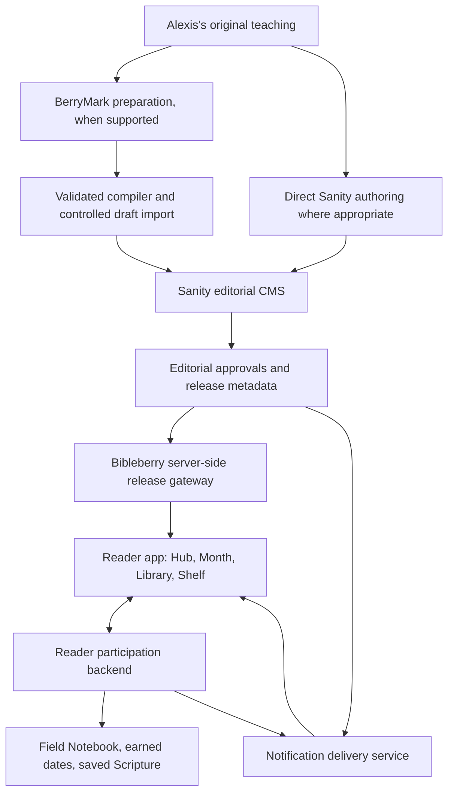

# Bibleberry CMS Content Management and Publishing Architecture

> **CMS CONTENT SPECIFICATION — November 9, 2026.** This is the accepted planning baseline for content schemas, editorial operations, security, and the 80 CMS decisions. The **only authoritative implementation order** is [Application Development Roadmap](../product/application-development-roadmap.md). The Phase A–G sequence below documents the original planning proposal and is **not a separate active engineering roadmap**; where sequencing differs, follow the canonical roadmap. [Current Project Status](../project/current-status.md) governs verified implementation progress, including completed November 8 R05 Stage 3C staging acceptance. No work is authorized by this document alone.

**Prepared:** November 9, 2026  
**Status:** Consolidated planning specification, for Aaron's review; not implementation authorization  
**Product authority:** Aaron Waid  
**Theological and substantive teaching authority:** Alexis Waid  
**Repositories reviewed:** [Bibleberry](https://github.com/ContraPhilosophy/Bibleberry) at `343b7523155e0850558ca05a66b117ea41bbfcc8`; [BerryMark](https://github.com/ContraPhilosophy/BerryMark) at `d94d5fa01d7b423650527d00f802ee0356362c6f`  
**Basis:** 80 CMS planning decisions, including eight deferred items subsequently resolved in discussion; four accepted operating walkthroughs; the November 8 approved reader-experience specification; read-only repository inspection.  
**Change control:** This file is prepared outside the repositories. No repository, Sanity, Cloudflare, account, Issue, PR, or deployment change is authorized by this document.

## 1. Executive decision

Bibleberry is a continuously publishing, free, mobile-first biblical formation ministry built around Alexis's substantive teaching. Editorial operations should be organized so that Aaron and Alexis can finish a future month, approve it, schedule it, and shift attention to later months. Daily publishing must not require them to return to Sanity.

The architecture has five distinct responsibilities:

1. **BerryMark:** The preferred, incrementally extensible preparation system for Alexis's authored material, including structure and descriptive metadata when supported. Its completeness is **not** a launch prerequisite.
2. **Sanity:** The authoritative editorial CMS after successful import; manages content, metadata, revisions, review, approval, monthly planning, and editorial scheduling.
3. **Bibleberry release gateway/backend:** The actual authority for reader access, preview-safe disclosure, date eligibility, withdrawal, and release-safe delivery. Sanity does not execute the daily release.
4. **Bibleberry reader/application:** Presents authorized content and the approved Hub, Month Screen, Shelf, Library, Field Notebook, Saved Scripture, and other ministry experiences.
5. **Bibleberry participation and notification services:** Maintain reader-specific progress, completions, card awards and dates, sync, notification preferences, and reliable scheduled delivery. Reader-specific data does **not** live in Sanity.

**Principal invariant:** Editing or withdrawing an editorial document must not silently delete valid reader completions, earned Scripture Cards, or their earned dates.

## 2. Authority, boundaries, and terminology

### 2.1 Sources of authority

- This specification summarizes the CMS planning conversation. It is subordinate to later explicit product decisions by Aaron and to Alexis's authority over her actual teaching.
- [November 8 approved reader experience](https://github.com/ContraPhilosophy/Bibleberry/blob/343b7523155e0850558ca05a66b117ea41bbfcc8/docs/product/2026-11-08-approved-reader-experience-and-month-screen.md) supersedes conflicting older reader/achievement ideas.
- Approved behavior is **not** evidence that it is implemented. Proposed engineering models below are proposals unless expressly recorded as product decisions.
- Ordinary content updates must not require app code changes; introducing new unsupported content capabilities can require coordinated engineering.
- Teaching substance and authorial fidelity take precedence over arbitrary card, word, screen or template limits. Optional deeper study is genuinely optional.
- No new reader-facing content-error form or theological complaint queue; direct ministry contact remains outside this feature.
- No complex internal comment threads; Aaron and Alexis communicate directly, with Sanity tracking review and corrections as needed.

### 2.2 Dataset policy and privacy boundary

The approved Sanity Growth target has **exactly two permitted datasets**: `production` for real ministry content and `staging` for development/synthetic tests. A third paid dataset is outside the approved budget/design. Historical mentions of `berrymark-development` are obsolete and must not be adopted as a live third-dataset plan. Current live dataset inventory and privacy settings must be verified before using staging or placing embargoed teaching in production.

The checked-in Studio currently targets `production` (`studio/sanity.config.ts`). The current BerryMark controlled importer rejects all `production` writes; it was developed for a separately authorized nonproduction dataset. Neither of those facts is an approved production editorial workflow by itself. A deliberate, audited production ingestion strategy is required; manually creating/editing an authorized Sanity draft may serve as an interim editorial path where necessary.

The production dataset containing future manuscripts must not be publicly queryable in a way that bypasses the gateway. CORS restrictions are not content authorization. Reader code must never embed private Sanity credentials or consume unfiltered unpublished Sanity documents.

### 2.3 Names and responsibilities

- **Challenge:** Every ordinary dated daily experience, whatever its format. Seven experience types are envisioned; their exact format-specific schemas, interactions, and intrinsic completion contracts still need technical/editorial specification.
- **Monthly Publication:** The calendar-month editorial organizer and roster authority, not necessarily identical to a thematic `challengeSeries`.
- **Scripture Card:** A **finished graphic** with all visible Scripture, explanation and illustration baked into the asset. Sanity stores the asset and supporting metadata; it does not rebuild the graphic from separate visible body fields.
- **Monthly Discovery:** A month-specific earning rule linked to a Scripture Card. It is not simply the card graphic.
- **Special Experience:** Optional, advertised, truly time-limited experience, separate from ordinary historical Challenges.
- **Reader Released:** Access outcome of an authorization evaluation for a given reader at a given time, not a single global Sanity status switch.

## 3. High-level system architecture

**Engineering distinction:** The gateway may retrieve content or use a secure, versioned server-side delivery cache, but it must always enforce the current approved release/withdrawal policy. A cache must never become a second uncontrolled publication authority.

**Separate concerns:** Sanity controls editorial truth; Bibleberry controls reader eligibility and state. A queued or Sanity-published Challenge is not automatically released to every reader.

## 4. Editorial content architecture

### 4.1 Central Monthly Publishing workspace

Adopt the approved **hybrid** model: one monthly editorial workspace with separately stored and independently editable linked content. The workspace opens on a chosen year/month and shows date slots, actual Challenges, the introduction/Welcome, discovery cards and rules, preview News, scheduled communications, and readiness exceptions.

A proposed `monthlyPublication` document is the calendar/roster authority, with a purpose-built Studio workspace or custom views on top. Whether existing `challengeSeries` stays a separate thematic grouping or is extended must be resolved by a schema migration design, not by keeping two competing authorities for monthly membership.

Proposed authoritative elements:

- Stable month identity (`YYYY-MM` with year and month stored explicitly), display theme/title, optional description and artwork.
- Generated calendar slots for the exact number of days, tied to local calendar dates, not manufactured global midnight release instants.
- Exactly one authoritative assignment of an ordinary Challenge to a publication slot; deliberate conflict warnings and rescheduling impact report.
- Explicit finalized-roster state, reviewer/actor, timestamp, version, and changed-since-finalization indicators.
- Links to flexible monthly introduction screens, preview-specific screens and the Welcome screen.
- Discovery definitions with thematic qualifying Challenge references, required totals, linked card asset, and a full-month card derived from the finalized roster.
- Linked preview News draft, preview source snapshot/diff status, scheduled features and readiness indicators.
- Bulk schedule confirmation showing records/dates/errors, with no silent approval of unreviewed content.

**Roster invariants:** Finalization must be explicit. Any later membership or date change must show consequences for existing progress and discoveries. A previously earned full-month card cannot be casually revoked by editorial rearrangement. Identity must be stable independently of sort order, publication date, or visible title.

### 4.2 Core content models (proposed decomposition)

| Model or schema area | Editorial purpose | Relationship and restrictions |
|---|---|---|
| `monthlyPublication` **new** | Month overview, dates, roster, preview, discovery definitions, review readiness | Proposed month authority; linked documents remain independent |
| `challenge` **existing, extend** | Daily teaching or practice with common metadata and format-specific capabilities | Stable canonical identity, month assignment, review/approval, supported blocks, Scripture, keywords |
| `challengeSeries` **existing** | Existing thematic/series grouping | Reconcile with month model; do not assume a series always equals a calendar month |
| `monthlyIntroduction` / introduction screen objects **new** | Flexible preview, introduction and separate Welcome content | Reader-facing visibility changes at month start; replay at any time |
| `scriptureCard` **new** | Finished image and card metadata, optional accessible equivalent, Notebook organization | No re-entry of visible text as a visual composition; rules are attached to parent month/event/foundation |
| `monthlyDiscovery` or embedded rule object **new** | Defines qualifying Challenges or finalized full roster | Prevent leakage of qualifying source Challenges in reader preview |
| `specialExperience` **new** | Timed event with ordered sessions, rules, grace and linked commemorative card | Event can release all activities together or individually; never historical Library content |
| `readerGuidance` **new** | Ministry-first tutorial and contextual explanatory content | Optional/replayable; earning criteria interpreted by Bibleberry backend |
| `foundation` / `resource` **new** | Foundational substantive teaching, reusable resources, external/downloadable assets | Can support permanently earnable cards; resource sections independently managed |
| `resourceSection` **new** | Named/ordered resource grouping | Manual ordering and section metadata |
| `newsArticle` **new** | Independent News with categories, dates, optional art, archives | Stable shareable URL; recurring monthly preview draft generation |
| `hubFeature` / promotional placement **new** | Curated Hub slots and feature priority | Automated current content with editorial overrides/fallbacks |
| `notice` **new** | Short-lived scheduled in-app notices | Independent editorial visibility window |
| `notification` **new** | Editorial message, push/in-app wording, audiences and schedule | Delivery, preferences, cancellations and eligibility remain backend responsibilities |
| `ministryPage` **new** | About, FAQ, ministry information | Application controls and ordinary UI labels remain in code |
| `keyword` vocabulary **new** | Flexible topical search labels | Established terms + unlimited editorial additions and deduplication suggestions |
| `scriptureReference`, media and provenance **existing/extend** | Reusable Scripture/rights and media records, lineaged import metadata | Validate usage rights, per-context rendering overrides, dependency impact |
| Review/audit records **new or extended** | Draft/In Review/Approved/Published status transitions and truthful attribution | No separate conversation/comment system required |

The table is a logical model, **not a mandate that every row become a distinct top-level Sanity document**. Embedded objects, standalone documents, Studio customizations and indexes should be chosen for referential integrity and editorial ergonomics.

### 4.3 Challenge authoring and format extensibility

Use one shared Challenge identity, core schema, search structure and state contract. Supply format-specific authoring tools and flexible supported blocks. Do not force every format through a generic text-only form or create seven disconnected reader identity models. Preserve the permanent CB1-CB9 identifiers; new BerryMark Content Block additions follow the existing cross-repository extension procedure. No unsupported block may be silently dropped from publication.

A Challenge's common fields should include at least title, stable slug/ID, date/assigned month, format, summary, Scripture references, searchable keywords, body/blocks or format payload, associated assets and companion links, review status, publication state, provenance, and related content dependencies. Exact format-specific completion behavior will be agreed and verified for each of the seven types.

### 4.4 Scripture Card content, collections, and earning rules

The **finished card graphic is the primary editorial artifact**. Supporting Sanity metadata should include internal/public title, graphic asset/version, alt/accessibility representation, Bible book/reference, editorial keywords, attribution/rights, Notebook collection placement, sort order, and share eligibility. The app shares the existing earned graphic and applies subtle Bibleberry attribution to the export only, rather than requiring separate share-image compositions.

A screen reader must have access to the meaningful biblical text contained within the graphic. Implementation may use an accessible transcription or equivalent, but it must not demand that Alexis recreate the visual composition as separate editable fields. Distinguish succinct illustration alt text from the card's substantive embedded text.

Earning rules live with their governing context:

- **Monthly thematic cards:** selected qualifying Challenges within the month. The reader sees goal title and numeric progress, but not qualifying Challenge identities or unearned card artwork/text.
- **Full-month card:** completion of the **finalized** month's entire roster. Completing every Challenge necessarily qualifies for all thematic cards as well.
- **Tutorial/foundation cards:** permanently earnable upon the defined completion action for eligible material; placed with earned Special Experience cards in the Field Notebook, without inheriting time limits.
- **Special Experience commemorative card:** earning requires all event-designated required activities, not optional activities, within the event rules. Unearned event cards never appear as missing/grayed-out slots.

Card award records and dates are owned by the participation backend. Content changes do not erase earned records.

### 4.5 Searchable keywords and content discovery

Implement a **hybrid, nonrigid keyword vocabulary**, not a mandatory theological taxonomy. Establish common terms (e.g., prayer, forgiveness) and suggest existing matches during editing; allow unlimited contextually appropriate new keywords. Apply keyword search to Challenges and eligible Card/Resource/News content as appropriate. Full-text search also uses titles, summaries, authorized teaching content and Scripture references.

When supported, BerryMark should propose and transmit search metadata during manuscript preparation. Sanity editors may refine the imported values; the current Sanity values then become authoritative. A field unknown to an importer/schema must produce an explicit compatibility result, not silently disappear. Search indexing must exclude embargoed manuscripts, unearned card detail, and withdrawn material from unauthorized results.

### 4.6 News, resources, Hub, and other content

News remains a single general-purpose content type with categories, dates, optional art, stable URLs, default chronological archive and intentional withdrawal. Monthly preview News is a generated **editable draft**; on upstream changes, show differences and selectively refresh generated content without overwriting edits.

The Hub combines automatic current teaching with editor-managed features, priorities, date windows and fallbacks. Resource library sections have editable names, descriptions and manual ordering. Editors can manage downloadable/external links with supported in-app presentation and broken-link checks. Short-lived notices are distinct from durable News. General ministry/About/FAQ pages belong in Sanity, while application controls and UI strings remain in code.

## 5. Editorial lifecycle and operating procedure

### 5.1 Logical lifecycle

`Draft → In Review → Approved → Sanity Published → Reader Eligible/Released`

These are distinct logical states even if not all are separate stored enum values. Sanity publication is **not** equivalent to reader release. A future-dated Challenge may be Sanity-published and remain embargoed until that reader's authorized local calendar date. Reader eligibility is computed by Bibleberry's backend.

- Aaron and Alexis receive truthful, appropriate review permissions/attribution; do not falsely attribute Aaron-approved technical test content to Alexis's theological review.
- Content-specific critical failures block publication; nonessential advisory warnings do not.
- Any substantive postapproval change triggers fresh review; minor proofreading can use a lighter approved path.
- Revisions, approvals, actor and timestamps are auditable. There is no internal threaded commenting platform.
- A withdrawn item remains in editorial history. Restoration uses the existing identity and proper review, not a replacement identity.
- Shared media/Scripture changes show affected references. Withdrawal can proceed immediately when necessary, even if a normal dependency impact analysis cannot finish first.

### 5.2 Month production checklist

1. Create month, autogenerated date slots, metadata and readiness report.
2. Prepare teaching in BerryMark to the extent presently supported; import via the authorized draft pathway or use direct Sanity authoring.
3. Preserve source manuscript, imported metadata, provenance and authorial fidelity.
4. Complete substantive editorial review, Scripture/rights and accessibility checks; approve Challenges individually.
5. Prepare the introduction/Welcome, finished Card graphics, discovery definitions, preview News draft, resources, features and optional notifications.
6. Verify 100% date coverage, conflicts, release metadata, card dependencies and reader renderer compatibility.
7. Finalize the month's Challenge roster explicitly; review complete bulk scheduling summary before confirmation.
8. Sanity-publish the authorized content; Bibleberry's backend enforces preview and daily eligibility. Editors move on to later months.
9. System monitoring detects exceptional delivery failures; no daily manual publication job.

The Studio should support a task-based publishing calendar, readiness dashboard, reviewer assignments, optional templates, secure in-context reader preview, month review packet export and optional review reminders. These are editorial operations, not compulsory reader interactions.

## 6. Runtime release contracts and confidentiality

### 6.1 Bibleberry, not Sanity, controls reader access

The backend/release gateway must make the authorization decision immediately before delivering protected content or by relying on a demonstrably safe, up-to-date server-side policy state. The reader application displays the authorized result. A client-side hidden button or device-clock check is never sufficient confidentiality enforcement.

The gateway's current code has `/api/challenges` and `/api/challenges/:slug`, server-clock UTC `releaseAt` checks, conservative editorial validation, projection allowlists, and no-store responses. Extending it for the approved Month Screen is a **real technical change**, not a configuration toggle. Existing gateway behavior must remain safe while new contracts are introduced.

### 6.2 Two disclosure classes

**Advance-preview public metadata**, eligible on the **28th of the preceding month, or February 27**, may contain the upcoming month/theme, approved preview-introduction material, and upcoming Challenge **titles/dates**. It must not contain future Challenge manuscripts, full Scripture Card graphics/explanations, thematic discovery titles/goals, unpublished editorial notes, or hidden qualifying-Challenge lists.

**Reader-authorized teaching**, eligible on the assigned reader-local day, contains only released Challenges, Welcome/Month Screen material and the discovery title/progress information appropriate for that reader. The Month Screen displays all Challenge titles with distinct completed, available and Coming Soon states. The Welcome is not part of the advance-preview presentation; prior preview readers may skip to Welcome when the month begins.

### 6.3 Candidate API contract (proposal, not implemented)

- `GET /api/months/:yearMonth/preview`: approved preview-safe title/date/theme and eligible preview-introduction projection.
- `GET /api/months/:yearMonth`: current/historical month calendar and approved discovery **titles/goal values**, with per-Challenge eligibility states; no qualifying Challenge IDs in unauthorized client data.
- `GET /api/challenges/:slug`: protected released full teaching only.
- `GET /api/news`, `/api/resources`, `/api/search`: only eligible, nonwithdrawn material in reader-safe projections.
- Reader-specific progress/awards should be served via authenticated participation APIs distinct from editorial content endpoints; guest behavior requires its own safe contract.

Exact paths, payload schemas, caching, authentication and whether to serve preview from the gateway or a dedicated endpoint are **engineering design choices** requiring acceptance tests.

### 6.4 Local-time authorization

The existing R05 gateway uses UTC release instants. The approved product calls for **reader-local calendar-day availability**. Engineering must define a trusted timezone context and server-authoritative evaluation, including changes of timezone, travel, daylight-saving transitions, offline state, first-use ambiguity, leap months and manipulated device clocks. The client's clock or arbitrary timezone query must not unlock early content. Do not pretend this is already solved by current UTC timestamp comparison.

### 6.5 Caches, failures, and withdrawal

- No prerelease manuscript may leak through catalogs, full-text indexes, assets, logs, caches or direct Sanity access.
- A CMS outage should not automatically prevent authorized delivery if a verified server-side copy and policy permit service.
- A gateway that cannot verify authorization must fail closed for unreleased content.
- Emergency withdrawal suppresses new delivery and dependent unsent notifications. Previously downloaded/offline copies cannot be guaranteed instantly recallable; define realistic revocation/cache behavior.
- Add versioned publication snapshots/policy invalidation where needed; avoid stale cache restoring withdrawn content.
- Run synthetic negative tests for unauthorized future slugs, drafts, missing records, unapproved blocks, direct Sanity exposure and client clock manipulation.

## 7. Reader participation and collections

### 7.1 Core state

Keep reader-specific progress, completion, award state, earned timestamps, saved Scripture, resume position and account sync **outside Sanity**. Stable IDs (not titles or screen positions) bind published content to progress. The backend must deduplicate repeated or concurrent completion/award submissions and reconcile legitimate offline/guest events without duplicating awards.

The normal Challenge finish action records completion; merely reaching the last page is not completion. Some of the seven formats require distinct intrinsic completion rules. Optional deeper material must never become a forced completion gate. Historical Challenge completion counts identically whether reached through Hub, Month Screen, Shelf or Library.

### 7.2 Monthly discoveries

A thematic discovery increments only when the associated Challenge is **finished**. No daily arbitrary rewards, no unsolicited in-reader pop-ups, no display of qualifying Challenge lists, and no unearned art/explanation exposure. Full-month completion follows the finalized roster. The Month Screen shows discovery titles and numeric progress once the month is active; the Notebook and All Earned Cards collection show earned cards only.

Earned-card announcements occur on the **next Hub arrival/return**, combined into one announcement for multiple new cards. Announcements and viewed/new indicators have separately approved persistence semantics. Opting out of announcements never disables earning.

### 7.3 Field Notebook, Foundation and Special Experience distinctions

Monthly earned Cards are filed with their **publication year/month**, even if earned years later; the actual earned date is separately recorded. Tutorial and foundational cards join an earned-only Special Collections area, but remain permanently earnable. Special Experience cards are strictly time-window eligible and never appear as empty missed-event slots. A single evolving lifetime participation status uses distinct Challenge completions, not extra milestone badge inventories.

A Special Experience has an opt-in event period, all-at-once or individually scheduled activity availability, a start-within-window eligibility requirement, an event-specific grace deadline for qualifying starters, and all-required-activities completion. Starting alone qualifies for available grace; it does not require completing the first activity immediately. After the event and grace close, its activities are not retroactively available in the Library.

### 7.4 Tutorial and Foundations

The initial tutorial is primarily an introduction to Bibleberry's ministry purpose and approach to biblical formation. A reader may bypass the tutorial **before entering** and return to take it at any time; once the tutorial has been entered, there is **no exit path that bypasses the final `Finish` action**. The tutorial can be revisited after completion. Contextual feature guidance appears when relevant and is optionally revisitable. Its exact theological points and graphics remain to be authored. The tutorial and each award-eligible Foundation reading have an explicit **`Finish` button**. Pressing `Finish` records completion and awards the associated Scripture Card when eligible; merely opening the content or reaching its last screen does not count. Replays never duplicate completion or awards. Sanity manages editorial guidance content; the app controls first-use status and award logic.

### 7.5 Accounts and platforms

The intended primary environment is installed iOS/Android, with web supplementary. Existing browser-local test stores are not a durable native account/sync implementation. Preserve the approved guest-to-account merge, cross-device synchronization intent, and offline conflict semantics in their dedicated engineering workstream. Do not add exhaustive behavior tracking beyond reliable required facts.

## 8. Notifications, audit, search and operations

### 8.1 Notification lifecycle

Sanity stores the editorial message, optional separate in-app and push text, intended date/time, target audience preset, relation to content or promotion, and operational status. The Bibleberry notification service handles delivery, opt-in/preferences, eligibility, audience selection, deduplication and tested devices.

Normal operation is automatic after schedule approval. A content date change updates dependent unsent notification eligibility and schedule; withdrawal suppresses dependent unsent messages. Editors retain an **emergency escape hatch** to cancel, pause, reschedule or disable pending notifications. Already delivered push messages cannot be recalled. Independently scheduled editorial announcements retain their own approved schedule unless deliberately changed or made ineligible. Notification records are not daily Sanity release jobs.

### 8.2 Discoverability, rights and accessibility

- Use secure eligible-content search across released Challenges, News and Resources. Card search must respect earned/hidden rules.
- Scripture reference records are reusable but quotations and presentation can vary by editorial context; track source translation/edition, passage, provenance and rights.
- The intended launch Bible text is **WEBP** (World English Bible Protestant, 66-book LORD edition), with pinned exact source and correct edition/rights contract. The existing generic rights checks must not be disabled casually; commercial translations are not launch prerequisites.
- Reusable media should be optimized automatically while retaining suitable originals, attribution/credit, descriptive alt text, rights and dependency information.
- Accessibility-critical fields block relevant publication; advisory quality improvements warn. Finished card graphics require access to embedded meaningful text for assistive technology.
- External links are validated and checked periodically; exported share links use stable URLs and safe previews; deliberate slug changes need redirects.
- Optional **aggregate** readership and completion reports can help editorial planning. Individual reader records are not copied into Sanity.

### 8.3 Administrative monitoring and backup

- Unified publishing calendar, readiness queue and optional email reminders for actual editorial deadlines.
- Gateway release monitoring and actionable operational exceptions, not an expectation of daily manual checks.
- Independent backups of production Sanity content **and media**, with restore tests, plus separate independently governed reader data backups.
- Recover prior editorial revisions via review and republication with the original identity; require reconciliation with current reader completion/award records.
- Identify unused drafts/media for manual cleanup; never automatically delete merely because an asset appears unused.
- Preserve published News archives unless deliberately withdrawn. No reader-generated theological objection or error-report queue.

## 9. Repository gap analysis (read-only inspection)

### 9.1 Evidence policy

Evidence below is based on the two checked repository commits named in the header, not on a live Sanity-account inspection, a deployed Cloudflare probe, or a fresh terminal test run. Later repository developments must be rechecked before assigning engineering tasks. Historical README/status notes can lag accepted implementation: for example, the November 7 Bibleberry status note still says BerryMark live draft acceptance is unverified, while the later BerryMark November 6 handoff documents successful development-dataset live create/readback, no-op and one-screen CB1-CB9 storage acceptance. The newer, narrower acceptance evidence controls the statement.

**Working labels:**

- **Existing:** Code or committed tests can be identified at the checked revision.
- **Partial:** Foundation exists but not the approved complete reader/editor workflow.
- **Planned:** Product decision exists, but no confirmed corresponding implementation in inspected files.
- **External verification required:** Actual account/service state cannot be inferred from code or repo documentation.

### 9.2 Current implementation inventory and gaps

| Area | Verified foundation | Important missing or unresolved work | Priority implication |
|---|---|---|---|
| Sanity Studio | `studio/sanity.config.ts`, `studio/structure.ts`, Challenge and Series schemas; CB1-CB9 object types; provenance | Only two top-level document types currently registered; Month workspace, cards, event, News, resources, keywords, notices, tutorials, pages and rich editorial operations need models/tools | Product launch scope; implement incrementally |
| Studio target | Checked Studio targets `production` | Explicit safe authoring/test flow for both approved datasets and verification that `production` cannot be directly queried for embargoed manuscripts | Security gate |
| BerryMark language | Parser, metadata validator, pure compiler, stable keys and CB1-CB9; source fidelity and extension documentation | Keyword and additional content-type metadata contracts are not yet present; support beyond Challenges must be added over time | Keyword metadata is useful early; unrestricted expansion is not launch blocking |
| BerryMark importer | Controlled create-only administrative draft apply, fresh preflight and exact readback; live **development-dataset** acceptance documented in BerryMark | Current code explicitly rejects `production`; old dev target must be reconciled with two-dataset `staging`; production ingestion method must be designed or use authorized direct Sanity drafting | Production workflow gate, not an invitation to weaken importer |
| Reader CMS adapters | Sanity Challenge mapping, tested blocks, shared player, controlled ordinary Challenge route and released-catalog provider | Normal Hub/Month/Shelf/Library content discovery still not comprehensively wired to live released catalog; format-specific seven-type contracts incomplete | Core integration |
| Release gateway | `src/gateway/handler.ts`, `projection.ts`, `worker.ts`; protected detail/catalog filtering, no-store and server clock; staging Worker config | Preview-safe future-title endpoint; month calendar; reader-local dates; additional content types; withdrawal/caching behavior; verified live protected staging | Security and product gate |
| Deployment | Cloudflare Worker runtime and static asset configuration in repo; prior CI dry-run evidence | Deployed Access-protected staging and private-dataset end-to-end acceptance not established by inspected repo documentation | External verification gate |
| Reader participation | Platform-neutral asynchronous participation store and reload pilot | Cloud account, native storage drivers, cross-device/offline reconciliation and permanent card-award service not established | Core reader-state gate |
| Month Screen | Authoritative product specification, existing reader components/fixtures | Real calendar and discovery UI/data contract, historical reuse, preview/Welcome interactions | Reader-facing product gate |
| Field Notebook | Detailed approved behavior | Permanent earned-card backend, graphic/card gallery, earned dates, Hub-only announcements, Special Collections | Reader-facing product gate |
| Special Experiences | Approved time-limited rules | Event CMS model, session scheduling, event-specific eligibility/grace, server enforcement and events UI | Capability foundation; actual events optional and not an automatic launch requirement |
| Tutorial/Foundations | Existing prototype Foundations and onboarding concepts | CMS-managed ministry-first tutorial, optional contextual guidance, completion cards and reliable foundation eligibility | Stage around approved first-run experience |
| News, resources, Hub | Existing prototype content/formation views | CMS-managed editorial document types, eligibility-safe feeds, promoted slots, archive, stable links | Launch planning; phase by functional dependency |
| Notifications | Editorial rules approved | CMS message model, delivery transport, audience/preferences, cancel/reschedule, testing and monitoring not confirmed | Implement before any notification feature is enabled |
| Backups and operations | Code/test and release rollback documentation | Production content+media backup and restore, reader data backup, monitoring, review packet, link checks, audit dashboards | Core recoverability plus later administrative refinements |
| Accessible final cards | Product decision on graphic-first assets | Embedded text accessibility, export watermark, responsive artwork and art direction unbuilt | Before card feature goes public |
| Scripture rights | Existing conservative reference/rights logic; deliberate WEBP launch translation direction | Pin WEBP edition/source, provenance/rights evidence and supplied-text tests; do not quietly strip validation | Before distributing full provided text |

### 9.3 Most consequential integration mismatches

**M1. Release time semantics:** Current gateway filters against absolute UTC `releaseAt`; product policy is reader-local calendar-day release. Develop a migration and safe eligibility contract, not a parallel client-side date check.

**M2. Preview privacy:** Existing gateway returns only released Challenges. Approved advance month preview requires a *different deliberately sanitized* channel containing approved future titles/dates and preview introduction but no manuscript/discovery leaks.

**M3. Existing series versus Month:** `challengeSeries` handles thematic grouping; the new `monthlyPublication` must become one definitive calendar/roster authority without changing stable Challenge identities or breaking importer series lookups.

**M4. BerryMark dataset boundary:** Current importer rejects `production`, and its previously tested `berrymark-development` target is not part of the newly approved two-dataset topology. Retargeting the development workflow to `staging` and creating an intentionally safe production draft pathway require separate approval and testing. Do not merely remove the safeguard.

**M5. Runtime progress versus CMS:** Current participation foundation is not yet a proven end-to-end native/cloud award service. A completed Challenge and earned Card date must not be written to Sanity or inferred from transient UI state.

**M6. Studio editorial workflow:** Current schema/editor is oriented to the November pilot. The Month publishing experience, review integrity and notifications must be added without rendering Alexis's teaching hostage to cumbersome data entry.

### 9.4 Items not silently classified as defects

The repository has no final detailed seven-format taxonomy, exact global navigation, final Scripture Card artwork or all mobile UX mockups. Those are **separately acknowledged design/engineering deliverables**, not evidence that the 80 CMS decisions are invalid. The existing BerryMark development importer was intentionally limited for safety and succeeded at its documented scope; its limited scope is not a failed importer.

## 10. Proposed launch sequencing

The distinction below is a **proposed implementation classification**, not unilateral permission to remove approved reader features. A specific public launch scope and any deferral of an approved experience require Aaron's explicit release planning. No calendar date, estimate or budget is asserted.

### L0. Non-negotiable technical release gates

A public build must satisfy these regardless of editorial convenience:

1. Private real-content source and no bypass path to future manuscripts.
2. Secure, server-authoritative local-day release and advance preview disclosure with comprehensive negative testing.
3. Truthful editorial review, appropriate permissions, safe draft/publish lifecycle, stable IDs and withdrawal/review recovery.
4. Real daily Challenge delivery in the ordinary reader, not only development labs; no content-specific source-code changes for ordinary new teaching.
5. A reliable completion/persistence model appropriate to the chosen public platform; no duplicate earned awards when applicable.
6. Licensed/rights-cleared Scripture and media with accessibility-critical validation.
7. Basic operational failure handling and tested editorial/reader data recoverability.
8. Approved safe separation of `production`/`staging`; no third dataset.

### L1. Approved reader-facing feature delivery (launch planning candidates)

Build the real Month Screen, current/historical calendar, preview and Welcome lifecycle, Hub and discovery flow, Shelf/Library integration, Field Notebook earned cards/dates and saved Scripture, with the approved nonpunitive behavior. The ministry-first tutorial and foundational content should be scheduled by their editorial readiness. These are part of the **approved product experience**; a minimal phased beta may differ only with an explicit release decision, not an accidental omission from this plan.

### L2. Launch-grade editorial ergonomics

The initial Month Publishing workspace must make a full month create/review/finalize/schedule process practical and safe. Complete manual control plus reliable validation can precede advanced convenience features, provided no safety or product promise depends on those conveniences. Examples of features that can mature iteratively: automated review packet exports, sophisticated shared-reference impact previews, richer dashboards, unused-asset reports, editorial reminder email, bulk link checking, preview draft selective refresh, extended analytics and generalized templates.

### L3. Post-launch/future growth, without blocking current product

- Broaden BerryMark to more metadata and substantive content types as editorial use cases demand; preserve direct Sanity fallback.
- First real additional CB type/variant via the existing extension checklist, then consider registry/scaffolding automation based on actual repetition.
- Advanced Studio automation, polished reporting and optional operational conveniences, after the safe manual equivalent exists.
- Individual Special Experience campaigns and custom themed assets, when expressly approved as events; the event **capability** and its time-limit model can be built separately from any actual event launch.
- Optional deeper memorization guidance or additional Scripture translations only under later decisions. Do not smuggle back deprecated generic badge/streak designs.

## 11. Engineering implementation sequence and dependencies

> **Sequencing superseded by the canonical roadmap:** The Phase A–G structure below is preserved as the November 9 CMS conversation's original planning analysis, **not as an independent active implementation plan**. For actual ordering, interfaces with reader work, stage status, and first authorized candidate, follow [the single application-development roadmap](../product/application-development-roadmap.md). In particular, R05 private staging Stage 3C already passed on November 8; do not reimplement it as Phase B.

This is a dependency-based sequence, **not** a single massive change request. Each code stage should become a scoped Issue/branch/PR with Aaron's implementation authorization and appropriate Alexis review.

### Phase A: Architecture contracts and target-state inventory

**Deliver:** approved schema/contract change proposals; document precedence update; current Sanity Growth dataset/privacy and Cloudflare runtime inventory; stable IDs and month/series authority; exact seven-format requirements; initial launch cohort of product experiences; test data protections.

**Evidence to accept:** read-only audit; explicit two-dataset plan; no accidental production writes; documented authoritative source fields, approval roles and migrations; staging secrets/Access design. This phase is specification and controlled discovery, not automatic deployment.

### Phase B: Safe private staging vertical slice

**Deliver:** private `staging` source and Worker, least-privilege credentials, protected preview path, synthetic data, corrected import/development target, secure Challenge detail and catalog validation, actual reader view. Reuse existing gateway and BerryMark safeguards.

**Acceptance:** anonymous Access denied; authorized tester sees released synthetic Challenge; embargoed/draft/unreviewed/withdrawn content never leaks; content and identity round-trip; repeated importer writes are no-ops; failed reads fail safely. No actual future Alexis teaching in publicly readable test content.

### Phase C: Month/Challenge editorial models and production content route

**Deliver:** first-class monthly editor, calendar/roster, `challengeSeries` reconciliation, draft/review/publication controls, format-specific authoring architecture, metadata/keyword vocabulary, month validation, safe source/provenance transfer and controlled production authoring path. Decide precisely which fields are imported and which are Sanity-only.

**Acceptance:** create a representative 30-day and 31-day month, import or author content safely, validate full roster, review and bulk schedule with a complete preview report; intentional reschedule/withdrawal retains IDs and flags dependent awards/communications. Verify missing metadata cannot silently vanish.

### Phase D: Release gateway 2.0 and Month Screen integration

**Deliver:** preview-safe title/date feed, reader-local date authorization, month and intro/Welcome endpoints, release-safe search and catalog projection, stable URL support, current/historical Month Screen reader integration.

**Acceptance:** Feb 27 preview; normal preceding-month 28th preview; Welcome at month start only; all future titles appear without manuscript exposure; no discovery-goal exposure during preview; timezone travel and device-clock tests; correct Month Screen calendar/Coming Soon behavior; no daily Sanity mutation.

### Phase E: Participation, discoveries, Field Notebook and accounts

**Deliver:** authoritative distinct completions, format-specific Finish contracts, award eligibility and timestamps, month thematic/full-month rules, historical qualification, saved Scripture, Hub-only combined award announcements, Field Notebook and Special Collections, guest/account sync as needed by public release.

**Acceptance:** read from Hub/Month/Shelf/Library produces identical completion credit; all month Challenges guarantee all thematic rewards; qualifying Challenge list remains hidden; complete same Challenge twice yields one credit; card award duplicate merges safely and retains credible earned date; app state survives device/platform scenarios; no unrelated pop-ups during teaching.

### Phase F: Communications and operational safety

**Deliver:** editorial News/resources/Hub and notices as prioritized for release, notifications when enabled, per-audience eligibility, emergency controls, revision and media backups, restore validation, monitoring, content impact and broken-link checks. Use a minimal safe workflow before adding elaborate Studio conveniences.

**Acceptance:** notifications do not precede eligible content; withdrawal automatically suppresses pending dependent notifications; manual cancel works; outage produces actionable failure; version restore does not roll back earned reader records; no individual reader history in Sanity. If notification delivery is not activated in a specific launch stage, don't construct phantom delivery guarantees.

### Phase G: Native/public launch qualification

**Deliver:** production security review; native iOS/Android storage, onboarding and notification behavior as applicable; accessibility/performance QA; content authoring rehearsals; staged backups and restore; incident runbook; production rollback plan and controlled release authorization.

**Acceptance:** complete manuscript → BerryMark or direct Sanity → review → production publication → reader-local release → completion → Card award → durable reload and account reconciliation. Verify full launch behavior with both 30- and 31-day months, leap-year February, multi-timezone readers, safe notification scheduling and embargo tests. Alexis reviews substantive teaching and final ministry-facing visual adaptations where appropriate; Aaron explicitly approves release.

### Parallel workstreams

- Editorial design and visual prototypes can proceed alongside platform contracts, provided artwork does not force teaching structure changes.
- BerryMark keyword/metadata support can be developed alongside Sanity keyword schema, provided the contract is versioned and both sides are tested together.
- Special Experience content authoring and event-campaign planning need not block ordinary monthly teaching delivery.
- Advanced CMS ergonomics can follow a working, secure core; they must not be used as an excuse to hardcode content or bypass review.

## 12. Acceptance matrix from the four validated walkthroughs

| Walkthrough | Operational invariant | End-to-end acceptance proof |
|---|---|---|
| 1. Prepare month | Finish the month in advance, then move on | Thirty/31 slots generated; BerryMark/direct authoring; review; cards; preview; roster finalization; bulk schedule; no app code edit |
| 2. Automated publication | Bibleberry backend, not Sanity, enforces access | Advance titles only; March/other month starts; local-day release; Gateway 404/suppression for future teaching; background schedule/notifications |
| 3. Reader participation | Permanent, accurately earned records | Finish from every source; tutorial cannot be exited after entry without Finish; award-eligible Foundation reading uses Finish; discoveries silent; Hub-only combined awards; earned-only Notebook; tutorial/foundation permanence; Special Experience grace and expiry |
| 4. Exceptions and recovery | Emergency control without progress regression | Minor/substantive edits; immediate withdrawal; notification cancel; CMS/backend outage; backup restoration; offline conflict and duplicate award handling |

### Required negative tests

Test future manuscript discovery through page source, API, Search, share metadata, media URLs, HTML caches, copied links and stale offline content; unpublished or unapproved content; unknown CB types; spoofed client time/offset; revoked content; incorrect reviewer attribution; duplicate Challenge slug/date; inconsistent month finalization; concurrent completion; repeated award submission; duplicate push delivery; unavailable database; malformed import metadata; invalid Scripture rights; and accidental production writes by test importer.

## 13. Engineering decision register (open implementation work, not reopened product decisions)

1. **Month authority:** Finalize logical/document identity and the nonduplicated relationship between `monthlyPublication`, existing `challengeSeries`, Challenge assignments and importer lookups.
2. **Release clock:** Formal reader-local day trust policy, timezone/travel rules, offline token/cache validity, and effect of postapproval schedule changes.
3. **API projection:** Exact preview/Month/Search/Card response schemas and per-reader confidentiality boundaries.
4. **Seven formats:** Exact names, payload schemas, intrinsic completion actions and per-format acceptance fixtures.
5. **Approval enforcement:** Growth plan role capability versus custom server safeguards; editorial authority and truthful status attribution, not just UI labels.
6. **Production ingestion:** Least-privilege route from BerryMark validation to production draft; current importer production rejection must not be removed without a separately accepted design.
7. **Native persistence:** iOS/Android packaging, account identity, guest merge and offline reconciliation with minimum reliable data collection.
8. **Event timing:** Server-enforced event start, per-activity schedule, starter grace, deadline and no historical retrieval.
9. **Media rights/accessibility:** Completed-card embedded-text access, media versioning, WEBP edition/source manifest, validation and attribution.
10. **Recovery:** Backups, alert thresholds, cache invalidation and reconciliation with durable reader awards under restore scenarios.
11. **Service economics:** Verify actual Growth entitlement, available plugins/features, Studio authorization features, API/asset quotas and notification transport, rather than asserting costs or plan features from assumptions.
12. **Launch release plan:** Confirm any staged-beta deviations from the entire approved product experience deliberately with Aaron, rather than treating implementation order as implicit feature cuts.

These are appropriate targets for engineering design reviews, scoped implementation assignments and acceptance tests. They do not automatically require another round of high-level product polling.

## Appendix A. Complete 80-decision CMS register

**State:** 80 decided, 0 deferred, as of November 9, 2026. This is the concise decision index. The normative detail is in the body and the original discussion; abbreviated rows do not authorize extrapolating unsupported implementation details.

| # | Approved CMS planning direction |
|---:|---|
| 1 | Hybrid central Monthly Publishing workspace, independently editable linked content. |
| 2 | Assign a calendar date per Challenge; Bibleberry automatically enforces reader-local release. |
| 3 | Generate an editable, unpublished monthly preview News draft from month content. |
| 4 | Scripture Cards are complete finished graphics plus metadata; Month/event controls earning rules. |
| 5 | Independently authored News records with title, content, date and optional art. |
| 6 | Hub combines automatically surfaced current material with curated editorial features. |
| 7 | Reusable Resources in organized sections/categories. |
| 8 | Ministry-purpose introductory tutorial, optional/replayable, contextual guidance; tutorial/Foundation cards can be earned and are filed with Special Collections. |
| 9 | Independently authored Special Experience records, reused structures, strict event windows and grace. |
| 10 | Sanity authors notification editorial content; application services handle delivery, preferences and eligibility. |
| 11 | Distinguish Draft, In Review, Approved, Published and Reader Released logically. |
| 12 | Secure reader-style previews of unreleased/scheduled content in Studio. |
| 13 | Reusable media with per-use description/alt and attribution. |
| 14 | Sanity references plus gateway authorization control content visibility. |
| 15 | Secure approved advance titles/dates contract, distinct from protected future teaching. |
| 16 | Edit and republish same content identity, preserving reader progress. |
| 17 | Publishing readiness dashboard for missing content, review and scheduling. |
| 18 | Bulk schedule individually approved monthly Challenges. |
| 19 | Content-specific editorial permissions and review responsibilities for Aaron/Alexis. |
| 20 | Optional promotional windows with start/end dates; retain underlying article. |
| 21 | Flexible supported content blocks and format-specific authoring capabilities. |
| 22 | Allow approved non-Challenge content to be Sanity-published early; gateway controls reader exposure. |
| 23 | Explicit qualifying Challenge selections for thematic monthly discoveries; full-month rule covers the complete finalized roster. |
| 24 | Nonrigid hybrid keyword system: consistent basics, suggested existing terms, unlimited additions and full-text search. |
| 25 | Studio navigation by ministry tasks, with search/filter. |
| 26 | Optional reusable editable content templates. |
| 27 | Unified editorial calendar across content categories. |
| 28 | Sanity revision history and audit of approval/publication. |
| 29 | Flexible multi-screen month introduction with preview visibility and Welcome gating. |
| 30 | Hub editorial feature slots, priorities and automatic fallbacks. |
| 31 | Block critical publication errors; warn for nonessential quality suggestions. |
| 32 | Withdrawal preserves editorial records but prevents backend delivery. |
| 33 | One notification record may have distinct in-app and push wording. |
| 34 | Duplicate past Special Experience as a new independent event record. |
| 35 | Secure mobile/desktop reader preview, with scheduled visibility simulation. |
| 36 | Automated gateway/content availability monitoring and dashboard exceptions. |
| 37 | Prefer BerryMark for as much content/metadata preparation as feasible; extend it iteratively, hand off authoritatively to Sanity, and do not block launch on BerryMark completeness. |
| 38 | Single News document family with editorial categories. |
| 39 | Stable shareable links for eligible News and resources. |
| 40 | Independent backups of production Sanity content and media, no third dataset. |
| 41 | Review queue with assignments, status and lightweight optional review notes. |
| 42 | Manually arrange items inside Resource sections. |
| 43 | Generate share previews from existing content, with optional editorial overrides. |
| 44 | Dedicated short-lived CMS-managed notices with controlled visibility. |
| 45 | Sanity-managed Resource sections with labels/descriptions/order. |
| 46 | Notification editorial suggestions can be content-driven; final schedule controlled by editors. |
| 47 | Review dashboard plus optional email reminders. |
| 48 | CMS-managed external links/media/downloads, with supported in-app rendering when feasible. |
| 49 | No in-app reader content-error reporting, theological objections or feedback queue; external contact remains possible. |
| 50 | Chronological searchable News archive unless deliberately withdrawn. |
| 51 | Automatically check external links and flag failures in the CMS. |
| 52 | Structured source/attribution/translation/rights metadata and validation. |
| 53 | Secure search across reader-eligible released Challenges, News and Resources. |
| 54 | Public attribution is to Bibleberry, not named personal authors. |
| 55 | Stable URLs through title changes; redirects for deliberate URL changes. |
| 56 | Optional aggregate editorial analytics; no individual reader records in Sanity. |
| 57 | Automatically create a month’s calendar day slots, dates and editorial checklist. |
| 58 | Renew review after substantive postapproval changes; lighter proofreading route. |
| 59 | Automatically optimize uploaded image variants while preserving source assets appropriately. |
| 60 | Safe test-account/device notification delivery before real audience sends. |
| 61 | Reusable Scripture references, allowing context-specific quote and presentation overrides. |
| 62 | Show affected references before withdrawal when possible, but permit immediate withdrawal. |
| 63 | Show batch content/date/error summary before confirmation. |
| 64 | Restore old revision via review/republication under the same identity. |
| 65 | Optional exported monthly editorial review packet. |
| 66 | Impact preview before editing shared media/Scripture records. |
| 67 | Validate renderer/content-block compatibility before publication. |
| 68 | Report unused drafts/assets for optional manual cleanup, never automatic deletion. |
| 69 | Authorized individual Challenge rescheduling with conflict/impact preview. |
| 70 | No dedicated internal comment thread; Aaron/Alexis discuss directly while Sanity tracks status, approvals and necessary corrections. |
| 71 | Validate accessibility-critical fields, with separate advisory quality warnings. |
| 72 | Automatic notification lifecycle synchronized with content release plus authorized emergency cancel/pause/reschedule/disable controls. |
| 73 | Explicitly finalize monthly roster; later membership changes are reviewed because awards depend on it. |
| 74 | One Special Experience document can contain ordered, flexible activities/sessions. |
| 75 | Show source changes to the generated monthly preview News draft; selective refresh without overwriting manual edits. |
| 76 | Predefined notification audiences, with reader eligibility, opt-in and preferences enforced by backend. |
| 77 | Shared Challenge identity and content system with format-specific editors and flexible blocks. |
| 78 | Each event may make all activities available together or schedule activities separately. |
| 79 | Completing every designated required event activity earns the card; optional activities do not block it. |
| 80 | Sanity manages ordinary ministry information pages; app controls and labels stay in code. |

**Interpretive notes:** Decision #41 allows lightweight outstanding-correction records but does not reintroduce the comment system rejected in #70. Decision #4 does not forbid storing accessibility-equivalent text outside the image; it forbids treating separate prose fields as the primary visual card composition. Decision #8 does not mandate that a reader complete the tutorial before using Bibleberry; however, once the tutorial has been entered, exiting it requires pressing Finish. Award-eligible Foundations readings also require Finish for completion and award issuance. Decisions #9, #74, #78 and #79 approve event *capabilities*, not any specific event. Decisions #2, #15, #22 and #72 together mean **Bibleberry's backend enforces delivery**, rather than Sanity performing daily release mutations.

## Appendix B. Source and evidence links

### Primary product and project documents

- [Approved Reader Experience, Month Screen & Field Notebook, November 8](https://github.com/ContraPhilosophy/Bibleberry/blob/343b7523155e0850558ca05a66b117ea41bbfcc8/docs/product/2026-11-08-approved-reader-experience-and-month-screen.md)
- [Current Project Status, including the November 7 R05 merge reconciliation](https://github.com/ContraPhilosophy/Bibleberry/blob/343b7523155e0850558ca05a66b117ea41bbfcc8/docs/project/current-status.md)
- [Product & Application Development Roadmap](https://github.com/ContraPhilosophy/Bibleberry/blob/343b7523155e0850558ca05a66b117ea41bbfcc8/docs/product/application-development-roadmap.md)
- [R05 Secure CMS Release Gateway](https://github.com/ContraPhilosophy/Bibleberry/blob/343b7523155e0850558ca05a66b117ea41bbfcc8/docs/architecture/r05-release-gateway.md)
- [Bibleberry Studio schema registry](https://github.com/ContraPhilosophy/Bibleberry/blob/343b7523155e0850558ca05a66b117ea41bbfcc8/studio/schemaTypes/index.ts)
- [Bibleberry Studio navigation](https://github.com/ContraPhilosophy/Bibleberry/blob/343b7523155e0850558ca05a66b117ea41bbfcc8/studio/structure.ts)
- [Bibleberry Studio production dataset target](https://github.com/ContraPhilosophy/Bibleberry/blob/343b7523155e0850558ca05a66b117ea41bbfcc8/studio/sanity.config.ts)
- [Release gateway runtime](https://github.com/ContraPhilosophy/Bibleberry/blob/343b7523155e0850558ca05a66b117ea41bbfcc8/src/gateway/handler.ts)
- [Release gateway projection/validation](https://github.com/ContraPhilosophy/Bibleberry/blob/343b7523155e0850558ca05a66b117ea41bbfcc8/src/gateway/projection.ts)
- [Reader participation store](https://github.com/ContraPhilosophy/Bibleberry/blob/343b7523155e0850558ca05a66b117ea41bbfcc8/src/participation/store.ts)

### BerryMark source and implementation documents

- [BerryMark language specification](https://github.com/ContraPhilosophy/BerryMark/blob/d94d5fa01d7b423650527d00f802ee0356362c6f/docs/language-spec.md)
- [BerryMark metadata validation](https://github.com/ContraPhilosophy/BerryMark/blob/d94d5fa01d7b423650527d00f802ee0356362c6f/docs/metadata-validation.md)
- [Pure Sanity compiler](https://github.com/ContraPhilosophy/BerryMark/blob/d94d5fa01d7b423650527d00f802ee0356362c6f/docs/sanity-compiler.md)
- [Controlled draft apply and live acceptance record](https://github.com/ContraPhilosophy/BerryMark/blob/d94d5fa01d7b423650527d00f802ee0356362c6f/docs/controlled-draft-apply.md)
- [November 6 cross-repository handoff and milestone verification](https://github.com/ContraPhilosophy/BerryMark/blob/d94d5fa01d7b423650527d00f802ee0356362c6f/docs/handoffs/2026-11-06-berrymark-bibleberry.md)
- [Existing Content Block extension procedure](https://github.com/ContraPhilosophy/BerryMark/blob/d94d5fa01d7b423650527d00f802ee0356362c6f/docs/development/adding-content-blocks.md)
- [Current controlled draft transport safeguards](https://github.com/ContraPhilosophy/BerryMark/blob/d94d5fa01d7b423650527d00f802ee0356362c6f/src/sanity-draft-apply-transport.js)

### Conversation-specific approvals not yet in GitHub

This November 9 planning discussion resolved CMS decisions #1-80 and validated all four operating walkthroughs. Particularly important additions not yet represented in the checked repositories include: the hybrid Month workspace; graphic-first cards and parent-managed earning definitions; tutorial/Foundation permanent cards grouped with Special Collections; hybrid flexible search keywords; BerryMark expansion without launch dependence; no in-app reader reporting; no internal comments; automated notification lifecycles with emergency control; and the explicit responsibility of **Bibleberry's backend, not Sanity, for reader release**.

## Appendix C. Change control and next action

**Recommended immediate next action:** Review and accept this specification as a planning baseline, then turn **Phase A** into a focused architecture/contract review assignment. Its first output should be a source-of-truth inventory and schema/API migration design for `monthlyPublication`, `challengeSeries`, production/staging content boundaries and reader-local release policy. Follow with a narrow, synthetic, private staging vertical-slice acceptance before authorizing broader implementation.

For implementation, follow the project's existing workflow: review the relevant issue and current main branch, make a scoped proposal, get Aaron's authorization, change one branch at a time, test, open PR, obtain review, and let Aaron decide whether to merge and deploy. Alexis's substantive teaching and relevant ministry-facing adaptations receive appropriate review. No steps in this planning document authorize service/account changes or repository writes.