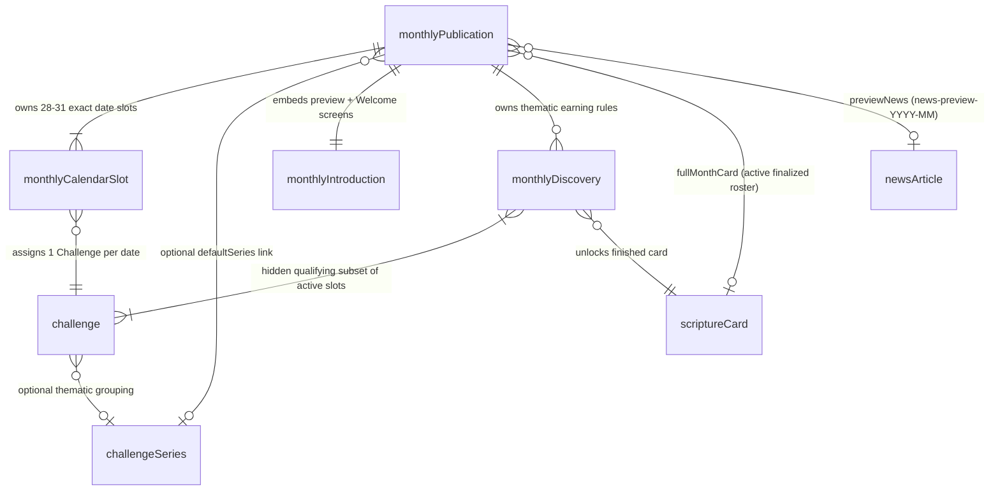
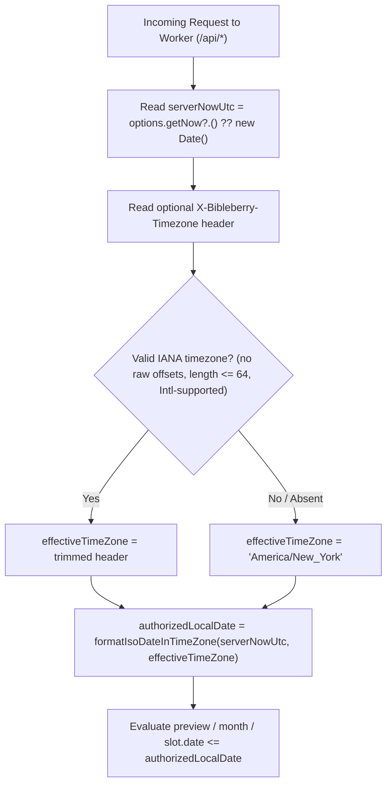
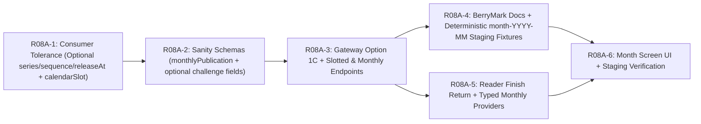

# Bibleberry R08A-0 — Monthly Publication, Series Identity, and Release Contract Design (Revision 2)

> **GitHub architecture handoff (November 9, 2026):** This document is the complete Argon Revision 2 R08A-0 technical specification, supplied by the project owner after independent architecture review. It is a **supporting implementation contract**, not a replacement for the [single canonical six-phase roadmap](../product/application-development-roadmap.md). Preserve its explicit owner-decision record, compatibility sequencing and no-implementation boundary. Coding, Sanity writes, external service changes, deployment and merging each require separately scoped authorization.

**Assignment:** R08A-0 (Phase 01 — Shared Architecture Contracts)  
**Revision:** v2 — Targeted revisions following ChatGPT independent review and owner direction  
**Status:** Revised implementation baseline candidate for final approval — **no implementation authorized**  
**Prepared:** November 9, 2026  
**Architect:** Gemini 4 Argon (operating in Antigravity, read-only mode)  
**Verified Repository Baselines:**  
- `ContraPhilosophy/Bibleberry` `main` at `ebe5b4a89695da5afacd06c8362b01fbaf16d446` (zero open PRs)  
- `ContraPhilosophy/BerryMark` `main` at `d94d5fa01d7b423650527d00f802ee0356362c6f` (zero open PRs)

---

## Concise Change Summary (v1 → v2)

| Revision Area | What Changed from v1 | Impacted Sections |
| --- | --- | --- |
| **A. Timezone Policy (`Option 1C`)** | Replaced `Option 1A` (`+180 min` Cloudflare IP-geolocation clamp + 48-hour HMAC continuity token + `GATEWAY_SIGNING_SECRET`) and `Option 1B` (IP-only) with **`Option 1C`**: authoritative `serverNowUtc` + validated reader-reported IANA timezone (`X-Bibleberry-Timezone`), with an explicit deterministic fallback to `'America/New_York'` (`CMS_EDITORIAL_TIME_ZONE`). Removed IP-geolocation clamping, Worker signing secrets, and continuity cookies/tokens. | §§ 1, 2.3, 4, 5.1, 5.3, 8, 9, 10 |
| **B. Migration Order & Non-Synthesized `releaseAt`** | Eliminated synthesized UTC-midnight `releaseAt` (`"${slot.date}T00:00:00Z"`) and synthesized `sequence` on calendar-slotted Challenges. Slotted Challenges project an explicit `calendarSlot` (`{ monthId, documentId, monthTitle, publicationDate, dayOfMonth }`) and omit `releaseAt` when governed by a monthly slot. Reordered the implementation sequence so **all existing reader, catalog, and Lab consumers (`R08A-1`) tolerate optional `series`, `sequence`, and `releaseAt` before Sanity schemas (`R08A-2`) or gateway endpoints (`R08A-3`) allow omitting them**. | §§ 2.2, 3.3, 4.5, 5.2, 7, 8, 9, 10 |
| **C. Emergency Roster Revisions (`Option 4A`)** | Reconciled exact `28/29/30/31` calendar-slot preservation with emergency Challenge withdrawal via `slotStatus: 'scheduled' \| 'withdrawn'` on `monthlyPublication.slots[]` and `availability: 'available' \| 'comingSoon' \| 'unavailable'` in Month Screen responses. Every calendar date remains in `slots[]`; initial `rosterVersion: 1` requires all `N` slots active, while exceptional `rosterVersion >= 2` re-finalization permits withdrawn slots, adjusts active full-month/discovery requirements, and preserves completed Challenges, `priorRosters[]`, and earned awards. | §§ 3.2, 3.3, 3.4, 5.2, 6.4, 8, 9, 10 |
| **D. Completion & Award Trust Model** | Explicitly documented that guest `completedChallengeIds` submitted to `POST /api/months/:yearMonth/progress` act as a **confidentiality-preserving progress input** (not an anti-cheat ledger), removed `knownEarnedAwardIds` from the request body, and separated **stateless displayed progress calculation** (gateway) from **authoritative recording and monotonic reconciliation of earned awards** (local `ReaderParticipationStore` in Phase 04; Account Participation & Sync Service in R13). | §§ 5.1, 5.2, 6.2, 6.3, 8 |
| **E. Fixture IDs & Sanity Asset CDN Privacy** | Replaced invalid `month-2026-11-synthetic` / `r08a-stg-` month document IDs with strictly deterministic `month-YYYY-MM` IDs (e.g., far-future staging fixtures `month-2096-02`, `month-2098-02`, `month-2098-03`, `month-2098-04`). Documented that Sanity `cdn.sanity.io` image URLs remain directly fetchable even when a dataset is private, distinguishing gateway withholding of unearned card URLs from binary asset access control. | §§ 2.3, 5.4, 7.1, 8, 9, 10 |

---

## 1. Executive Recommendation

Bibleberry should adopt **`monthlyPublication` as the single authoritative calendar, slot, preview, introduction, and discovery-roster organizer**, while preserving existing `challenge` identities (`cms:<publishedSanityBaseId>`), keeping `challengeSeries` as an optional independent thematic grouping, and extending the proven R05 Cloudflare Worker release gateway rather than introducing a parallel delivery service.

### Primary Technical Decisions

1. **Single Calendar & Roster Authority (`monthlyPublication`):**
   - Each publication month is represented by one deterministic Sanity document (`_id: "month-YYYY-MM"`, `_type: "monthlyPublication"`, logical key `yearMonth: "YYYY-MM"`).
   - Calendar membership and ordinary daily scheduling live **exclusively** in `monthlyPublication.slots[]` (`28`, `29`, `30`, or `31` deterministic day slots keyed by `"day-01"`..`"day-31"` with exact ISO dates `"YYYY-MM-DD"`).
   - Individual `challenge` documents do **not** duplicate month membership or calendar-slot dates as editable fields, eliminating dual-write synchronization drift in Sanity Studio.
2. **Non-Competing `challengeSeries` & Honest Schedule Metadata:**
   - `challengeSeries` remains an optional independent thematic grouping (supporting multi-week series, sub-month series, cross-month series, or recurring format groupings).
   - `challenge.series`, `challenge.sequence`, and `challenge.releaseAt` become **optional** for Challenges assigned to a `monthlyPublication` slot.
   - Calendar-slotted Challenges project an explicit `calendarSlot` (`publicationDate: "YYYY-MM-DD"`, `dayOfMonth`, `monthId`) and **never synthesize a misleading UTC-midnight `releaseAt` timestamp**. All existing reader, catalog, and Lab consumers are updated first (`R08A-1`) to tolerate optional `series`, `sequence`, and `releaseAt` before any schema or gateway change omits them.
3. **Simple Server-Time + Reader IANA Timezone Release Policy (`Option 1C`):**
   - The Cloudflare Worker determines `authorizedLocalDate` (`YYYY-MM-DD`) from **authoritative server time (`serverNowUtc`)** formatted in the **reader-reported IANA timezone** (`X-Bibleberry-Timezone`), falling back explicitly to `'America/New_York'` (`CMS_EDITORIAL_TIME_ZONE`) whenever the header is absent or invalid.
   - Client device clock timestamps are never trusted. Bibleberry intentionally avoids IP-geolocation clamping and HMAC travel-continuity tokens: we do not add fragile anti-spoofing machinery to stop a determined user from shifting their timezone within Earth's current `[UTC-12, UTC+14]` window to read free, already-approved daily teaching a few hours early, while **strictly protecting actual editorial privacy** (drafts, unreviewed content, withdrawn content, multi-day future Challenges beyond `UTC+14`, pre-preview months, hidden discovery rules, and unearned card metadata).
4. **Dual Disclosure API & Confidentiality-Preserving Progress Calculation:**
   - Extend [handler.ts](../../src/gateway/handler.ts) with:
     - `GET /api/months/:yearMonth/preview` — eligible starting on the **28th of the preceding month, or February 27**; exposes theme, `previewScreens[]`, and slot `date` + `title` only (no `welcomeScreen`, no discoveries, no Challenge bodies, slugs, or document IDs).
     - `GET /api/months/:yearMonth` — eligible starting `${yearMonth}-01` in `authorizedLocalDate`; exposes introduction + `welcomeScreen`, all `28..31` calendar slots (`available`, `comingSoon`, or `unavailable`), and visible Monthly Discovery titles + target counts (with full-month goal last).
     - `POST /api/months/:yearMonth/progress` — statelessly evaluates client-submitted `completedChallengeIds` (intersected with released slots `slot.date <= authorizedLocalDate`) against authoritative CMS discovery rules, returning displayed progress counts plus `earnedCard` metadata **only** when a discovery threshold is met. Authoritative persistence and monotonic reconciliation of earned awards live in the Participation Store (and later the R13 Account Participation Service), never in Sanity.
5. **Finalized Roster Invariants, Proportionate Emergency Revisions & Non-Revocable Awards:**
   - Explicit `rosterFinalization` on `monthlyPublication` snapshots `finalizedChallengeIds` and `rosterVersion`, enforcing $\text{Qualifying}(D) \subseteq \text{FinalizedRoster}(M)$ so completing the finalized month necessarily earns every thematic card plus the full-month card.
   - In an exceptional live emergency where a Challenge must be withdrawn without an immediate replacement, `slotStatus: 'withdrawn'` preserves every calendar date (`1..N`) on the Month Screen (`availability: "unavailable"`) while explicit `rosterVersion >= 2` re-finalization adjusts active award requirements and preserves completed Challenges, `priorRosters[]`, and all previously earned awards.
6. **Embedded Monthly Introductions & Minimal Preview News:**
   - `monthlyPublication.introduction` embeds flexible `previewScreens[]` plus a month-start-gated `welcomeScreen`.
   - A minimal `newsArticle` schema (`_id: "news-preview-YYYY-MM"`, `category: "monthlyPreview"`, `relatedMonth`) satisfies the Phase 03 advance-preview News dependency cleanly.

---

## 2. Current Implementation Findings

### 2.1 Live Repository & Staging Delta (Verified November 9, 2026)

Per [ai-development-protocol.md](../ai-development-protocol.md) §0, live repository state was inspected directly before proposing contracts:

- **Bibleberry `main`:** `ebe5b4a89695da5afacd06c8362b01fbaf16d446` (PR #65 unified six-phase roadmap and November 9 CMS specification, above `343b7523155e0850558ca05a66b117ea41bbfcc8` PR #64 standalone HTML Month Screen design reference in [docs/prototypes/month-screen/index.html](../prototypes/month-screen/index.html)). Working tree clean; zero open PRs.
- **BerryMark `main`:** `d94d5fa01d7b423650527d00f802ee0356362c6f` on GitHub (zero open PRs). Local `/home/aaron/BerryMark` is at older commit `671543db34d7033601c694d761e4e840270adcc4` with untracked example files and was left untouched; canonical `d94d5fa0` files were read directly from GitHub.
- **Completed R05 Staging Baseline ([#62](https://github.com/ContraPhilosophy/Bibleberry/issues/62), [#63](https://github.com/ContraPhilosophy/Bibleberry/issues/63)):** Deployed `bibleberry-staging` Worker (`e73541b9-c353-404b-8d41-dfdff5ced3bb`) behind Cloudflare Access verified private Sanity `staging` reads, same-origin `/api/challenges/:slug` delivery, CB4/CB8 rendering, durable guest save/completion across reload, and neutral HTTP 404 / UI not-found handling for embargoed Fixture B (`2099-01-01T00:00:00.000Z`). Six synthetic documents (`r05-3b-series-acceptance` and Challenges A, B, C, `drafts.D`, F) remain retained in private `staging`.

### 2.2 Code-Level Findings & Consumer Dependency Audit

1. **Sanity Studio Schemas ([studio/schemaTypes/](../../studio/schemaTypes/index.ts)):**
   - Only [`challenge`](../../studio/schemaTypes/documents/challenge.ts#L19-L181) and [`challengeSeries`](../../studio/schemaTypes/documents/challengeSeries.ts#L5-L37) exist today.
   - [`challenge.ts`](../../studio/schemaTypes/documents/challenge.ts#L55-L79) currently requires `series` (weak ref to `challengeSeries`), `sequence` (`integer >= 1`), and `releaseAt` (`datetime`).
   - [`editorialReview.ts`](../../studio/schemaTypes/objects/editorialReview.ts#L18-L23) labels `adaptationReviewed` as `'Adaptation reviewed by Alexis'`, requiring UI label clarification for synthetic technical fixtures without altering wire keys.
   - [`studio/sanity.config.ts`](../../studio/sanity.config.ts#L7-L17) currently configures a single workspace hardcoded to `dataset: 'production'`.
2. **Release Gateway ([src/gateway/](../../src/gateway/handler.ts)):**
   - [`worker.ts`](../../src/gateway/worker.ts#L13-L37) routes `/api` and `/api/*` (`run_worker_first: ["/api/*"]` in [`wrangler.staging.jsonc`](../../wrangler.staging.jsonc#L10)).
   - [`handler.ts`](../../src/gateway/handler.ts#L96-L146) currently permits only `GET` and `OPTIONS`, serving `/api/challenges` and `/api/challenges/:slug` with `Cache-Control: no-store`.
   - [`query.ts`](../../src/gateway/query.ts#L6-L158) and [`projection.ts`](../../src/gateway/projection.ts#L375-L536) currently require `defined(releaseAt)` and `Date.parse(releaseAt) <= nowTime`.
3. **Complete Consumer Audit for `series`, `sequence`, and `releaseAt` / `releaseAtUtc`:**
   Every existing consumer in `src/` that assumes required `series`, `sequence`, or `releaseAt` was audited so none break when monthly Challenges omit those fields:
   - [`src/cms/sanity/types.ts`](../../src/cms/sanity/types.ts#L113-L122): `CmsChallenge` currently types `series`, `sequence`, `releaseAt`, and `releaseAtUtc` as non-optional.
   - [`src/cms/sanity/mapChallenge.ts`](../../src/cms/sanity/mapChallenge.ts#L224-L230): Zod `challengeDocumentSchema` currently requires `series`, positive integer `sequence`, and `releaseAt: explicitInstant`, computing `new Date(value.releaseAt).toISOString()` at line 411.
   - [`src/cms/reader/releasedCatalogProvider.ts`](../../src/cms/reader/releasedCatalogProvider.ts#L148-L151): `gatewayCatalogItemSchema` and `ReleasedCatalogSummary` currently require `series`, `sequence`, and `releaseAt`.
   - [`src/cms/reader/releasedChallengeHostModel.ts`](../../src/cms/reader/releasedChallengeHostModel.ts#L161-L168): Gateway mode trusts server release authorization (`source === 'gateway'`), **except line 161 still executes `Date.parse(challenge.releaseAtUtc)` and returns `status: 'ineligible', reason: 'invalidTimestamp'` if `releaseAtUtc` is absent**.
   - [`src/cms/reader/releaseEligibility.ts`](../../src/cms/reader/releaseEligibility.ts#L45-L55): Direct/non-gateway fallback requires `challenge.releaseAtUtc`.
   - [`src/cms/sanity/SanityChallengeLab.tsx`](../../src/cms/sanity/SanityChallengeLab.tsx#L49-L50) & [`readPublishedChallenges.ts`](../../src/cms/sanity/readPublishedChallenges.ts#L10-L22): Developer Studio's CMS Lab accesses `challenge.series.title`, `challenge.sequence`, and `formatCmsReleaseDate(challenge.releaseAtUtc)` directly (lines 49–50 and 221).
   - *(By contrast, [`ChallengePlayer.tsx`](../../src/components/challenge/ChallengePlayer.tsx#L32-L61), [`PersistedChallengeHost.tsx`](../../src/participation/PersistedChallengeHost.tsx#L39-L53), and [`admitTrustedCatalogChallenge`](../../src/participation/admission.ts#L65-L99) already decouple presentation and participation identity from `series`, `sequence`, and `releaseAt`!)*
   - In [`ChallengePlayer.tsx`](../../src/components/challenge/ChallengePlayer.tsx#L160-L169), the final button currently reads `'Complete Challenge'` and stays on the screen, whereas the approved November 8 specification (§5.1) requires **`Finish`** with immediate return to origin.
4. **Participation Foundation ([src/participation/](../../src/participation/types.ts)):**
   - Canonical durable Challenge ID is `cms:<publishedSanityBaseId>` ([`identity.ts`](../../src/participation/identity.ts#L46-L55)).
   - [`model.ts`](../../src/participation/model.ts#L75-L189) **already implements `reconcileChallengeAliases`** (`oldId -> newId`, collapsing duplicate completions to the earliest `completedOn` date) and [`admission.ts`](../../src/participation/admission.ts#L67-L99) already supports `previousDocumentIds`.
   - [`persistence.ts`](../../src/participation/persistence.ts#L146-L159) fails closed with `health: 'unsupportedNewerSchema'` whenever `schemaVersion > 1`. Preserving `GuestParticipationEnvelopeV1` (`schemaVersion: 1`) throughout Phase 03 (storing lightweight monthly intro seen-state under `bibleberry-month-intro-v1`) guarantees lossless Worker rollback until Phase 04 adds `earnedAwards`.
5. **BerryMark Compiler & Controlled Importer (`ContraPhilosophy/BerryMark @ d94d5fa0`):**
   - `src/metadata.js` already allows `publishing.series`, `publishing.sequence`, and `publishing.releaseAt` to be `null` or omitted while remaining `importEligible: true` (and [`BerryMarkLocalPreview.tsx`](../../src/cms/sanity/BerryMarkLocalPreview.tsx#L156-L157) already handles `null` `sequence` and `releaseAt`).
   - [`src/import-fingerprint.js`](https://github.com/ContraPhilosophy/BerryMark/blob/d94d5fa01d7b423650527d00f802ee0356362c6f/src/import-fingerprint.js#L249-L368) enforces strict allowlists on `CONTENT_ROOT_FIELDS` and nested `editorialReview` keys (`['sourceTitle', 'sourceRevision', 'adaptationReviewed', 'reviewedBy', 'reviewedAt', 'reviewNotes']`). Keeping schedule slots on `monthlyPublication` and leaving `editorialReview` wire property names untouched preserves 100% compatibility with BerryMark's `verified-noop` readback check.
   - [`src/sanity-draft-apply-transport.js`](https://github.com/ContraPhilosophy/BerryMark/blob/d94d5fa01d7b423650527d00f802ee0356362c6f/src/sanity-draft-apply-transport.js#L1192-L1207) (`assertSanityDraftApplyTarget`) already works with `staging` today while blocking `production` writes.

### 2.3 Evidence Classification Matrix

| Capability / Detail | Classification | Notes / Source |
| --- | --- | --- |
| Private `staging` dataset + Access-protected `bibleberry-staging` Worker + same-origin gateway reader | **Confirmed Fact** | Passed in Issues [#62](https://github.com/ContraPhilosophy/Bibleberry/issues/62) and [#63](https://github.com/ContraPhilosophy/Bibleberry/issues/63) (Worker `e73541b9-c353-404b-8d41-dfdff5ced3bb`). |
| Two-dataset policy (`production` and `staging` only; `berrymark-development` deleted) | **Confirmed Constraint** | Owner-confirmed in [current-status.md](../project/current-status.md#L24). |
| `cms:<documentId>` canonical completion identity & alias reconciliation reducer | **Confirmed Fact** | Implemented and unit-tested in [`src/participation/`](../../src/participation/model.ts#L75-L189). |
| Sanity private dataset protects GROQ/document/asset-list queries, while `cdn.sanity.io` binary URLs remain capability-accessible | **Confirmed Platform Behavior** | Standard Sanity Content Lake architecture; see §5.4 for gateway URL-withholding vs. asset-level privacy boundary. |
| `monthlyPublication`, `scriptureCard`, `newsArticle`, `Option 1C` local-day gateway release, Month Screen UI | **Proposed Design (R08A-0 v2)** | Not yet implemented; standalone HTML prototype in `docs/prototypes/month-screen/` is visual reference only. |
| Current visibility (`public` vs `private`) of Sanity `production` dataset | **External Verification Required** | Was public during Nov 3 Milestone B3 test; must be verified and switched to `private` before real future manuscripts enter `production`. |
| Sanity Growth custom-role granularity (draft-create-only vs dataset-wide Contributor) | **External Verification Required** | Verify in Sanity Manage (`80016lrq`) only if CLI draft imports into `production` are later desired. |

---

## 3. Proposed Data Model

### 3.1 Source-of-Truth & Relationship Diagram



> [!IMPORTANT]
> **Single Calendar Authority Invariant:** `monthlyPublication.slots[]` is the **only** place in Sanity where an ordinary Challenge is bound to a publication month and civil calendar date (`YYYY-MM-DD`). Neither `challenge` nor `challengeSeries` stores competing calendar-slot dates, and calendar-slotted Challenges never synthesize fake UTC `releaseAt` timestamps.

### 3.2 Answers to Core Relationship & Identity Questions (Design Area A)

1. **Which record is authoritative for calendar membership?**  
   `monthlyPublication` (`_id: "month-YYYY-MM"`) is the sole authority for calendar-month membership, date-slot assignment, advance-preview timing, finalized roster membership, and monthly discovery rules.
2. **Can `challengeSeries` remain independent thematic groupings?**  
   **Yes.** `challengeSeries` remains an independent curatorial grouping (`title`, `slug`, `description`, `coverImage`) that can span 7 days, 26 days, a full month, multiple months, or a recurring weekly theme. Making `challenge.series` and `challenge.sequence` optional allows standalone daily Challenges within a month without forcing duplicate monthly `challengeSeries` documents, while preserving full support whenever a series is used.
3. **How is a Challenge assigned to exactly one ordinary publication date?**  
   Each `monthlyPublication` contains `slots[]` with exact length `daysInMonth(year, month)` (`28`, `29`, `30`, or `31`). Each slot holds `dayOfMonth` (`1..N`), `date` (`"YYYY-MM-DD"`), `slotStatus` (`'scheduled' | 'withdrawn'`), and `challenge` (`reference` to `challenge`). Document validation rejects duplicate `challenge._ref` values within the same month, and asynchronous Studio validation (backed by fail-closed gateway validation) rejects any `challenge._ref` assigned to another `monthlyPublication`.
4. **What happens when a Challenge is rescheduled or emergency-withdrawn?**  
   - **Pre-release swap within the same month:** Editors swap the two `challenge` references in `slots[]`. Because `challenge._id` is unchanged, `rosterFinalization.finalizedChallengeIds` (an unordered set of required Challenge IDs) and `monthlyDiscovery.qualifyingChallenges[]` (referencing `challenge._id`, not `dayOfMonth`) remain valid without manual rule edits. *(Editorial slug convention: avoid day-of-month numbers in new monthly Challenge slugs so pre-release swaps never leave misleading URLs.)*
   - **Post-release replacement or emergency withdrawal (`Option 4A`):** Every calendar slot `day-01`..`day-N` remains in `slots[]` permanently so no date ever disappears from the calendar. If an unavailable Challenge is replaced, `slot.challenge` points to the replacement (with optional `supersedesChallengeIds` preserving prior completions via `reconcileChallengeAliases`) and `rosterVersion` increments. If no replacement manuscript is ready in an exceptional emergency, setting `challenge.withdrawn = true` immediately suppresses the Challenge route (`404`) and renders that calendar date `unavailable`, while marking `slotStatus: 'withdrawn'` and re-finalizing (`rosterVersion >= 2`) updates `finalizedChallengeIds` to the remaining active non-withdrawn Challenges while preserving `priorRosters[]`, prior completions, and earned awards (see §6.4).
5. **How are 28-, 29-, 30-, and 31-day months represented?**  
   `daysInMonth(year, month)` (`new Date(Date.UTC(year, month, 0)).getUTCDate()`) deterministically enforces `28` slots for non-leap Februaries (`2027-02`, `2098-02`), `29` slots for leap Februaries (`2028-02`, `2096-02`), `30` slots, or `31` slots. Studio templates initialize all `N` slots automatically, and validation rejects missing, extra, out-of-order, or mismatched `date` entries.
6. **How are month identities and stable Challenge IDs preserved?**  
   - Month logical ID: `YYYY-MM` (`yearMonth`); Sanity document `_id`: `month-YYYY-MM` (draft `drafts.month-YYYY-MM`) across production, staging, and synthetic fixtures without exception.
   - Challenge logical route ID: immutable `slug.current`; durable participation ID: `cms:<publishedSanityBaseId>`. BerryMark-originated Challenges retain `berrymark-challenge-<slug>`.
7. **How should BerryMark resolve and reference these records?**  
   BerryMark v0.1 works with **zero compiler or schema-fingerprint changes**: manuscripts compile and import as `drafts.berrymark-challenge-<slug>` with `publishing.series`, `sequence`, and `releaseAt` optional/`null` (already supported by `BerryMark/src/metadata.js`), and slot assignment occurs on `monthlyPublication` in Sanity Studio.

### 3.3 Document Schemas, Identifiers & Validation Rules

#### A. `monthlyPublication` (New Top-Level Document)

- **Sanity `_id`:** Strictly `month-${yearMonth}` (e.g., `month-2027-03`, `month-2098-03`; draft `drafts.month-${yearMonth}`)
- **Fields:**
  - `yearMonth`: `string` (required, immutable after publish, regex `/^\d{4}-(0[1-9]|1[0-2])$/`)
  - `year`: `number` (required integer `2026..2100`, matches `yearMonth`)
  - `month`: `number` (required integer `1..12`, matches `yearMonth`)
  - `title`: `string` (required — reader-facing monthly theme title)
  - `subtitle`: `text` (optional short theme summary)
  - `coverImage`: `image` (optional; when present, `alt` string is **blocking-required**)
  - `defaultSeries`: `reference` to `challengeSeries` (`weak: true`, optional editorial convenience)
  - `editorialStatus`: `'draft' | 'inReview' | 'approved' | 'scheduled'` (required, initial `'draft'`)
  - `withdrawn`: `boolean` (initial `false` — whole-month emergency suppression switch)
  - `editorialReview`: `monthlyEditorialReview` (`reviewedBy`, `reviewerRole: 'theological_editorial' | 'technical_synthetic'`, `reviewedAt`, `reviewNotes`)
  - `introduction`: `monthlyIntroduction` object:
    - `previewScreens`: `array` of `introductionScreen` (`min(1)` required before `'scheduled'`; reuses `richTextBlock`, `statementBlock`, `scriptureBlock`)
    - `welcomeScreen`: `introductionScreen` (required before `'scheduled'`; gated to `${yearMonth}-01`)
  - `slots`: `array` of `monthlyCalendarSlot` (`length === daysInMonth(year, month)`):
    - `_key`: `"day-01"` .. `"day-31"`
    - `dayOfMonth`: `number` (`1..daysInMonth`)
    - `date`: `date` (`"${yearMonth}-${pad2(dayOfMonth)}"`)
    - `slotStatus`: `'scheduled' | 'withdrawn'` (required, initial `'scheduled'`)
    - `challenge`: `reference` to `challenge` (`weak: true`)
    - `withdrawalReason`: `string` (optional; required only when `slotStatus === 'withdrawn'`)
  - `rosterFinalization`: `object`:
    - `isFinalized`: `boolean` (initial `false`)
    - `rosterVersion`: `number` (positive integer; `1` on initial launch finalization, incremented only on explicit post-finalization roster amendment)
    - `finalizedAt`: `datetime`
    - `finalizedBy`: `string`
    - `finalizedChallengeIds`: `array` of `string` (canonical base `challenge._id` values of active `'scheduled'` slots)
    - `priorRosters`: `array` of `{ _key, rosterVersion, finalizedChallengeIds, supersededAt, reason }`
  - `discoveries`: `array` of `monthlyDiscovery` (optional `[]` in Phase 02/03; populated in Phase 04):
    - `_key`: deterministic slug token
    - `discoverySlug`: `string` (immutable within month, regex `/^[a-z0-9]+(?:-[a-z0-9]+)*$/`)
    - `title`: `string` (reader-visible goal title)
    - `qualifyingChallenges`: `array` of `reference` to `challenge` (`min(1)`, unique `_ref`s, **must be a subset of `rosterFinalization.finalizedChallengeIds`**)
    - `card`: `reference` to `scriptureCard` (required in Phase 04)
  - `fullMonthCard`: `object` (optional in Phase 02/03; required in Phase 04):
    - `title`: `string` (e.g., `"Complete March"`)
    - `card`: `reference` to `scriptureCard`
  - `previewNews`: `reference` to `newsArticle` (`weak: true`, points to `news-preview-${yearMonth}`)

- **Blocking Validation Rules on `monthlyPublication`:**
  1. **Deterministic Identity:** `_id` must equal `month-${yearMonth}` or `drafts.month-${yearMonth}`; `year` and `month` must match `yearMonth`.
  2. **Complete Calendar Grid Always Preserved:** `slots` must contain **all** `daysInMonth(year, month)` entries (`1..N`) in exact sequential order with `slot.date === "${yearMonth}-${pad2(dayOfMonth)}"`. Calendar dates are never omitted, even during an emergency slot withdrawal.
  3. **Unique Assignment:** Non-empty `slots[].challenge._ref` values must have **zero duplicates** within `slots[]` and (via async Studio validator + gateway fail-closed check) **zero collisions** with `slots[].challenge._ref` in any other `monthlyPublication`.
  4. **Finalization & Proportionate Emergency Slot Revision Rules:** When `editorialStatus` is `'approved'` or `'scheduled'`, or when `rosterFinalization.isFinalized === true`:
     - **Initial Finalization (`rosterVersion === 1`):** Every slot `1..N` must have `slotStatus === 'scheduled'` and reference a published, editorially reviewed (`adaptationReviewed === true`), block-approved, non-withdrawn `challenge`. (No month can initially finalize with missing or pre-withdrawn days.)
     - **Exceptional Emergency Re-finalization (`rosterVersion >= 2`):** `priorRosters` must be non-empty (`length >= rosterVersion - 1`). Any slot with `slotStatus === 'withdrawn'` must include a non-empty `withdrawalReason` (retaining its `date`, `dayOfMonth`, and audit `challenge` ref if previously populated). At least one active `'scheduled'` slot must remain, and every `'scheduled'` slot must reference a published, reviewed, block-approved, non-withdrawn `challenge`.
     - **Active Roster Equality:** `rosterFinalization.isFinalized` must be `true`, and `rosterFinalization.finalizedChallengeIds` must equal the exact set of `slots.filter(s => s.slotStatus === 'scheduled').map(s => s.challenge._ref)`.
     - **Discovery Subset Guarantee (`V-DISC-SUBSET`):** Every `discoveries[]` entry must have `qualifyingChallenges.length >= 1`, and every `_ref` in `qualifyingChallenges[]` must exist in `rosterFinalization.finalizedChallengeIds` (ensuring withdrawn Challenges are removed or replaced in discovery rules during re-finalization so 100% of thematic and full-month cards remain earnable).
     - `introduction.previewScreens` (`>= 1`) and `introduction.welcomeScreen` must be complete.

#### B. Extensions to Existing `challenge` Document

- **Preserved unchanged:** `_id`, `_type`, `title`, `slug`, `challengeType`, `summary`, `primaryScripture`, `screens` (CB1–CB9), `companionLinks`, `importProvenance`.
- **Targeted compatible adjustments (deployed after `R08A-1` consumer compatibility):**
  - `series`: optional (`weak: true` reference to `challengeSeries`).
  - `sequence`: optional (`integer >= 1`; used only for ordering within a `challengeSeries` when `series` is set).
  - `releaseAt`: optional (`datetime`; retained only for standalone/legacy UTC-timestamp Challenges such as retained R05 Fixtures A–F; **omitted** on calendar-slotted Challenges).
  - `withdrawn`: optional `boolean` (default `false` — immediate individual Challenge suppression).
  - `supersedesChallengeIds`: optional `array` of `string` (explicit canonical base IDs for exceptional document-recreation alias reconciliation via [`admission.ts`](../../src/participation/admission.ts#L69-L90)).
  - `keywords`: optional `array` of `string`.
  - `editorialReview.adaptationReviewed`: update Studio UI label from `'Adaptation reviewed by Alexis'` to `'Editorial adaptation reviewed and approved'` while preserving exact wire property names (`adaptationReviewed`, `reviewedBy`, `reviewedAt`, `reviewNotes`) so BerryMark's [`import-fingerprint.js`](https://github.com/ContraPhilosophy/BerryMark/blob/d94d5fa01d7b423650527d00f802ee0356362c6f/src/import-fingerprint.js#L267) requires zero changes.

#### C. `scriptureCard` (Phase 04 Schema Contract — Reserved Now)

- **Sanity `_id`:** `card-${slug}`
- **Fields:** `title`, immutable `slug`, `cardCategory` (`'monthlyThematic' | 'monthlyFull' | 'foundation' | 'tutorial' | 'specialExperience'`), `artwork` (finished graphic containing illustration + baked-in text), optional `thumbnailArtwork`, blocking-required `illustrationAlt` (concise illustration description), blocking-required `accessibleTranscription` (verbatim text/explanation in the graphic for screen readers and eligible card search), `scriptureCitation` (`book`, `reference`, `translation`, `usageRightsConfirmed`), `keywords`, `editorialReview`, and `withdrawn`.

#### D. Minimal `newsArticle` (Phase 03 Schema Contract for Preview News)

- **Sanity `_id`:** `news-preview-${yearMonth}` for auto-associated monthly previews (general `news-${slug}` in Phase 06)
- **Fields:** `title`, immutable `slug`, `category` (`'monthlyPreview' | 'ministryUpdate' | 'announcement'`), `summary`, `body` (Portable Text), optional `coverImage` (required `alt`), `publishOnDate` (`YYYY-MM-DD`, defaults to `computeAdvancePreviewStartDate(year, month)`), `relatedMonth` (reference to `monthlyPublication`), read-only `sourceSnapshot` (`monthTitle`, `monthSummary`, `sourceDigestSha256`, `generatedAt`), `editorialReview`, and `withdrawn`.

### 3.4 Representative Sanity Document Example (`monthlyPublication`)

```json
{
  "_id": "month-2027-03",
  "_type": "monthlyPublication",
  "yearMonth": "2027-03",
  "year": 2027,
  "month": 3,
  "title": "Abiding in the Vine",
  "subtitle": "Thirty-one daily studies in John 15 and the fruit of patient faithfulness.",
  "editorialStatus": "scheduled",
  "withdrawn": false,
  "editorialReview": {
    "reviewedBy": "Alexis Waid (theological & editorial review)",
    "reviewerRole": "theological_editorial",
    "reviewedAt": "2027-02-14T16:30:00.000Z"
  },
  "introduction": {
    "previewScreens": [
      {
        "_key": "intro-1",
        "_type": "introductionScreen",
        "screenLabel": "Coming in March",
        "heading": "Why Jesus speaks of a vineyard",
        "blocks": [
          {
            "_key": "intro-1-b1",
            "_type": "statementBlock",
            "text": "Branches do not strain to manufacture sap; they remain connected to the vine."
          }
        ]
      }
    ],
    "welcomeScreen": {
      "_key": "welcome",
      "_type": "introductionScreen",
      "screenLabel": "March Teaching",
      "heading": "Welcome to Abiding in the Vine",
      "ctaLabel": "Open March Calendar",
      "blocks": [
        {
          "_key": "welcome-b1",
          "_type": "statementBlock",
          "text": "Begin anywhere at your own pace. Every Challenge completed counts permanently."
        }
      ]
    }
  },
  "slots": [
    {
      "_key": "day-01",
      "dayOfMonth": 1,
      "date": "2027-03-01",
      "slotStatus": "scheduled",
      "challenge": { "_type": "reference", "_ref": "berrymark-challenge-the-true-vine", "_weak": true }
    },
    {
      "_key": "day-02",
      "dayOfMonth": 2,
      "date": "2027-03-02",
      "slotStatus": "scheduled",
      "challenge": { "_type": "reference", "_ref": "berrymark-challenge-pruned-for-fruitfulness", "_weak": true }
    }
  ],
  "rosterFinalization": {
    "isFinalized": true,
    "rosterVersion": 1,
    "finalizedAt": "2027-02-15T14:00:00.000Z",
    "finalizedBy": "Aaron Waid",
    "finalizedChallengeIds": [
      "berrymark-challenge-the-true-vine",
      "berrymark-challenge-pruned-for-fruitfulness"
    ],
    "priorRosters": []
  },
  "discoveries": [
    {
      "_key": "vineyard-imagery",
      "discoverySlug": "vineyard-imagery",
      "title": "Vineyard Imagery in the Prophets",
      "qualifyingChallenges": [
        { "_type": "reference", "_ref": "berrymark-challenge-the-true-vine" },
        { "_type": "reference", "_ref": "berrymark-challenge-pruned-for-fruitfulness" }
      ],
      "card": { "_type": "reference", "_ref": "card-2027-03-vineyard-imagery" }
    }
  ],
  "fullMonthCard": {
    "title": "Complete March",
    "card": { "_type": "reference", "_ref": "card-2027-03-abiding-full-month" }
  },
  "previewNews": {
    "_type": "reference",
    "_ref": "news-preview-2027-03",
    "_weak": true
  }
}
```
*(Representative example abbreviated to 2 slots; actual `month-2027-03` documents contain all 31 sequential slots `day-01`..`day-31`.)*

---

## 4. Release Authorization Model (`Option 1C`)

### 4.1 Design Policy: Authoritative Server Time + Reader-Reported IANA Timezone

Bibleberry adopts **`Option 1C`**: determine the reader's local civil calendar date (`YYYY-MM-DD`) on the Cloudflare Worker using **authoritative server time (`serverNowUtc`)** and the **reader-reported IANA timezone (`X-Bibleberry-Timezone`)**, with an explicit deterministic fallback to **`'America/New_York'`** (`CMS_EDITORIAL_TIME_ZONE`).

We intentionally do **not** implement IP-geolocation clamping or travel-continuity tokens. Bibleberry is a free Bible teaching application: we are not trying to stop a determined technical user from changing their timezone setting to read tomorrow's already-approved daily Challenge a few hours early, whereas we **strictly enforce** editorial confidentiality for drafts, unreviewed or withdrawn content, multi-day future Challenges, pre-preview months, hidden discovery rules, and unearned Scripture Cards.



### 4.2 Exact Server Resolution Contract (`resolveAuthorizedReaderDate`)

```ts
export const DEFAULT_RELEASE_TIME_ZONE = 'America/New_York' // Matches CMS_EDITORIAL_TIME_ZONE

const RAW_OFFSET_PATTERN = /^(?:[+-]\d{2}:?\d{2}|(?:GMT|UTC)[+-]\d+)/i

export function isValidIanaTimeZone(candidate: string | null | undefined): candidate is string {
  if (typeof candidate !== 'string') return false
  const trimmed = candidate.trim()
  if (trimmed.length === 0 || trimmed.length > 64) return false
  // Require named IANA zone (e.g., 'America/New_York', 'Pacific/Honolulu', 'UTC', 'Etc/GMT+12');
  // reject arbitrary custom numeric offsets like '+99:00' or '+14:00'.
  if (RAW_OFFSET_PATTERN.test(trimmed)) return false
  try {
    new Intl.DateTimeFormat('en-US', { timeZone: trimmed })
    return true
  } catch {
    return false
  }
}

export function resolveAuthorizedReaderDate(
  serverNowUtc: Date,
  reportedTimeZoneHeader: string | null | undefined,
): { authorizedLocalDate: string; effectiveTimeZone: string; usedFallback: boolean } {
  const effectiveTimeZone = isValidIanaTimeZone(reportedTimeZoneHeader)
    ? reportedTimeZoneHeader.trim()
    : DEFAULT_RELEASE_TIME_ZONE

  const parts = new Intl.DateTimeFormat('en-CA', {
    timeZone: effectiveTimeZone,
    year: 'numeric',
    month: '2-digit',
    day: '2-digit',
  }).formatToParts(serverNowUtc)

  const year = parts.find(p => p.type === 'year')!.value
  const month = parts.find(p => p.type === 'month')!.value
  const day = parts.find(p => p.type === 'day')!.value

  return {
    authorizedLocalDate: `${year}-${month}-${day}`,
    effectiveTimeZone,
    usedFallback: effectiveTimeZone !== reportedTimeZoneHeader?.trim(),
  }
}
```

#### Inherent Global Physics Bounds (`[UTC-12:00, UTC+14:00]`)

Because `serverNowUtc` is the Worker's NTP clock and every real IANA timezone on Earth lies within `[UTC-12:00, UTC+14:00]`:
- **Hard Global Embargo Ceiling (`UTC+14:00`, `Pacific/Kiritimati`):** Any date `D > formatIsoDateInTimeZone(serverNowUtc, 'Pacific/Kiritimati')` has not yet arrived anywhere on Earth. No `X-Bibleberry-Timezone` value can ever unlock Days 3..31 on Day 1 or reveal an upcoming month before its preview date reaches `UTC+14`.
- **Universal Historical Floor (`UTC-12:00`, `Etc/GMT+12`):** Any date `D <= formatIsoDateInTimeZone(serverNowUtc, 'Etc/GMT+12')` has already arrived in every timezone on Earth and is universally eligible regardless of header or fallback.

### 4.3 Scenario-by-Scenario Behavior

| Reader Scenario | Exact System Behavior under `Option 1C` |
| --- | --- |
| **1. Anonymous guest reader** | Browser/app sends `X-Bibleberry-Timezone: Intl.DateTimeFormat().resolvedOptions().timeZone` on gateway requests. Challenges unlock accurately at `00:00` in the reader's local timezone with zero login, zero cookies, zero Worker secrets, and zero CGNAT/Private Relay false delays. |
| **2. Authenticated reader** | Uses the exact same `serverNowUtc` + `X-Bibleberry-Timezone` rule as guests. Signing in or out never shifts Challenge availability. |
| **3. Traveling eastward (e.g., NY → London)** | As soon as the device OS updates its local timezone upon arrival, `X-Bibleberry-Timezone` sends `Europe/London` and the reader immediately sees London's calendar date (even on home-routed international roaming SIMs). |
| **4. Traveling westward (e.g., Tokyo at 12:30 AM Nov 10 → Honolulu at 5:30 AM Nov 9)** | Calendar availability cleanly reflects the reader's current local Honolulu date (`2026-11-09`): any Challenge **already completed** in Tokyo remains permanently marked `Completed` in `ReaderParticipationData` (never lost), and any saved/in-progress state is preserved in local storage while an unfinished Nov 10 slot simply waits until Honolulu reaches Nov 10. |
| **5. Daylight-saving transitions (Spring / Fall)** | Evaluated by civil date `YYYY-MM-DD` via IANA `Intl.DateTimeFormat` on `serverNowUtc`. 23-hour Spring days and 25-hour Fall days transition cleanly at local `00:00:00` without drift, skipped days, or double releases. |
| **6. Device clock / timezone manipulation** | Advancing the device clock (e.g., to `2027-01-25`) has **zero effect** because `serverNowUtc` governs the instant. Changing the OS timezone to an eastern zone (up to `Pacific/Kiritimati`, `UTC+14`) can only reach *that real zone's current calendar date* — never future days beyond `UTC+14`, drafts, unreviewed manuscripts, or pre-preview months. |
| **7. Offline / intermittent connectivity** | Unreleased Challenge bodies are never pre-cached. Already-opened released Challenges and previously loaded Month Screen metadata remain readable offline; `Coming Soon` slots fail closed until reconnected. |
| **8. First-time user / missing timezone context** | Works on the very first request via `X-Bibleberry-Timezone`. If the header is omitted or malformed (e.g., privacy-hardened client or direct curl check), `resolveAuthorizedReaderDate` falls back deterministically to `'America/New_York'`. |
| **9. Historical Challenges** | Any `slot.date <= localDate(serverNowUtc, 'Etc/GMT+12')` (`UTC-12`) is eligible in every valid IANA timezone and under the `'America/New_York'` fallback. |

### 4.4 Security Honesty: Enforceable Guarantees vs. Intentional Non-Goals

| Property | Classification | Explanation |
| --- | --- | --- |
| Drafts, unreviewed manuscripts, unapproved CB4–CB8 blocks, withdrawn Challenges/months | **Strictly Server-Enforceable** | Never returned by the gateway regardless of headers, slugs, or timezones. |
| Multi-day future Challenges & pre-preview months (`date > localDate(serverNowUtc, UTC+14)`) | **Strictly Server-Enforceable** | Impossible to access from anywhere on Earth because `serverNowUtc` + real IANA zones cannot exceed `UTC+14`. |
| Device clock manipulation immunity | **Strictly Server-Enforceable** | Client timestamps (`Date` header, query params) are completely ignored. |
| Hidden discovery `qualifyingChallenges` & unearned card URL withholding | **Strictly Server-Enforceable** | Stripped by gateway allowlist projection; `POST /progress` ignores any `challengeId` whose `slot.date > authorizedLocalDate`. |
| Preventing a user from selecting an eastern IANA timezone (`<= UTC+14`) | **Intentional Non-Goal** | By design (`Option 1C`), Bibleberry does not use IP geolocation or tokens to police timezone selection for already-approved daily teaching within Earth's active 26-hour day window. |

### 4.5 Safe Evolution from UTC `releaseAt` (Zero Synthesized Timestamps)

`evaluateChallengeRelease` in the gateway uses a clean **dual-path precedence rule without ever synthesizing fake UTC timestamps**:

1. **Monthly Slotted Path (Authoritative when slotted):** GROQ `challenge` queries project reverse-referenced published `monthlyPublication` slot assignments (`*[_type == "monthlyPublication" && !(_id in path("drafts.**")) && ^._id in slots[].challenge._ref]`).
   - If the Challenge appears in `> 1` published `monthlyPublication` slot: **fail closed (`404`)** and log an integrity error.
   - If assigned to 1 published `monthlyPublication` slot:
     - Require `monthlyPublication.editorialStatus === 'scheduled'`, `!monthlyPublication.withdrawn`, `slot.slotStatus === 'scheduled'`, `!challenge.withdrawn`, `slot.date <= authorizedLocalDate`, plus existing `adaptationReviewed === true`, `unapprovedBlockCount === 0`, and Scripture rights checks.
     - Project explicit **`calendarSlot: { monthId, documentId, monthTitle, publicationDate: slot.date, dayOfMonth: slot.dayOfMonth }`** and **omit `releaseAt`** on the outgoing Challenge payload (even if an older document still carried a stale `releaseAt` in Sanity), so consumers never mistake a civil calendar date for a UTC-midnight timestamp.
2. **Legacy Unslotted Fallback Path:** If a Challenge has **zero** `monthlyPublication` slot assignments and defines `releaseAt` (such as the retained R05 synthetic staging fixtures `r05-3b-challenge-a-released` and `r05-3b-challenge-b-future`), the gateway evaluates `!challenge.withdrawn && Date.parse(releaseAt) <= serverNowUtc.getTime()` and projects `releaseAt` as today, preserving 100% R05 regression compatibility.

---

## 5. Reader-Safe API Contracts

### 5.1 Gateway Route Summary (Extending `src/gateway/handler.ts`)

| Endpoint | Method | Eligibility Rule (`authorizedLocalDate`) | Unavailable / Unauthorized Behavior |
| --- | --- | --- | --- |
| `GET /api/months/:yearMonth/preview` | `GET` | `editorialStatus == "scheduled"`, `!withdrawn`, and `authorizedLocalDate >= computeAdvancePreviewStartDate(year, month)` | Indistinguishable `404` `{ ok: false, error: { kind: "notFound", message: "Month not found" } }` |
| `GET /api/months/:yearMonth` | `GET` | `editorialStatus == "scheduled"`, `!withdrawn`, and `authorizedLocalDate >= "${yearMonth}-01"` | Indistinguishable `404` (`Month not found`) before month start, draft, withdrawn, or nonexistent |
| `POST /api/months/:yearMonth/progress` | `POST` | Same as `GET /api/months/:yearMonth`; JSON body `{ completedChallengeIds: string[] }` (`<= 8 KB`, `<= 500` IDs) | `404` before month start / withdrawn; `400` malformed body; ignores any `challengeId` not in active released slots (`slot.date <= authorizedLocalDate`) |
| `GET /api/challenges/:slug` | `GET` | Slotted (`slotStatus == "scheduled"`, `slot.date <= authorizedLocalDate`) OR legacy unslotted (`releaseAt <= serverNowUtc`), reviewed, approved blocks, `!withdrawn` | Indistinguishable `404` (`Challenge not found`) for `comingSoon`, `withdrawn`, draft, unreviewed, unapproved-block, or guessed slugs |
| `GET /api/challenges` | `GET` | Currently eligible Challenges only (slotted with `calendarSlot` or legacy with `releaseAt`) | `200` `{ ok: true, challenges: [...] }` omitting all future/withdrawn/unreviewed records |
| `GET /api/news` | `GET` | Published, reviewed, `!withdrawn`, `publishOnDate <= authorizedLocalDate` (and if `category == "monthlyPreview"`, `relatedMonth` also preview-eligible & `!withdrawn`) | `200` `{ ok: true, articles: [...] }` omitting premature/withdrawn items (`?category=monthlyPreview` supported) |

#### Deterministic Advance Preview Start Rule (`computeAdvancePreviewStartDate`)

```ts
export function computeAdvancePreviewStartDate(year: number, month: number): string {
  if (month === 1) return `${year - 1}-12-28`
  if (month === 3) return `${year}-02-27` // Preceding month is February (both 28- and 29-day years)
  return `${year}-${String(month - 1).padStart(2, '0')}-28`
}
```

### 5.2 Representative JSON Payloads

#### 1. Slotted Challenge Detail Payload (`GET /api/challenges/bread-for-today` — No Synthesized `releaseAt`)

```json
{
  "ok": true,
  "serverContext": {
    "authorizedLocalDate": "2026-11-09",
    "effectiveTimeZone": "America/New_York"
  },
  "challenge": {
    "_id": "berrymark-challenge-bread-for-today",
    "_type": "challenge",
    "title": "Bread for Today",
    "slug": "bread-for-today",
    "challengeType": "teaching",
    "calendarSlot": {
      "monthId": "2026-11",
      "documentId": "month-2026-11",
      "monthTitle": "Gratitude in Ordinary Life",
      "publicationDate": "2026-11-09",
      "dayOfMonth": 9
    },
    "primaryScripture": {
      "reference": "Exodus 16:4",
      "translation": "WEBP",
      "textStatus": "provided",
      "passage": "Then Yahweh said to Moses, \"Behold, I will rain bread from the sky for you...\"",
      "usageRightsConfirmed": true,
      "practiceStatus": "notConfigured"
    },
    "screens": [
      {
        "_key": "s1",
        "_type": "challengeScreen",
        "screenLabel": "Daily Provision",
        "heading": "Enough for This Day",
        "blocks": [
          {
            "_key": "b1",
            "_type": "statementBlock",
            "text": "God taught Israel to trust Him one morning at a time.",
            "requiredForCompletion": true
          }
        ]
      }
    ],
    "editorialEligibility": {
      "adaptationReviewed": true,
      "reviewedAt": "2026-10-20T14:00:00.000Z"
    }
  }
}
```
*Schedule compatibility note:* `calendarSlot` carries the authoritative civil `publicationDate` (`"2026-11-09"`). Because this Challenge is not part of an optional `challengeSeries` and is not scheduled by a UTC timestamp, `series`, `sequence`, and `releaseAt` are cleanly **omitted** rather than synthesized.

#### 2. Advance Preview Payload (`GET /api/months/2027-03/preview` on `2027-02-27`)

```json
{
  "ok": true,
  "serverContext": {
    "authorizedLocalDate": "2027-02-27",
    "effectiveTimeZone": "America/New_York"
  },
  "month": {
    "monthId": "2027-03",
    "documentId": "month-2027-03",
    "year": 2027,
    "month": 3,
    "daysInMonth": 31,
    "phase": "advancePreview",
    "monthStartsOn": "2027-03-01",
    "title": "Abiding in the Vine",
    "subtitle": "Thirty-one daily studies in John 15 and the fruit of patient faithfulness.",
    "coverImage": {
      "url": "https://cdn.sanity.io/images/80016lrq/production/example-cover.jpg",
      "alt": "Watercolors of an olive and grapevine branch"
    },
    "introduction": {
      "version": "v1-a8f3c2",
      "previewScreens": [
        {
          "id": "intro-1",
          "stepLabel": "Coming in March",
          "title": "Why Jesus speaks of a vineyard",
          "blocks": [
            {
              "_key": "intro-1-b1",
              "_type": "statementBlock",
              "text": "Branches do not strain to manufacture sap; they remain connected to the vine."
            }
          ]
        }
      ]
    },
    "slots": [
      { "dayOfMonth": 1, "date": "2027-03-01", "title": "The True Vine", "availability": "comingSoon" },
      { "dayOfMonth": 2, "date": "2027-03-02", "title": "Pruned for Fruitfulness", "availability": "comingSoon" }
    ]
  }
}
```
*Confidentiality note:* Absent from advance preview: `welcomeScreen`, `discoveries`, `fullMonthCard`, `slug`, `challengeId`, `primaryScripture`, `screens`, `editorialReview`, and `rosterFinalization`.

#### 3. Active Month Payload (`GET /api/months/2026-11` on `2026-11-09`)

```json
{
  "ok": true,
  "serverContext": {
    "authorizedLocalDate": "2026-11-09",
    "effectiveTimeZone": "America/New_York"
  },
  "month": {
    "monthId": "2026-11",
    "documentId": "month-2026-11",
    "year": 2026,
    "month": 11,
    "daysInMonth": 30,
    "phase": "active",
    "rosterVersion": 1,
    "totalChallenges": 30,
    "title": "Gratitude in Ordinary Life",
    "subtitle": "Recognizing God's goodness in joy and sorrow.",
    "introduction": {
      "version": "v1-91d0e4",
      "previewScreens": [
        {
          "id": "intro-1",
          "stepLabel": "November Theme",
          "title": "More than a seasonal feeling",
          "blocks": [
            { "_key": "i1", "_type": "statementBlock", "text": "Biblical gratitude is anchored in who God is." }
          ]
        }
      ],
      "welcomeScreen": {
        "id": "welcome",
        "stepLabel": "Welcome",
        "title": "Welcome to Gratitude in Ordinary Life",
        "ctaLabel": "Explore November",
        "blocks": [
          { "_key": "w1", "_type": "statementBlock", "text": "Read at your own pace; every finished Challenge counts." }
        ]
      }
    },
    "slots": [
      {
        "dayOfMonth": 8,
        "date": "2026-11-08",
        "availability": "available",
        "title": "Songs in the Night",
        "slug": "songs-in-the-night",
        "challengeId": "cms:berrymark-challenge-songs-in-the-night",
        "challengeType": "teaching"
      },
      {
        "dayOfMonth": 9,
        "date": "2026-11-09",
        "availability": "available",
        "title": "Bread for Today",
        "slug": "bread-for-today",
        "challengeId": "cms:berrymark-challenge-bread-for-today",
        "challengeType": "teaching"
      },
      {
        "dayOfMonth": 10,
        "date": "2026-11-10",
        "availability": "comingSoon",
        "title": "Remembering the Wilderness"
      }
    ],
    "discoveries": [
      {
        "discoveryId": "discovery:2026-11:psalms-of-thanksgiving",
        "kind": "thematic",
        "title": "Psalms of Thanksgiving",
        "targetCount": 3
      },
      {
        "discoveryId": "discovery:2026-11:table-fellowship",
        "kind": "thematic",
        "title": "Table Fellowship in Luke",
        "targetCount": 2
      },
      {
        "discoveryId": "discovery:2026-11:full-month",
        "kind": "fullMonth",
        "title": "Complete November",
        "targetCount": 30
      }
    ]
  }
}
```
*Slot states:* `availability` is `'available' | 'comingSoon' | 'unavailable'`:
- `'available'`: includes `title`, `slug`, `challengeId`, `challengeType`.
- `'comingSoon'`: includes `dayOfMonth`, `date`, `title`, and `availability: 'comingSoon'` only (omitting `slug`, `challengeId`, and `challengeType`).
- `'unavailable'` (used only in an exceptional emergency withdrawal): preserves `dayOfMonth` and `date` on the calendar grid without `slug` or `title` (and includes `formerChallengeId: "cms:<docId>"` **only** when `date <= authorizedLocalDate` so a reader who already completed that Challenge before withdrawal can see their completion preserved on that date while the Challenge route itself remains closed). `totalChallenges` equals the count of active non-withdrawn slots (`30` normally, or `29` if 1 slot was withdrawn).

#### 4. Stateless Progress Calculation Payload (`POST /api/months/2026-11/progress`)

**Request Body:**
```json
{
  "completedChallengeIds": [
    "cms:berrymark-challenge-rejoice-always",
    "cms:berrymark-challenge-songs-in-the-night",
    "cms:berrymark-challenge-bread-for-today"
  ]
}
```

**Response (`200 OK`):**
```json
{
  "ok": true,
  "serverContext": {
    "authorizedLocalDate": "2026-11-09",
    "effectiveTimeZone": "America/New_York"
  },
  "monthId": "2026-11",
  "rosterVersion": 1,
  "completedInMonthCount": 3,
  "totalChallenges": 30,
  "thematicEarnedCount": 1,
  "thematicTotalCount": 2,
  "discoveries": [
    {
      "discoveryId": "discovery:2026-11:psalms-of-thanksgiving",
      "kind": "thematic",
      "title": "Psalms of Thanksgiving",
      "achievedCount": 1,
      "targetCount": 3,
      "isEarned": false
    },
    {
      "discoveryId": "discovery:2026-11:table-fellowship",
      "kind": "thematic",
      "title": "Table Fellowship in Luke",
      "achievedCount": 2,
      "targetCount": 2,
      "isEarned": true,
      "awardId": "card:monthly:2026-11:table-fellowship",
      "earnedCard": {
        "cardDocumentId": "card-2026-11-table-fellowship",
        "title": "At Table with the Lord",
        "publicationYearMonth": "2026-11",
        "thumbnailUrl": "https://cdn.sanity.io/images/80016lrq/production/thumb-9f8e7d.png",
        "fullImageUrl": "https://cdn.sanity.io/images/80016lrq/production/card-3a2b1c.png",
        "illustrationAlt": "Hand-illustrated loaves and olive bowl from Alexis's field notebook",
        "accessibleTranscription": "Luke 24:30–31 (WEBP) — When he had sat down at the table with them, he took the bread and gave thanks...",
        "scriptureReference": "Luke 24:30–31",
        "translation": "WEBP"
      }
    },
    {
      "discoveryId": "discovery:2026-11:full-month",
      "kind": "fullMonth",
      "title": "Complete November",
      "achievedCount": 3,
      "targetCount": 30,
      "isEarned": false
    }
  ]
}
```

#### 5. Historical Month (`GET /api/months/2026-10`) & Minimal Preview News (`GET /api/news?category=monthlyPreview`)

- **Historical Month:** Same contract as Active Month with `"phase": "historical"` and all active slots returning `"availability": "available"`, keeping historical months permanently completable and earnable.
- **Minimal Preview News:** `GET /api/news?category=monthlyPreview` returns `{ ok: true, serverContext, articles: [{ id, documentId: "news-preview-2027-03", category: "monthlyPreview", publishedOn: "2027-02-27", title, summary, destination: { kind: "month", monthId: "2027-03" } }] }` only when `publishOnDate <= authorizedLocalDate` and the target month is preview-eligible and not withdrawn.

### 5.3 Caching, Withdrawal & Guessed-Slug Confidentiality Rules

1. **HTTP Caching (`Cache-Control: no-store`):** Gateway responses depend on `authorizedLocalDate` (from `serverNowUtc` + `X-Bibleberry-Timezone`), so responses set `Cache-Control: no-store` and `Vary: Origin, X-Bibleberry-Timezone`.
2. **Optional Internal Upstream Cache:** If Sanity query caching inside the Worker is ever enabled later, cache only raw upstream Sanity documents for `<= 30s` (invalidated by webhook on publish/withdrawal) and always execute `resolveAuthorizedReaderDate`, `withdrawn` checks, and allowlist projection per request.
3. **Neutral `404`s:** `GET /api/challenges/:slug` returns byte-identical `404` (`Challenge not found`) for `comingSoon`, `withdrawn`, draft, unreviewed, unapproved-block, and nonexistent slugs. `GET /api/months/:yearMonth` and `/preview` return byte-identical `404` (`Month not found`) before their eligible dates or when withdrawn/nonexistent.

### 5.4 Sanity Asset CDN URL Accessibility vs. Gateway URL Withholding

> [!NOTE]
> **Sanity Private Dataset CDN Behavior:** Setting a Sanity dataset (`staging` or `production`) to **Private** blocks unauthenticated GROQ queries, document fetches, and `sanity.imageAsset` metadata enumeration on `*.api.sanity.io` / `*.apicdn.sanity.io`. However, **ordinary Sanity image assets hosted on `https://cdn.sanity.io/images/<projectId>/<dataset>/<sha1Hash>-<dimensions>.<ext>` remain directly URL-accessible without a token to anyone who already knows the exact SHA-1 asset URL**.

Accordingly, this architecture explicitly distinguishes two boundaries:
1. **Withholding Unearned Card URLs (Guaranteed by Private Dataset + Gateway Projection):** Because dataset queries are private (preventing asset-table scraping) and the gateway omits `thumbnailUrl`, `fullImageUrl`, `illustrationAlt`, and `accessibleTranscription` from `GET /api/months/:yearMonth/preview`, `GET /api/months/:yearMonth`, and unearned entries in `POST /api/months/:yearMonth/progress`, **no reader can discover an unearned card's URL or text through the app or API before its qualifying Challenges have released and been satisfied**.
2. **Asset-Level Binary Privacy After Earning (Not Claimed):** Once a card has been legitimately earned by a reader (and its `cdn.sanity.io` URL is delivered), that image URL is capability-accessible if shared externally. Because Scripture Cards are shareable ministry keepsakes rather than confidential user records or DRM media, URL withholding + private dataset query protection is the right, proportionate boundary without introducing a signed object-storage binary proxy.

---

## 6. Participation and Discovery Integration

### 6.1 Canonical Identity & Ownership Boundary

| Entity | Canonical Durable Identifier | Authoritative Owner |
| --- | --- | --- |
| Challenge completion / save / resume | `cms:<publishedChallengeBaseId>` (implemented in [`identity.ts`](../../src/participation/identity.ts)) | Reader Participation Store / R13 Account Service (never Sanity) |
| Publication month | `YYYY-MM` (e.g., `"2027-03"`) | Sanity `monthlyPublication` (`month-YYYY-MM`) |
| Monthly thematic discovery | `discovery:YYYY-MM:<discoverySlug>` | Sanity `monthlyPublication.discoveries[]` |
| Monthly full-month discovery | `discovery:YYYY-MM:full-month` | Sanity `monthlyPublication.rosterFinalization` |
| Permanent earned award record | `card:monthly:YYYY-MM:<discoverySlug>` / `card:monthly:YYYY-MM:full-month` | Reader Participation Store / R13 Account Service (never Sanity) |

### 6.2 Trust Model: Displayed Progress Calculation vs. Authoritative Award Recording

```mermaid
sequenceDiagram
    participant R as Reader App (Month Screen / Player)
    participant S as Participation Store (Guest Local -> R13 Cloud Service)
    participant G as Release Gateway Worker (Stateless CMS Rule Engine)
    participant C as Private Sanity Dataset

    R->>S: Tap "Finish" on final Challenge screen
    S->>S: Authoritatively record completedChallenges["cms:<docId>"] = { completedOn }
    R->>G: POST /api/months/2026-11/progress { completedChallengeIds }
    G->>C: Read published month-2026-11 (slots, finalizedRoster, discoveries, cards)
    G->>G: Intersect completedChallengeIds with active released slots (slot.date <= authorizedLocalDate)
    G->>G: Statelessly calculate displayed counts + eligible earnedCard projections
    G-->>R: Return counts + earnedCard payloads where threshold is met
    R->>S: Reconcile newly earned awards monotonically into durable earnedAwards (Phase 04+)
    R->>R: Merge displayed progress with durable earnedAwards; return silently to origin
```

1. **Guest Completion Submission Trust Model (Confidentiality Boundary, Not Anti-Cheat):**
   - In guest mode, browser storage owns `completedChallenges`. A user who manually edits `localStorage` or posts released `cms:<docId>` strings to `POST /api/months/:yearMonth/progress` can only affect their own local display for already-released Challenges. Bibleberry intentionally does **not** build cryptographic completion receipts, server-side reading timers, or anti-cheating heuristics.
   - What `POST /api/months/:yearMonth/progress` **does** enforce is **release and surprise confidentiality**:
     - Hidden `qualifyingChallenges` lists stay on the server so casual browsing or network inspection of `GET /api/months/:yearMonth` never spoils which Challenges belong to a thematic discovery.
     - Submitted `completedChallengeIds` are **intersected strictly with active released slots (`slotStatus === 'scheduled' && !challenge.withdrawn && slot.date <= authorizedLocalDate`)**, so submitting guessed or future Challenge IDs cannot probe unreleased slots or unlock unearned card URLs before qualifying Challenges have actually released.
2. **Separation of Concerns Between Progress Calculation and Award Recording:**
   - **Calculation of Displayed Progress (`POST /api/months/:yearMonth/progress` on the Gateway):** Pure, stateless projection of `(monthDefinition, authorizedLocalDate, completedChallengeIds) -> { completedInMonthCount, totalChallenges, discoveries[] }`. The gateway stores zero user progress and never accepts client-asserted `"alreadyEarned"` flags to reveal card URLs.
   - **Authoritative Recording & Reconciliation of Earned Awards (Participation / Account Layer):**
     - **Phase 04 Guest Mode:** `ReaderParticipationStore` (`ParticipationEnvelopeV2`) is the guest's durable store for `earnedAwards` (caching the earned card's display metadata + `earnedOn` + presentation flags `hubAnnouncementAcked` and `cardViewed`). When rendering the Month Screen or Field Notebook, UI selectors combine stateless gateway progress with durable `earnedAwards` (`effectiveEarned = gatewayDiscovery.isEarned || Boolean(earnedAwards[awardId])`) so a previously earned award can never regress visually.
     - **Future R13 Account Participation Service ([user-accounts-and-sync.md](../architecture/user-accounts-and-sync.md)):** For authenticated users, the account participation backend is the authoritative recorder and reconciler of `completed_challenges` and `earned_awards`. During cloud sync and guest-to-account merge, the account service reconciles `completed_challenges` monotonically (collapsing duplicate completions/awards to `min(credibleDates)` bounded by `>= monthStartDate` and `<= serverSyncDateInUtcPlus14`) and derives/verifies durable `earned_awards` against the authoritative CMS discovery rules (including `priorRosters[]`), preserving historical awards without introducing punitive anti-cheat rejection.

### 6.3 Origin-Aware `Finish` & Independent Presentation Markers

- **Explicit `Finish` & Origin Return:** Only tapping **`Finish`** on the final Challenge screen dispatches `completeChallenge`; reaching the final screen and navigating back leaves the Challenge `inProgress`. Typed route context (`origin: { kind: 'hub' } | { kind: 'month', monthId: string } | { kind: 'shelf', monthId: string } | { kind: 'library', monthId?: string }`) returns the reader immediately to their origin surface on `Finish` without a second confirmation screen or toast.
- **Three Independent Award Markers (Reserved for Phase 04/05):** `earnedOn` (`authorizedLocalDate` at earn time), `hubAnnouncementAcked` (cleared as one combined batch only upon Hub arrival/acknowledgment), and `cardViewed` (cleared individually when that specific card is opened, independent of the Field Notebook unseen dot).

### 6.4 Proportionate Emergency Roster Revisions (`Option 4A`)

When an exceptional post-finalization defect requires withdrawing a live Challenge:
1. **Completed Challenges Preserved:** Any reader's existing `completedChallenges["cms:<withdrawnDocId>"]` stays untouched in `ReaderParticipationData` and lifetime `distinctCompletedChallengeCount`.
2. **Every Calendar Date Preserved:** The slot stays at its exact `dayOfMonth` and `date` in `monthlyPublication.slots[]` with `slotStatus: 'withdrawn'`, rendering calmly as `Unavailable` (unopenable) on the Month Screen.
3. **Previously Earned Awards Preserved:** Any thematic or full-month award already recorded in `earnedAwards` remains permanently earned with its original `earnedOn` date; `priorRosters[]` also preserves historical roster versions on `monthlyPublication`.
4. **Active Full-Month & Thematic Requirements Adjusted Cleanly:** Even before Studio re-finalization completes, if `challenge.withdrawn === true`, the gateway excludes that Challenge from the active required set (`activeRequiredIds = finalizedChallengeIds.filter(id => !withdrawnIds.has(id))`), and formal Studio re-finalization (`rosterVersion: 2`) snapshots the `N - 1` active Challenges (or `N` if a replacement Challenge was substituted) and verifies `V-DISC-SUBSET` so current and future historical readers can still achieve `100%` completion (`29 of 29`) and earn every card.

---

## 7. Migration Strategy

### 7.1 Strictly Ordered, Non-Breaking Sequence (Aligned 1-to-1 with `R08A-1`..`R08A-6`)



1. **Step 1 — Consumer Compatibility First (`R08A-1`, Before Any Schema or Gateway Omission):**
   - Update all existing TypeScript types, Zod schemas, eligibility evaluators, and Lab views ([`types.ts`](../../src/cms/sanity/types.ts), [`mapChallenge.ts`](../../src/cms/sanity/mapChallenge.ts), [`presentation.ts`](../../src/cms/sanity/presentation.ts), [`SanityChallengeLab.tsx`](../../src/cms/sanity/SanityChallengeLab.tsx), [`readPublishedChallenges.ts`](../../src/cms/sanity/readPublishedChallenges.ts), [`releasedCatalogProvider.ts`](../../src/cms/reader/releasedCatalogProvider.ts), [`releaseEligibility.ts`](../../src/cms/reader/releaseEligibility.ts), [`releasedChallengeHostModel.ts`](../../src/cms/reader/releasedChallengeHostModel.ts)) so:
     - `series` and `sequence` are optional across `CmsChallenge` and `ReleasedCatalogSummary`.
     - Release metadata accepts **either** `calendarSlot` (`publicationDate: "YYYY-MM-DD"`, `dayOfMonth`, `monthId`, `monthTitle`) **or** legacy `releaseAt` (`releaseAtUtc`), failing closed only if **both** are absent.
     - `releasedChallengeHostModel.ts` (line 161) validates `calendarSlot.publicationDate` **or** `releaseAtUtc` in gateway mode instead of unconditionally calling `Date.parse(challenge.releaseAtUtc)`.
     - **Zero synthesized UTC-midnight `releaseAt` timestamps** are generated anywhere.
2. **Step 2 — Studio Schema Addition (`R08A-2`):**
   - Safe to merge immediately after `R08A-1`: add `monthlyPublication` and minimal `newsArticle`, configure `/production` and `/staging` workspaces in [`studio/sanity.config.ts`](../../studio/sanity.config.ts), update `editorialReview.adaptationReviewed` UI title for truthful attribution, and make `challenge.series`, `sequence`, and `releaseAt` conditionally optional when slotted. Existing Sanity documents require **zero data migration**.
3. **Step 3 — Gateway `Option 1C` & Monthly Endpoints (`R08A-3`):**
   - Add `resolveAuthorizedReaderDate` (`serverNowUtc` + `X-Bibleberry-Timezone` + `'America/New_York'` fallback), dual-path Challenge projection (`calendarSlot` without `releaseAt` for slotted Challenges; `releaseAt` for unslotted legacy Challenges), and `/api/months/*` + `/api/news` endpoints. Zero new Cloudflare Worker secrets required.
4. **Step 4 — BerryMark Two-Dataset Alignment & Deterministic `month-YYYY-MM` Staging Fixtures (`R08A-4`):**
   - Update BerryMark docs/examples from deleted `berrymark-development` to `staging` (preserving `production` CLI write rejection).
   - Add dry-run-default synthetic staging fixtures using **strictly valid deterministic `month-YYYY-MM` IDs** in dedicated far-future calendar months (`month-2096-02` for 29-day leap Feb, `month-2098-02` for 28-day Feb, `month-2098-03` for 31-day March + Feb 27 preview rule, `month-2098-04` for 30-day April, plus optional wall-clock `month-YYYY-MM` in private `staging` during live staging acceptance), leaving all 6 retained R05 fixtures (`r05-3b-*`) completely untouched.
5. **Step 5 & Step 6 — Ordinary Reader `Finish` Return (`R08A-5`) & Month Screen UI (`R08A-6`):**
   - Ship `Finish` + origin-aware return and typed monthly gateway providers (`R08A-5`), then the feature-gated Month Screen, Introduction/Welcome lifecycle (`bibleberry-month-intro-v1`), and Preview News slice (`R08A-6`).
6. **Mandatory Pre-Production Manuscript Privacy Gate & Rollback Safety:**
   - Before any real unpublished future manuscript enters `production`, verify/switch Sanity `production` to **Private** and configure the production Worker's `SANITY_READ_TOKEN`.
   - Keeping `bibleberry-reader-participation-v1` at `schemaVersion: 1` throughout Phase 03 guarantees `wrangler rollback` never triggers `unsupportedNewerSchema` in [`persistence.ts`](../../src/participation/persistence.ts#L147-L152).

---

## 8. Security and Acceptance Tests

| Test Category | Specific Scenario | Expected Deterministic Result |
| --- | --- | --- |
| **Consumer Schedule Tolerance (`R08A-1`)** | Map & open a slotted Challenge that omits `series`, `sequence`, and `releaseAt` and carries `calendarSlot.publicationDate = "2027-03-01"` across `mapChallenge`, `releasedCatalogProvider`, `ReleasedChallengeHost`, and `SanityChallengeLab` | Succeeds with zero TypeErrors, zero `invalidTimestamp` rejections, and **no synthesized `releaseAt`**; unscheduled Challenge lacking both `calendarSlot` and `releaseAt` still fails closed. |
| **Embargo & Slug Leakage** | `GET /api/challenges/:futureSlug` for a `comingSoon` slot in an active or preview month | HTTP `404` neutral `Challenge not found` (`Cache-Control: no-store`), byte-identical to nonexistent slug; zero title/body/scripture leakage. |
| **Preview Boundary (Ordinary & Feb 27)** | Request `GET /api/months/2098-01/preview` (`12-27` vs `12-28`), `2098-03/preview` (28-day Feb: `02-26` vs `02-27`), and `2097-03` / `2096-03` leap-year Feb (`02-26` vs `02-27`) | `12-27` / `02-26` → HTTP `404`; `12-28` / **`02-27` (both 28- and 29-day Februaries)** → HTTP `200` with theme, `previewScreens`, and Coming Soon titles only (no `welcomeScreen`, no `discoveries`, no `slug`/`challengeId`). |
| **Month Length & Deterministic IDs** | Validate `month-2098-02` (`28`), `month-2096-02` (`29`), `month-2098-04` (`30`), and `month-2098-03` (`31`); also test non-conforming `_id: "month-2098-03-synthetic"` | `28/29/30/31` slot counts pass; non-conforming `_id` or missing/extra slot is rejected by schema validation. |
| **`Option 1C` Reader Timezone & Fallback** | Send `X-Bibleberry-Timezone: America/New_York`, `Asia/Tokyo`, `Pacific/Honolulu` at `2026-11-10T02:00:00Z`; also send missing header, `""`, `"Mars/Olympus"`, and `"+14:00"` | Valid IANA zones resolve exact local dates (`2026-11-09` NY/Honolulu; `2026-11-10` Tokyo); missing, invalid, or raw-offset headers fall back deterministically to `'America/New_York'` (`usedFallback: true`). |
| **Device Clock Manipulation & `UTC+14` Ceiling** | Client sends `Date: Thu, 01 Jan 2099 00:00:00 GMT` and `X-Bibleberry-Timezone: Pacific/Kiritimati` at `serverNowUtc = 2026-11-09T15:00:00Z` | Client `Date` header ignored; `Pacific/Kiritimati` (`UTC+14`) resolves at most `2026-11-10` — Days `2026-11-11..30` and `month-2026-12/preview` remain strictly embargoed (`comingSoon` / `404`). |
| **DST Transitions** | Simulate `America/New_York` across `2027-03-14` (Spring 23h) and `2026-11-01` (Fall 25h) around `04:00Z`–`05:00Z` | Exact transition at `00:00` local civil time on both days; no premature 11 PM unlock or 1 AM lockout. |
| **Duplicate Slot / Multi-Month Conflict** | Assign `challenge-x` to two slots in `month-2098-03` or to both `month-2098-03` and `month-2098-04` | Blocked by Studio validation; if injected upstream in raw mock test, gateway fails closed (`404`). |
| **Discovery Confidentiality & Oracle Protection** | Inspect `GET /api/months/:ym` and submit unreleased or nonexistent `completedChallengeIds` to `POST /api/months/:ym/progress` | Zero `qualifyingChallenges` IDs in any response; unreleased `challengeId`s ignored by calculator; unearned `scriptureCard` URLs, alt text, and transcriptions completely absent. |
| **Full-Month Subset Guarantee (`V-DISC-SUBSET`)** | Attempt to finalize `monthlyPublication` where Discovery A references a `challenge` outside active `finalizedChallengeIds`; then test completing all active finalized slots | Out-of-roster discovery reference blocked; completing all active finalized slots returns `isEarned: true` for 100% of thematic discoveries + `fullMonth`. |
| **Emergency Slot Withdrawal (`Option 4A`)** | In a finalized 30-day month, withdraw Day 18 (`challenge.withdrawn = true`, `slotStatus = 'withdrawn'`, re-finalize `rosterVersion: 2`) after Reader A completed Day 18 and Reader B earned full-month under `rosterVersion: 1` | All 30 calendar dates remain in `slots[]`; Day 18 shows `availability: "unavailable"` and `GET /api/challenges/:day18Slug` returns `404`; Reader A's completion and Reader B's earned award remain intact; new readers earn `Complete [Month]` at `29 of 29`. |
| **R05 Baseline Regression** | Re-run all 67 existing gateway tests + 6 retained staging fixtures (`A, B, C, drafts.D, E, F`) | 100% pass without modifying retained staging documents. |

---

## 9. Implementation Breakdown (Proposed Narrow Future PRs)

Per [ai-development-protocol.md](../ai-development-protocol.md) §2A, each assignment is a single independently reviewable, recoverable PR authorized sequentially after R08A-0 approval.

### Assignment 1 (`R08A-1` — Phase 02 Prep): Consumer Compatibility for Optional `series`/`sequence`/`releaseAt` and `calendarSlot`
- **Objective:** Update all existing reader mappers, catalog providers, eligibility evaluators, host models, and Developer Studio's `SanityChallengeLab` to accept optional `series`, optional `sequence`, and explicit `calendarSlot` (`publicationDate: "YYYY-MM-DD"`) alongside legacy `releaseAt`, with **zero synthesized UTC timestamps**.
- **Files/Systems Affected:** `src/cms/sanity/types.ts`, `src/cms/sanity/mapChallenge.ts`, `src/cms/sanity/presentation.ts`, `src/cms/sanity/SanityChallengeLab.tsx`, `src/cms/sanity/readPublishedChallenges.ts`, `src/cms/reader/releasedCatalogProvider.ts`, `src/cms/reader/releaseEligibility.ts`, `src/cms/reader/releasedChallengeHostModel.ts`, `tests/sanity/*.test.ts`.
- **Dependencies:** Approval of R08A-0.
- **Acceptance Criteria:** Existing unit/smoke suites + new tests for series-less, sequence-less, `calendarSlot`-scheduled Challenges pass (`tsc -b`, `vitest`, `playwright`); unscheduled Challenges lacking both `calendarSlot` and `releaseAt` still fail closed.
- **Relevant Risks:** Formatting `"YYYY-MM-DD"` via `new Date("YYYY-MM-DD")` in Western timezones shifting display back by 1 day (mitigated by explicit civil-date parsing `[year, month, day]` in `formatCmsCalendarDate`).
- **Must Not Change:** Sanity schemas, gateway Worker routes, `GuestParticipationEnvelopeV1`, or ordinary reader UI layout.

### Assignment 2 (`R08A-2` — Phase 02A): Sanity `monthlyPublication`, Emergency Slot Withdrawal, Introduction & Preview News Schemas
- **Objective:** Introduce `monthlyPublication` (`_id: "month-YYYY-MM"`, `28..31` slots with `slotStatus: 'scheduled' | 'withdrawn'`, `monthlyIntroduction`, `rosterFinalization` with `rosterVersion` & `priorRosters`, Phase 04-ready `discoveries` placeholders), minimal `newsArticle` (`monthlyPreview`), conditional optionality on `challenge` (`series`, `sequence`, `releaseAt`, `withdrawn`, `supersedesChallengeIds`), truthful `editorialReview` label, and dual `/production` + `/staging` Studio workspaces.
- **Files/Systems Affected:** `studio/schemaTypes/**`, `studio/sanity.config.ts`, `studio/structure.ts`, `studio/tests/`.
- **Dependencies:** `R08A-1`.
- **Acceptance Criteria:** Offline `@sanity/validation` tests pass for `28/29/30/31`-day slots, `month-YYYY-MM` ID enforcement, `rosterVersion: 1` vs `rosterVersion >= 2` emergency withdrawal rules, `V-DISC-SUBSET` invariant, BerryMark `importProvenance.test.ts` regression, and `sanity build`.
- **Relevant Risks:** Accidental mutation of `editorialReview` wire property names breaking BerryMark fingerprints (mitigated by changing UI title only and running `importProvenance.test.ts`).
- **Must Not Change:** `src/gateway/**`, `src/participation/**`, live Sanity datasets, or Cloudflare Workers.

### Assignment 3 (`R08A-3` — Phase 03A): `Option 1C` Reader-Local Release Gateway & Monthly Endpoints
- **Objective:** Implement `resolveAuthorizedReaderDate` (`serverNowUtc` + `X-Bibleberry-Timezone` + `'America/New_York'` fallback), dual-path Challenge projection (`calendarSlot` with omitted `releaseAt` when slotted; `releaseAt` fallback when unslotted), `GET /api/months/:yearMonth/preview`, `GET /api/months/:yearMonth`, stateless `POST /api/months/:yearMonth/progress`, and `GET /api/news`.
- **Files/Systems Affected:** `src/gateway/handler.ts`, `src/gateway/query.ts`, `src/gateway/projection.ts`, `src/gateway/types.ts`, `src/gateway/localRelease.ts` (new), `tests/gateway/*.test.ts`.
- **Dependencies:** `R08A-1`, `R08A-2`.
- **Acceptance Criteria:** All 67 existing gateway tests + complete Section 8 `Option 1C` timezone/fallback/DST/Feb-27/withdrawal/embargo tests pass offline; zero new Worker secrets required; zero leakage of `comingSoon` slugs/IDs or hidden `qualifyingChallenges`.
- **Relevant Risks:** Accepting non-IANA offset strings or throwing on malformed timezone headers (mitigated by `isValidIanaTimeZone` rejecting raw offsets and falling back cleanly to `'America/New_York'`).
- **Must Not Change:** Reader React components, `src/participation/**` storage envelope, or live Cloudflare deployments.

### Assignment 4 (`R08A-4` — Phase 02B): BerryMark Two-Dataset Alignment & Deterministic `month-YYYY-MM` Staging Fixtures
- **Objective:** Align BerryMark target docs/tests from deleted `berrymark-development` to `staging` (preserving `production` CLI write block) and add dry-run-default synthetic monthly fixture tooling in Bibleberry using strictly conforming `month-YYYY-MM` document IDs (`month-2096-02`, `month-2098-02`, `month-2098-03`, `month-2098-04`) alongside retained `r05-3b-*` fixtures.
- **Files/Systems Affected:** Companion BerryMark docs/tests PR (if needed); Bibleberry `scripts/`, `src/gateway/fixtures/`, offline fixture validation tests.
- **Dependencies:** `R08A-2`, `R08A-3`.
- **Acceptance Criteria:** Dry-run manifests pass both Studio schema validation (`month-YYYY-MM`) and gateway projection tests; retained `r05-3b-*` fixtures remain untouched; zero live Sanity writes without separate Aaron gate approval.
- **Relevant Risks:** Colliding with existing staging records (mitigated by `month-2096-*` / `month-2098-*` synthetic years, `r08a-stg-` Challenge/Card IDs, and `perspective=raw` preflight).
- **Must Not Change:** BerryMark `production` write guard, compiler CB1–CB9 output, or reader UI.

### Assignment 5 (`R08A-5` — Phase 03B): Ordinary Reader `Finish` Semantics, Origin-Aware Return & Monthly Gateway Providers
- **Objective:** Update ordinary-reader Challenge completion action to **`Finish`** with immediate return to typed `origin` (`hub`, `month`, `shelf`, `library`), and add typed frontend gateway clients (`monthProvider.ts`) sending `X-Bibleberry-Timezone` for Month Preview, Active/Historical Month, Progress Calculation, and Preview News while preserving `GuestParticipationEnvelopeV1`.
- **Files/Systems Affected:** `src/components/challenge/**`, `src/participation/PersistedChallengeHost.tsx`, `src/cms/reader/**`, `tests/`.
- **Dependencies:** `R08A-1`, `R08A-3`.
- **Acceptance Criteria:** Reaching final screen without tapping `Finish` leaves Challenge `inProgress`; tapping `Finish` records completion once and returns immediately to origin; Lab diagnostic mode remains intact; `GuestParticipationEnvelopeV1` remains at `schemaVersion: 1`.
- **Relevant Risks:** Existing smoke tests asserting `'Complete Challenge'` button text (mitigated by updating ordinary-reader assertions intentionally).
- **Must Not Change:** `GuestParticipationEnvelopeV1` schema version, Sanity schemas, or global tab navigation.

### Assignment 6 (`R08A-6` — Phase 03C): Calendar Month Screen, Introduction/Welcome Lifecycle & Preview News Slice
- **Objective:** Build the feature-gated CMS-backed Month Screen (current + historical months, `Available` / `Continue` / `In progress` / `Completed` / `Coming Soon` / `Unavailable` states, `X of Y` completion ticker, visible discovery progress bars with full-month last, Advance Preview mode, swipeable Introduction + month-start Welcome + `Skip to Welcome` + `Read Monthly Introduction` replay in `bibleberry-month-intro-v1`, and minimal Preview News entry point), followed by separately authorized `staging` deployment and live verification.
- **Files/Systems Affected:** `src/components/month/**` (new), `src/App.tsx` (feature-gated route/navigation), `tests/smoke/`.
- **Dependencies:** `R08A-4`, `R08A-5`.
- **Acceptance Criteria:** Playwright smoke tests pass for Feb 27 / 28th preview, month-start rollover, historical intro, calendar states (including emergency `Unavailable` slot), silent return on `Finish`, and zero direct `*.api.sanity.io` calls.
- **Relevant Risks:** Low-end mobile render performance on 31-day calendar + progress bars (mitigated by flat semantic DOM and memoized slot selectors).
- **Must Not Change:** Full Shelf/Library/Hub IA (Phase 05), Field Notebook & Hub card announcements (Phase 04), or account sync (R13).

---

## 10. Decisions Requiring Aaron's Final Approval

With the targeted ChatGPT review revisions incorporated, the four owner-level decisions are aligned for final sign-off:

1. **Decision 1 — Reader-Local Release Timezone Policy (`Option 1C` — Revised per Review):**  
   Approve **`Option 1C`**: evaluate local calendar availability on the Worker using authoritative `serverNowUtc` and validated reader-reported IANA `X-Bibleberry-Timezone`, with an explicit deterministic fallback to `'America/New_York'` (`CMS_EDITORIAL_TIME_ZONE`) and **no** IP-geolocation clamping or HMAC continuity tokens.
2. **Decision 2 — Optional `challengeSeries` & Non-Synthesized `calendarSlot` Migration (`Option 2A` — Revised Order):**  
   Approve making `challenge.series`, `sequence`, and `releaseAt` optional on month-slotted Challenges **after** `R08A-1` updates all existing reader/Lab consumers, projecting `calendarSlot` (`publicationDate: "YYYY-MM-DD"`) without synthesizing UTC-midnight `releaseAt` timestamps.
3. **Decision 3 — `production` Dataset Privacy Gate, BerryMark Guard & Sanity Asset CDN Boundary (`Option 3A` — Clarified):**  
   Approve verifying/switching Sanity `production` to **Private** (with Worker read token) before real future manuscripts enter `production`, keeping BerryMark's `production` CLI block in place during Phases 02–03, and accepting gateway withholding of unearned `cdn.sanity.io` card URLs (recognizing that Sanity `cdn.sanity.io` image URLs are capability-accessible once earned/known).
4. **Decision 4 — Proportionate Emergency Slot Withdrawal (`Option 4A` — Reconciled with Calendar Slots):**  
   Approve `slotStatus: 'scheduled' | 'withdrawn'` on `monthlyPublication.slots[]` so initial launch (`rosterVersion: 1`) requires all `28..31` slots active, while an exceptional emergency withdrawal preserves every calendar date (`availability: "unavailable"`), completed Challenges, `priorRosters[]`, and earned awards while adjusting active full-month and discovery requirements under `rosterVersion >= 2`.