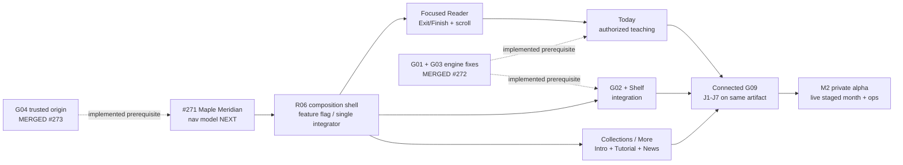

# Bibleberry — Product & Application Development Roadmap

> **CURRENT EXECUTION ROADMAP — November 21, 2026.** The **one** authoritative six-phase engineering sequence, modernized from the actual merged implementation and accepted R06 architecture. This document maps remaining dependencies and acceptance milestones **through public launch**; it is not a blanket coding assignment or a release authorization.
>
> **Readiness is evidence-based:** a design approval, merged PR, feature-gated module, prototype, local test, or green but skipped GitHub Actions job does not establish integrated, hosted, mobile-device, or launch readiness. See [Current Project Status](../project/current-status.md), [Internal Alpha Readiness](../project/internal-alpha-readiness.md), [R06 decisions #22](https://github.com/Bibleberry/Bibleberry/issues/22) and exact PR/CI artifacts.
>
> **Evidence and ownership:** The current implementation/assignment statuses belong in [Current Project Status](../project/current-status.md), scoped [GitHub Issues/PRs](https://github.com/Bibleberry/Bibleberry/issues), and the [Internal Alpha Readiness register](../project/internal-alpha-readiness.md). Recheck live refs before acting; this roadmap describes **stable dependencies and remaining acceptance**, not a live PR count or dispatch board. Aaron controls technical scope, merges and releases; Alexis controls substantive teaching/editorial decisions and relevant ministry presentation.
>
> **R06 accepted foundations and prerequisite implementation (November 21 evidence):** [Paper Compass #264](https://github.com/Bibleberry/Bibleberry/pull/264) consolidated the reader specification; [Glass Atlas #267](https://github.com/Bibleberry/Bibleberry/pull/267) merged an **isolated prototype**, not yet a recorded owner hands-on visual acceptance; [Ivory Sextant #268](https://github.com/Bibleberry/Bibleberry/pull/268) merged the corrected architecture blueprint. **Steady Finch [#269](https://github.com/Bibleberry/Bibleberry/issues/269) / [PR #272](https://github.com/Bibleberry/Bibleberry/pull/272) and Harbor Signal [#270](https://github.com/Bibleberry/Bibleberry/issues/270) / [PR #273](https://github.com/Bibleberry/Bibleberry/pull/273) are merged implementation prerequisites** (G01/G03 and G04 trusted origin); they are **not** full R06 integrated acceptance. The **next unimplemented navigation dependency** at this checkpoint is [Maple Meridian #271](https://github.com/Bibleberry/Bibleberry/issues/271), followed by a production shell. Check #271 live before dispatch; no already-merged assignment should be reissued.
>
> **Delivery milestones:** M1 connected R06 production reader → M2 protected web / guest-only private internal alpha → M3 **owner-scoped** controlled beta readiness → M4 public-launch readiness → M5 controlled public launch. **Hosted accounts, trusted account Cards, and installed native qualification remain required when their channels/features enter approved beta scope and before their eventual account-enabled/native public release.** These milestones **do not replace or prematurely complete** the six phases below; phases overlap by dependency.

### Six-phase orientation — implementation versus acceptance

| Approved phase | Existing foundation (on `main`, not blanket acceptance) | Remaining qualification / delivery |
| --- | --- | --- |
| **01. Shared architecture contracts** | R08A source-of-truth, identity/release contracts; compatibility consumer changes [#68](https://github.com/Bibleberry/Bibleberry/pull/68); accepted R06 blueprint [#268](https://github.com/Bibleberry/Bibleberry/pull/268); trusted-origin implementation [#273](https://github.com/Bibleberry/Bibleberry/pull/273) | Consume the accepted trusted-origin interface without duplicating history authority; preserve cross-system content, release and award invariants during integration |
| **02. Monthly publishing and editorial content** | Monthly Studio schema/workspaces [#73](https://github.com/Bibleberry/Bibleberry/pull/73), readiness inspector [#126](https://github.com/Bibleberry/Bibleberry/pull/126) | One complete, real, private-staging month; repeatable editorial review/finalization, correction and withdrawal |
| **03. Secure monthly delivery and reader** | Gateway local-day release [#81](https://github.com/Bibleberry/Bibleberry/pull/81), month/preview/News endpoints [#84](https://github.com/Bibleberry/Bibleberry/pull/84), controlled reader/Month [#90](https://github.com/Bibleberry/Bibleberry/pull/90)/[#92](https://github.com/Bibleberry/Bibleberry/pull/92) | R06 connected Month/Challenge/return, full-month preview/release/embargo evidence against *live private staging* |
| **04. Participation, Discoveries and Cards** | Guest Finish/awards [#107](https://github.com/Bibleberry/Bibleberry/pull/107), Notebook [#127](https://github.com/Bibleberry/Bibleberry/pull/127), application integration [#147](https://github.com/Bibleberry/Bibleberry/pull/147) | R06 earned-only integration, durable notices and real staged month → Finish → earned Card; trusted hosted awards for beta |
| **05. Navigation and accounts** | Feature-gated Shelf/Library [#231](https://github.com/Bibleberry/Bibleberry/pull/231), Hub Continue [#237](https://github.com/Bibleberry/Bibleberry/pull/237), G01/G03 fixes [#272](https://github.com/Bibleberry/Bibleberry/pull/272), real-*local* account verification [#249](https://github.com/Bibleberry/Bibleberry/pull/249), OTP adapter [#255](https://github.com/Bibleberry/Bibleberry/pull/255) | Navigation model, R06 composition shell and G09 journeys; later real hosted accounts, secure persistence and merge/recovery |
| **06. Release, operations and launch** | News foundation, browser/native CI and emulator/simulator probes | Access-protected alpha, operational recovery; later real-device/mobile stores, privacy/security, production content, monitoring/support and signed launch |

## 0. How to use this roadmap — one source of implementation order

**This file is the single authoritative sequencing and dependency roadmap for Bibleberry.** There is no parallel active CMS build roadmap or reader-experience build roadmap. Amend **this file** by an approved PR when priorities change; use Git history and dated records for earlier sequencing. Older Issue bodies, reports, archived roadmaps and chat handoffs do not independently establish a competing queue of work.

Different documents have different authority:

| Question | Authoritative document or evidence |
| --- | --- |
| What reader behavior and integrated reader acceptance have been approved? | [Approved Reader Experience, Navigation & Acceptance Specification](2026-11-08-approved-reader-experience-and-month-screen.md) (November 8 + November 20–21 R06/G01–G09 consolidation) |
| What editorial content, CMS workflows, and models are planned? | [November 9 CMS content and publishing architecture](../architecture/content-management-and-publishing.md), including its 80-decision register |
| **Which work comes first, and what depends on what?** | **This roadmap alone** |
| What is implemented, deployed, or independently verified? | [Current Project Status](../project/current-status.md), current GitHub commits, accepted Issue/PR evidence and relevant service checks |
| What may an AI agent actually modify? | [AI Development Protocol](../ai-development-protocol.md) plus an **explicitly authorized, scoped** assignment Issue and branch/PR |

The CMS architecture document retains its original **Phase A–G** planning discussion as historical design rationale; that sequence is **not a second executable roadmap**. Its approved editorial requirements remain applicable. The November 8 reader document governs its domain when older texts conflict. This roadmap controls implementation order, **not** substantive theology or a unilateral reduction of approved product behavior.

Existing **R01–R21** workstream IDs and **R08A** are retained below for continuity. A phase is a dependency grouping, **not** a giant PR, a fixed release promise, or a ban on sensible parallel tracks. A proposed stage may be split into multiple narrowly scoped assignments. Scope any early beta or feature deferral explicitly with Aaron; phase placement alone does not authorize omissions.

## 1. Product operating model and non-negotiable boundaries

Bibleberry is a free, ministry-first biblical formation app for **installed iOS and Android**, with hosted web supplementary. Alexis's substantial teaching and editorial integrity lead; reader participation and collectible systems serve that teaching, never dictate its length, format, topic or pace.

- **Editors operate ordinary publishing without code changes.** Aaron and Alexis prepare, review, preview, schedule and publish monthly Challenges, introductions, finished Scripture Cards, News, Special Experiences, instructional content and resources through Sanity. A genuinely new interaction type may need engineering.
- **Exactly two allowed Sanity Growth datasets:** `production` (actual editorial content) and `staging` (private synthetic development/testing). The former `berrymark-development` dataset was deliberately removed; **do not recreate it** or add any third dataset without a new explicit budget/architecture decision. Existing BerryMark write protections must be adapted intentionally, not casually disabled.
- **Clear authority split:** BerryMark prepares supported teaching and metadata; Sanity is authoritative for editorial content and approval after import; the private **Cloudflare gateway/backend** authorizes preview, embargo, withdrawal and release; the app renders reader content; the separate reader participation/account system stores personal state. No private reader records belong in Sanity.
- **Controlled publication:** Sanity-published is not the same as reader-released. Future Challenge manuscripts and hidden monthly discovery answer keys must not leak through APIs, client bundles, assets, search or cache. A sanitized future-title/preview feed is distinct from a released-teaching feed.
- **Reader-local calendar dates:** the approved reader-local release contract now has gateway implementation (R08A [#81](https://github.com/Bibleberry/Bibleberry/pull/81)); a complete real-staging month with timezone/travel/preview/withdrawal cases remains **not verified**. Preserve server-side release authority; do not trust a changeable device clock or arbitrary user offset as a standalone access decision.
- **Permanent participation:** distinct Challenge completions, saved Scripture, earned-card identities and credible earned dates remain independent of transient UI and editable CMS documents. `Finish` (not viewing the last screen) records Challenge completion; idempotent awards must survive account merges and historical reading.
- **Accessibility and device reach:** preserve meaningful text for finished graphic cards, robust navigation and large text, and low-end Android performance. Do not shorten Alexis's material to satisfy card or screen limits.
- **Change control:** separate narrowly scoped branches and PRs, review/tests, explicit Aaron merge/deploy approvals; no unrelated service mutations or production content writes.

## 2. Implementation evidence and remaining integration gaps

**Evidence types used below:** **Integrated on main** = reachable in a tested ordinary app configuration; **feature-gated / isolated** = source and narrower tests exist, not the finished app; **real-staging verified (limited)** = tested with actual private service for a specific scope; **not verified** = needed acceptance not shown; **pending decision** = Aaron must settle before implementing that particular contract. The [status register](../project/current-status.md) records dated evidence; this roadmap records the consequences for sequencing.

| Subsystem | Accepted implementation evidence (verify live refs) | Specific remaining gap / next proof |
| --- | --- | --- |
| **R06 global reader** | **Not implemented as production shell.** `src/main.tsx` still mounts the legacy `App`; `src/App.tsx` renders fixture-backed legacy views, with many separate feature flags. Glass Atlas is under `docs/prototypes/` only. | New feature-gated composition root mounts **existing** hosts, `Today \| Library \| Collections \| More`, focused Reader and real data; integrated G09 acceptance at one exact build SHA |
| **Shelf, Hub Continue, history** | **Merged G01/G03 engine/host correction:** [Steady Finch PR #272](https://github.com/Bibleberry/Bibleberry/pull/272) addresses the Ivory Sextant-audited Active Focus rollover eviction and incorrect fallback; earlier feature-gated hosts [#231](https://github.com/Bibleberry/Bibleberry/pull/231)/[#237](https://github.com/Bibleberry/Bibleberry/pull/237) remain reused. | **Not yet connected R06 acceptance:** G02 one-time rollover orchestration, atomic Shelf focus-choice **policy + UI**, and G09 historical J4/J5 regressions on the same app candidate. No re-dispatch of #269. |
| **External links and navigation state** | **Merged G04-A correction:** [Harbor Signal PR #273](https://github.com/Bibleberry/Bibleberry/pull/273) prevents URL-supplied origins from forging in-app Challenge returns, includes mandatory gateway authorization and targeted tests. Existing `BrowserRouter` is installed/wrapped; the legacy app still uses manual history/hash navigation. | **Next unimplemented navigation seam:** [Maple Meridian #271](https://github.com/Bibleberry/Bibleberry/issues/271) reducer/route model, then one shell integrator; external-first-use and full G09 J2 connected proof remain. No repeat #270 dispatch or duplicate history owner. |
| **Monthly Sanity and gateway** | Schemas/Studio/readiness inspector and gateway monthly APIs **merged**; [R05 #63](https://github.com/Bibleberry/Bibleberry/issues/63) **real-staging verified limited** to a released single Challenge + an embargoed counterexample | A complete month authored, reviewed and finalized in existing private `staging`; genuine preview/current/historical release, withdrawal, content/privacy negative checks and browser return; no assertion this full chain has passed |
| **Challenge formats and content rendering** | Shared screen player, CB1–CB9 block types, tested explicit Finish/resume on existing paths | Seven **distinct Challenge experiences are envisioned but are not seven proven implementations**; approve exact formats and intrinsic Finish contract before claiming full catalogue; do not constrain Alexis's teaching to synthetic screen lengths |
| **Guest state, Cards, Saved Scripture** | Guest participation, distinct Finish, award projections, Notebook/Card viewer/share, Saved Scripture and app-shell adapters exist; component and mocked browser tests | One connected released-month completion and earned-only/announcement/New-state proof; no duplicate awards, leaks or loss on interruption; G07 eligible categories remain a separate content/source contract |
| **Account identity and sync** | Auth/sync/verifier code, [real-local Supabase #249](https://github.com/Bibleberry/Bibleberry/pull/249), [GoTrue OTP adapter #255](https://github.com/Bibleberry/Bibleberry/pull/255) | **No verified hosted OTP/SMTP/templates, second-client restore, secure native token store or hosted verifier**; local/fake tests are not hosted service proof; this is **beta/public**, not guest-only first alpha |
| **Native and accessibility/performance** | Capacitor `android/` and `ios/`, unsigned Android/iOS CI and browser accessibility checks; [Birch Falcon #256](https://github.com/Bibleberry/Bibleberry/issues/256) constrained connected browser metrics | `capacitor.config.ts` still says `com.example.bibleberry.r20poc`; establish final identifiers/signing, installed physical iPhone/Android, VoiceOver/TalkBack, low-budget Android [#37](https://github.com/Bibleberry/Bibleberry/issues/37), deep links and performance. [Granite Lantern #257](https://github.com/Bibleberry/Bibleberry/issues/257) is open CI simulator reliability |
| **BerryMark import** | Companion repo `ContraPhilosophy/BerryMark` has experimental parser, compiler, planners and guarded create-only *staging draft* apply; [README](https://github.com/ContraPhilosophy/BerryMark) explicitly says not a production importer | Manual Sanity Studio is **approved** for first alpha. Later make repeatable one-way authorized import/editorial review without claiming complete format parity or permitting production writes |
| **CI, environments, release operations** | GitHub CI, Collections, Android and iOS workflows; [CI coverage matrix](../testing/ci-coverage-matrix.md); initial [release/rollback plan](../release/release-readiness-and-rollback.md) | Verify actual tests executed for exact candidate SHA (not skipped jobs); connected G09 harness wired into CI; protected web staging; credentials, monitoring, logs, content withdrawal/rollback, backups and restore tests; later production/store release operations |

**Service truthfulness:** GitHub source establishes configuration *intent* and past recorded runs, not current external Sanity/Cloudflare/Supabase service state. No fresh live-service access, hosted OTP, complete full-month staging rehearsal, native physical-device or production deployment was conducted by this roadmap review. Reconfirm live services during the applicable acceptance package.

**Current boundaries approved in [Roosting Falcon #260](https://github.com/Bibleberry/Bibleberry/issues/260#issuecomment-7042529764):** **first internal alpha** is a private **Cloudflare Access-protected web** candidate, local **guest-only** participation with truthful unrecoverable browser/device-local limitations, and **manual Sanity Studio authoring in the existing private `staging` dataset** using synthetic/approved material. Accounts, hosted awards, native devices and BerryMark production importer are deferred to later applicable gates, **not cancelled**. Exactly `staging` and `production` are authorized Sanity datasets.

**Implementation evidence, not a dispatch queue:** [Paper Compass #264](https://github.com/Bibleberry/Bibleberry/pull/264), [Glass Atlas #267](https://github.com/Bibleberry/Bibleberry/pull/267), and corrected [Ivory Sextant #268](https://github.com/Bibleberry/Bibleberry/pull/268) established R06 product/prototype/architecture inputs; [Steady Finch #272](https://github.com/Bibleberry/Bibleberry/pull/272) and [Harbor Signal #273](https://github.com/Bibleberry/Bibleberry/pull/273) merged the first production prerequisite fixes. [Maple Meridian #271](https://github.com/Bibleberry/Bibleberry/issues/271) is the outstanding navigation-model Issue at this verified checkpoint. **Agent allocation, open/closed Issue state, branch SHA and current PR counts belong to the live GitHub records and [Current Status](../project/current-status.md)**, not this sequencing specification. Glass Atlas visual acceptance must be independently recorded before presentation-dependent work; do not infer that acceptance from its merged prototype PR.

## 3. Authoritative dependency-based implementation phases

**Phase acceptance is cumulative, not an early milestone exit gate.** The **Acceptance** clauses in Phases 01–06 describe the eventual complete workstream, including Phase 04 account-backed Cards, Phase 05 hosted merge and physical-device navigation, and Phase 06 release/notification operations *where approved*. M1 and M2 instead qualify their explicitly limited connected-reader and private web/guest-only slices; a later phase requirement must not falsely block those milestones or be marked done because M1/M2 passed. M3 is likewise qualified only against Aaron's approved beta tester/channel scope. Track unmet full-phase obligations through beta/public readiness until individually accepted.

### Phase 01 — Shared architecture contracts: R08A-0

**Status (Nov 21):** R08A-0 contract design and consumer-compatibility work are accepted and merged; the numbered items below are the governing **historical contract**, not authorization to repeat R08A-1. Continue to enforce canonical content IDs, reader-local release and trusted origin during R06 integration.

**Objective:** Establish one common content identity, release, participation and visibility model before expanding CMS schemas or constructing calendar APIs.

**Historical R08A-0 design obligations — [Revision 2 technical architecture](../architecture/r08a-0-monthly-publication-release-contract.md), preserved for traceability; initial contract and six implementation PRs are merged, but ongoing acceptance continues:**
1. Inventory actual `challenge`, `challengeSeries`, BerryMark importer, `production`/`staging` configuration, gateway catalog/detail, and stable completion IDs. No mutations in this assignment.
2. Choose the single **calendar-month roster authority**, provisionally `monthlyPublication` with stable `YYYY-MM` identity; reconcile it explicitly with existing thematic `challengeSeries` and importer series lookups. Do not establish two competing membership sources.
3. Define date-slot identity, Challenge relationship and stable IDs, finalization and later correction/rescheduling impacts without retroactive loss of legitimately earned awards.
4. Specify a server-enforced reader-local release policy (timezone provenance, travel, DST, clock manipulation, first-time readers, guest users, offline cache) and migration from UTC `releaseAt` semantics.
5. Define **two reader-safe disclosure contracts**: approved month preview (preceding 28th / Feb 27: theme, intro subset, future titles and dates) versus active/historical month (calendar, eligible Challenges, visible discovery titles/progress). Future bodies, hidden card art and qualifying Challenge IDs never appear in unauthorized client data.
6. Align reader-specific completion/award IDs and record ownership; explicitly reserve space for signed-in merge rules and account-bound storage without requiring those implementations in this contract assignment.
7. Identify migration tests, rollout strategy, negative embargo cases and narrow subsequent GitHub assignments. Record confirmed actual staging environment/evidence, not unsupported assumptions.

**Acceptance:** One reviewed schema and API contract, source-of-truth/identity diagram, release test matrix, migration/rollout strategy and a list of small implementation PRs. **No implementation** is implied by accepting this design.

**Parallel design:** Account/native identity requirements (R13/R20), seven daily format taxonomy (R04/R10), and Field Notebook visual prototypes can progress without modifying the gateway.

### Phase 02 — Monthly Publishing foundation (Sanity + controlled authoring)

**Status (Nov 21):** `monthlyPublication`, Studio workflows and readiness inspector are implemented; **real full-month private-staging editorial acceptance is not verified** (M2 Alpha A). Manual Studio authoring is enough for first alpha; BerryMark is not silently considered complete.

**Objective:** Make a complete month an editable, verifiable editorial unit without forcing content changes through an app rebuild.

**Scope:** Minimal `monthlyPublication` and associated introduction/roster schemas; date slots, uniqueness, stable references, finalized roster; Studio review and scheduling workflow; compatibility with existing `challenge`/`challengeSeries` and CB1–CB9; existing source fidelity and rights checks; controlled BerryMark-to-`staging` test path, plus an intentional safe production draft path or direct Sanity authoring. Add enough editorial validation to detect missing/duplicate dates, wrong relations, unsupported content and false approval attribution. Use **only** the permitted datasets.

**Acceptance:** On private staging, prepare representative 30-, 31-, and February-month fixtures, review assigned Challenges, inspect truthful preview/readiness and finalize the roster without publishing embargoed material to an unauthorized channel. Test an ordinary postapproval typo edit without altering completion identity. A custom polished dashboard can improve later; safe manual Studio workflow is acceptable first.

**Dependencies:** Phase 01 authority, stable identities, privacy and review contracts. BerryMark expansion beyond supported authored teaching is *incremental*, not a launch prerequisite.

### Phase 03 — Secure Month Screen vertical slice (R08A + essential News)

**Status (Nov 21):** local-day gateway/month preview and feature-gated Month Screen/News foundation merged. Outstanding: real connected R06 routes and full-month **live staging** gateway/embargo/withdrawal/replay proof, not another R05 single-Challenge experiment.

**Objective:** Deliver the first substantial connected reader experience using the approved calendar on current **and historical** months.

**Scope:** Extend the proven R05 gateway with sanitized month/preview projection, current/historical Month Screen calendar states and navigation into the ordinary Challenge reader, origin-aware Finish return, month completion ticker, correctly timed introduction/Welcome/replay, and **only the News schema/feed needed for the recurring next-month preview**. Provide a minimal way to navigate into historical Month Screens; the polished Library/Shelf UX follows later.

**Acceptance:** A reader sees all month Challenge titles and which are completed/available/Coming Soon; cannot access future teaching; Feb 27 and ordinary preceding-28th preview show permitted material without premature Welcome or discovery goals; month start unlocks Welcome and eligible discovery titles; historical-first-time and preview-return intro paths work; finishing returns to origin and updates state silently. Secure negative tests cover direct slug guesses, search/cache/asset leakage, timezone changes, unpublished content and server fallback.

**Dependency warning:** Do **not** wait for an elaborate full News system to support monthly previews, but do not omit the preview-News link from this vertical slice.

### Phase 04 — Discoveries, Scripture Cards and lasting collections

**Status (Nov 21):** guest awards, notebook, viewer, sharing and saved content are in source/isolated integrations. Need G09 connected participation/earned-only/announcement tests and private staging proof; account-trusted awards remain a beta/launch requirement.

**Objective:** Connect the author's month definitions to permanent, earned-only reader accomplishments.

**Scope:** CMS `scriptureCard` graphic-first model with accessible transcription/search metadata; month-owned `monthlyDiscovery` thematic qualifying rules and finalized-roster full-month rule; server-safe hidden mappings; idempotent award identity and credible earned date; earned thumb/full-card viewer and share-image attribution; Field Notebook year/month and unified newest-earned-first All Earned Cards; distinct combined inline **Hub-only** card announcements and New markers, with presentation opt-out semantics. Preserve cards earned from historical Library work. Per [Issue #22 G06/G07](https://github.com/Bibleberry/Bibleberry/issues/22#issuecomment-7058548963), permanently earnable Cards from explicitly designated Foundations/ministry teaching belong in a separate earned-only **Foundations & Learning** Field Notebook collection (distinct from time-limited **Special Experiences**, with no `Special Collections` parent), and the skippable G06 interface `App Tutorial` awards no Cards.

**Acceptance:** One Challenge may count toward several discoveries; completing all finalized month Challenges guarantees all thematic plus full-month card; unrewarded art and qualifying locations never leak; duplicate Finish/offline/account merges do not duplicate awards; earned date is preserved; Month Screen updates progress silently; announcements occur **on Hub arrival only**; no new card is revoked by ordinary editorial corrections.

**Dependency:** Phase 01 record contract and Phase 02 finalized roster. Account-sync foundation must be designed concurrently, and genuine multi-device permanence cannot be promised until R13 acceptance.

### Phase 05 — Coherent navigation and personal reading experience

**Status (Nov 21 evidence):** approved R06 IA and Glass Atlas prototype exist, and prerequisite G01/G03 and G04-A source corrections **merged in #272/#273**; the **four-tab production shell does not yet exist**. Remaining sequence: #271 navigation model → feature-gated composition → connected G09 acceptance. Hosted accounts, native secure state and recovery remain later beta/public gates under approved guest-only web first-alpha scope.

**Objective:** Complete the connected reader environment rather than six independent screens.

**Scope:** Hub teaching-first hierarchy; one unobtrusive Continue suggestion; properly connected current and historical Month Screens; historical **Shelf (0–3)** with protected reader-selected months and limited auto-admission; always-accessible **Library** and origin-aware return; personal Saved Scripture; optional accounts and automatic guest-to-account merges; first-use and replayable onboarding; applicable Foundation content and award presentation. The **Hub** is where combined earned-card announcements surface, never a permanent achievement backlog.

**Acceptance:** Completed old-month Challenges earn identically via Shelf/Library; putting away Shelf months never erases content/progress; a completed or interrupted Challenge resumes appropriately; account merge retains distinct completions, dates, Scripture and existing account's Shelf choices on conflict; no hidden drafts appear on browsing routes; new readers can begin teaching promptly; navigation works accessibly on actual devices.

**Parallelization:** Auth/native storage and account security (R13/R20), stable deep links (R12), and Saved Scripture (R09) should start their contract work earlier than this phase; do not serially postpone prerequisite security or durable-state work merely because complete UX integration is listed here.

### Phase 06 — Expanded editorial systems and operational release

**Status (Nov 21):** some News, CMS, native and CI building blocks exist; operational deployment/backup/restore, public content, device distribution and launch readiness are **not** demonstrated. Distinguish approved minimum launch requirements from unapproved specific Events, broad search and optional push campaigns.

**Objective:** Make the complete ongoing ministry operation sustainable while preserving reader and deployment safety.

**Scope:** Finish standalone News archive, resources/Foundations, Hub editorial slots, ministry pages, in-app notices and searchable reader-eligible content; editorial notification authoring and **separate** audience/preference/permission/delivery/cancel infrastructure; reusable time-limited Special Experience CMS/eligibility/session framework when authorized; Studio monthly readiness/preview ergonomics; monitoring/backup/restore, native app packaging and release qualification.

**Acceptance:** Editors can prepare ordinary new content without code changes; future releases require no daily Sanity mutations; dependent unsent notifications cancel or reschedule safely; withdrawn content is suppressed; backups include Sanity documents **and media** separately from private reader records; accessible graphics and low-end Android remain usable; a full content-to-reader-to-award flow is rehearsed before public release.

**Scope guard:** Specific Special Experience campaigns are **not automatically authorized** by an architecture for events. Full push delivery depends on native channel and explicit launch scope. Production/launch sequencing and any beta omissions require a distinct Aaron decision.

## 4. Cross-phase parallel requirements (not a postponed backlog)

| Track | Required work across phases |
| --- | --- |
| **CMS/editorial** | Independent artwork and theological review; Studio ergonomics and preview; safe import/direct draft choices; monthly publishing rehearsal |
| **R04/R10 formats** | Reconcile all seven Challenge experiences and format-specific Finish semantics; keep optional study truly optional and preserve CB1–CB9 |
| **R07/R13 continuity** | Canonical distinct IDs, async/native storage, guest-account merge, user authorization, earned-date reconciliation and minimal data collection |
| **R16–R18 engineering** | CI/lint/regression, protected staging and rollback, privacy/release negative tests; reuse verified staging, don't start R05 over |
| **R19/R21 devices** | Accessible images, screen readers, real older/budget Android performance, network/interruption recovery |
| **R20 release** | Production permissions, credentials, native iOS/Android choices, deployment/incident runbook, backups and recovery |
| **Editorial communications** | Minimal monthly preview-News **early**; full News/push later after safe content link and reader destination contracts |

## 5. Legacy workstream index — preserved identifiers, not a second priority order

The IDs below retain Issue and documentation traceability; **Phase 01–06 above determines implementation order**. Existing Issues may contain dated, superseded terminology and must be reconciled with current product authority before coding.

| ID | Workstream | Active alignment |
| --- | --- | --- |
| **R01** | BerryMark → Sanity draft import acceptance | Historical dev-dataset live tests accepted; current two-dataset/production pathway Phases 01–02 |
| **R02** | Live Sanity-to-reader integration | Nov 3 local proof; extended by accepted R05 staging evidence; Phases 02–03 |
| **R03** | Ordinary CMS Challenge player integration | Controlled route demonstrated in staging #63; full navigation/discovery Phases 03–05 |
| **R04** | Unified Challenge content contract | Phases 01–02, incremental formats cross-phase |
| **R05** | Server-enforced content release | Secure gateway and staging proof **accepted #62/#63**; new local-day/preview contract Phases 01–03 |
| **R06** | Hub and whole-app information architecture | Phases 03–05 |
| **R07** | Durable distinct reader progress | Foundation exists; phase-spanning state and award integration |
| **R08** | Shelf, Library, Field Notebook and personal collections | Phases 04–05 |
| **R08A** | Month Screen and monthly welcome | R08A-0 accepted and R08A-1..6 implementation merged; full staged monthly proof still required |
| **R09** | App-wide Saved Scripture | Phase 05; contracts earlier |
| **R10** | First-class formats and Biblical Discovery | Contracts Phases 01–02; incremental implementation cross-phase |
| **R11** | Ministry News/What's New | **Minimal preview News Phase 03**; full feed Phase 06 |
| **R12** | Deep links and replayable onboarding | Phases 03 and 05; destinations before push |
| **R13** | Optional accounts and cross-device sync | Early data contract; Phase 05 experience and launch qualification |
| **R14** | Nonpunitive discoveries, cards, permanent awards | Phase 04 and final integration |
| **R15** | Real device reminders/notifications | Phase 06, after platform/permissions and safe destination contracts |
| **R16** | ESLint and CI enforcement | Parallel enabling track |
| **R17** | Automated reader regression | Parallel enabling track, add tests each slice |
| **R18** | Protected environments, access and rollback | Proven staging foundation; parallel operations |
| **R19** | Mobile accessibility/usability validation | Parallel design/testing and launch gate |
| **R20** | Release engineering, native packaging and operations | Start architecture early; production launch gate |
| **R21** | Low-end Android inclusive performance | Parallel measurable baseline and launch gate |

The additional CMS models (monthly publication, graphic-first cards, discoveries, introductions, News, resources, events, tutorials, notices, editorial notifications and ministry pages) are governed by the [November 9 content architecture](../architecture/content-management-and-publishing.md), **not independent competing workstream numbers**.

## 6. Dependency-aware remaining engineering program

**Work-package selection rule:** Only the **next 2–3 bounded, authorized** assignments should be active. Within an authorized planning initiative, Engineering Issue Planning (Planning) researches candidate scopes from this sequence, checks for duplicate work and codename reuse, and creates each scoped Issue with its permanent two-word codename in **Triage**. Development Management (Dev) determines readiness and priority, selects the coding agent, and dispatches the assignment once Aaron’s authorization covers implementation. A roadmap entry is **not** an Issue, branch, coding order, service-change authority, or approval to merge. Re-evaluate interfaces after each accepted PR; do not pre-open all future packages.

### 6.1 Critical path to a connected R06 reader (M1)

**Delivered prerequisites (do not re-dispatch) and next navigation dependency:**
1. **G01/G03 — [Steady Finch #269](https://github.com/Bibleberry/Bibleberry/issues/269), merged [PR #272](https://github.com/Bibleberry/Bibleberry/pull/272):** Active Focus rollover protection and Hub Continue behavior are implemented with targeted legacy regressions; **do not** conflate this with the still-unimplemented G02 or atomic Put Away/replacement focus decision/UI.
2. **G04-A — [Harbor Signal #270](https://github.com/Bibleberry/Bibleberry/issues/270), merged [PR #273](https://github.com/Bibleberry/Bibleberry/pull/273):** Trusted in-session Challenge return origins and mandatory gateway authorization are implemented with targeted tests; external **Month**-link return remains undecided and integrated J2 remains unverified.
3. **Next unresolved navigation model — [Maple Meridian #271](https://github.com/Bibleberry/Bibleberry/issues/271):** Pure `Today | Library | Collections | More` nested-stack/scroll/reducer contract consumes #273, retains existing `BrowserRouter`, and does not own the visual shell or rewrite `App.tsx`. Check live dispatch/owner state before commissioning it.

**Follow-on production package map after the navigation model (candidates, not dispatched):**

| Package / source blueprint | Delivery and reuse | Dependencies, concurrency and ownership boundary | Principal risk and acceptance evidence | Indicative size |
| --- | --- | --- | --- | --- |
| **R06-Shell** ([Ivory Sextant WP-02b](../project/r06-production-implementation-audit.md)) | Feature-gated four-tab R06 composition root, wrapping **existing** Month, Challenge, Shelf, Notebook, Saved Scripture, News hosts; legacy off-flag path preserved | #271 and already merged origin interface; one **designated Shell Integrator** owns `src/main.tsx`, shared shell route/chrome and `src/App.tsx` switch. Glass Atlas hands-on acceptance gates **visual treatment** | Dual-shell drift, history conflicts; flag on/off production builds and tab/back/reload smoke | M–L; split wiring and visual polish |
| **Reader + controls** (WP-03a/b) | Focused Challenge outside chrome; safe origin-aware Exit/Finish, Month scroll; proper Previous/Next, Read Again, Start from Beginning | Shell + #270; shared Challenge host changes owned by one package; controls may be independently prepared | Loss/duplication of participation, inconsistent formats; existing lifecycle and G09 J1/J2/J3 regression tests | M; separate shared host changes |
| **Today** (WP-04) | Use existing authorized current-month gateway source; true primary Challenge, Completed/Read Again or Explore This Month, compact Month, single focus continuation | Shell, Reader, merged G01/G03 engine from #272; presentation depends on owner Glass Atlas acceptance | Static fixture leakage, wrong Continue/duplicate card; J1/J4 + release-failure tests | M |
| **Rollover + Library/Shelf** (WP-05a/b/c) | G02 one-time interrupted continuation; Shelf-centered Library, Browse All Months, Foundations; focus-first ordering, search, Add/Keep/Put Away with **one atomic UI+policy** replacement confirmation | Merged G03 policy #272 → G02 owner tie-break decision; shell for landing; serialize `src/shelf/policy.ts` edits; catalogue gateway search must be server-safe | Active focus eviction, silent data loss, embargo search leaks; J4/J5 + preservation/negative tests | L; split G02, atomic focus UI, search |
| **Month Screen presentation** (WP-05d) | Continuous weekly agenda/current-week positioning, correct first intentional Introduction, Feb 27/28 preview, return scroll; existing Month data/intro host reused | Focused Reader scroll contract; visual acceptance; no parallel modification to the same Month component | Future-content leak or reset; J3 plus 320/375px, large text, date edge tests | S–M |
| **Cards / Collections / Today notices** (WP-06a/b; G07 projections separately scoped) | Earned-only Notebook and Saved Scripture, durable `New Discoveries`, inline Hub-only announcement and contextual Foundations & Learning/Special Experiences **only when genuinely earned** | Shell/Today + authoritative participation; one additive schema migration owner; G07 mapping requires source/award contract, not fictional seeded awards | Duplicate award, migration loss or unearned art disclosure; J6, image failure and persistence tests | L; split migration, Notebook, Hub notice |
| **First use, external ingress, reader profile** (WP-07a/b) | Independent Introduction/Tutorial state, existing onboarding reuse, external Challenge before pending onboarding, durable guest prefs/dismissal | Shell, #270, isolated profile store; do not touch account service or fake auth; owner decides later re-offer policy when needed | False completed onboarding, lost records, unsafe ingress; J1/J2 and replay tests | M; profile store may be S |
| **Guided tutorial + More/News/preferences** (WP-07c/WP-08) | Accessible short spotlight for **actually shipped controls**, More feature/news routes, appearance, guest-local disclosure, invitation eligibility | Stable shell and landing anchors, profile; visual approval for presentation; News reused | Dead-end tutorial, invented news/account backup claims; J7 with keyboard/screen-reader checks | L; split tutorial and More |
| **Connected test harness and G09 acceptance** (WP-09a/b) | One R06 flag-on, production-code browser harness with realistic synthetic gateway fixtures; J1–J7, failures and release negatives, legacy-off regression | Start harness **with the shell**; complete after above packages. CI integration is separately reviewed. **J8 real hosted accounts is later** | False-green / mocks mistaken for staging; exact code SHA and executed tests, full G09 matrix, viewport/focus/reduced-motion proof | M–L; harness starts at shell |
| **Legacy-shell retirement** ([Ivory Sextant WP-11](../project/r06-production-implementation-audit.md)) | After evidence of R06 parity, make the new reader the default through a reversible owner-approved cutover; then separately retire obsolete fixture-backed `App` routes, redundant flags and duplicated navigation | **After M1 connected acceptance** for default cutover; keep known-good rollback during M2; consider final removal only after stable M2 and regression/rollback review, well before M4 launch qualification | Dual-shell maintenance and accidental legacy dead code; verify default/public bundle, no dev fixture leakage, G09 and rollback | M; separate cutover/retirement PRs |

**Delivered logical prerequisites:** G04-A trusted origin [#273](https://github.com/Bibleberry/Bibleberry/pull/273) and G01/G03 engine corrections [#272](https://github.com/Bibleberry/Bibleberry/pull/272) are merged and **should not be reissued**. **Remaining critical path begins with [Maple Meridian #271](https://github.com/Bibleberry/Bibleberry/issues/271) → shell → focused Reader → Today → connected G09**; G02 and atomic Shelf focus-choice join before J4/J5 acceptance. The early Today → authorized Challenge → Finish → origin round trip is an **M1a hands-on integration checkpoint**, not full M1 until all applicable G09 journeys pass.

**Safe parallel lanes:** #269/#270 were successfully separate prerequisite packages and are now merged. The [#271](https://github.com/Bibleberry/Bibleberry/issues/271) navigation model, independently owned reader-profile store, G09 harness scaffolding and **approved/synthetic full-month Sanity editorial preparation** can advance where their files and security contracts do not overlap. CI coverage and Access/rollback planning, editorial rights inventory, and beta hosted-auth/native security **design and test plans** can proceed without unauthorized service writes. Do **not** parallelize PRs editing `src/App.tsx`, the route table, `src/shelf/policy.ts`, participation schema or the same shell integration files. Legacy host consumers' regression tests accompany policy changes.

### 6.2 The distinct private-alpha acceptance work (M2)

The first alpha is **private web + local guest + manual Studio**, not an iOS/Android or hosted-account claim. Reuse accepted [R05 one-Challenge staging #63](https://github.com/Bibleberry/Bibleberry/issues/63) without reimplementing it. Commission these **acceptance** packages after approving actual operation/scopes:

| Package | Work and prerequisite | Demonstrable exit / mapped [alpha gates](../project/internal-alpha-readiness.md) |
| --- | --- | --- |
| **Alpha A — real complete staging month** | In existing **private `staging` only**, prepare/approve synthetic content through **manual Sanity Studio**, roster/intro/discoveries/cards, readiness and schedule, correction/withdrawal playbook. Can **prepare in parallel** with shell. No new dataset or unauthorized publish. | One full real editorial month + replayable authoring procedure; local 28/29/30/31 calendar variants; A2/A5 |
| **Alpha B — private gateway and connected reader** | With M1 candidate and Alpha A, exercise actual Sanity→Cloudflare gateway→R06 Month/Challenge/Finish→guest progress→earned Card; preview, embargo, withdrawn/invalid direct URLs, cache/privacy, historical + date-boundary negatives | Real candidate/live-private-staging evidence, distinct from mocked browser tests; A1/A3/A4 |
| **Alpha C — protected web candidate and operations** | Versioned R06 build behind verified Cloudflare Access; approved flag set, no dev Studio/lab; test 320/375 and tablet layouts, 200% text, keyboard/screen-reader, current CI and explicit skipped-test audit, logs, rollback/withdrawal and backup expectations | One specific candidate SHA/env and A1–A5, A8–A10 evidence; guest-local limitation displayed; no false auth claims. Aaron records Alpha GO / HOLD / NO-GO |

**No hosted sign-in/OTP or native device gate is secretly passed by a guest-only web alpha.** Each enters the **first controlled beta** only if Aaron explicitly approves the corresponding tester/account/channel scope. Hosted account recoverability, trusted account Card verification, installed native qualification and device acceptance remain **unwaived requirements for their eventual approved authenticated/native release**, including public launch if those features/channels ship. A beta limited to web/guest does not certify them.

### 6.3 Beta and launch packages (not yet separate commissioned Issues)

**Timing and beta-scope note:** The long-form content, rights, Card-art and format-readiness stream starts in parallel with R06 engineering (see §6.4); it is **not** deferred until a public launch candidate. **Aaron must approve M3's tester population, web/native channels, and guest/authenticated features before beta acceptance is evaluated.** B1/B2 apply to an **authenticated beta**; B3 and device-specific B4 proof apply to an **installed-native beta**. If first beta is narrower, mark those gates **not yet verified/deferred to their approved channel release**, not passed or permanently waived. Approved first-alpha gates remain web/guest-only. In all cases public release of authenticated/native capabilities requires their own hosted/device evidence.

| Stage / workstream | Reused foundations; missing deliverable | Prerequisites and proof / key risk |
| --- | --- | --- |
| **Beta B1 — hosted identity and recoverability (authenticated-channel gate)** | Existing R13 AuthProvider/GoTrue adapter, sync coordinator, real-local PostgREST/RLS. Configure approved actual hosted OTP email templates, SMTP/rate limits, verified identity/session, safe session storage/refresh, guest→account merge, G08 notice, account Shelf precedence and cross-device restore | Approved hosted environment/security configuration; real two-client E2E with wrong-code/retry/revocation/collision/zero-data-loss. Resolve furthest-valid-screen vs missing trusted screen order before asserting merge correctness |
| **Beta B2 — trusted account Cards (authenticated-channel gate)** | Local private verifier / security tests; deploy least-privileged **hosted private verifier** tied to approved Sanity content, RLS and authoritative award sources | Hosted identity and secure service role separation; forged/replayed/withdrawn award negatives; credible earned date and recovery; no client-side award authority |
| **Beta B3 — installed mobile channel (native-channel gate)** | Existing Capacitor iOS/Android projects, lifecycle bridge and emulator/simulator CI. Replace POC IDs/assets/signing only through approved release work; real app-link/universal-link ingress, safe areas, lifecycle/notification permissions when in scope; **secure auth-token storage in Keychain/Keystore is required only when authenticated accounts are enabled** | Real installed-device smoke on supported iOS/Android, deep-link and hardware Back behavior, background/foreground/relaunch, interrupted-session and device-local data durability, guest-local loss disclosure, and Apple/Google package/signing validation; **second-client account authentication and secure native token persistence are required only for an authenticated native beta**. A guest-only native beta must not claim cloud recovery. [Granite Lantern #257](https://github.com/Bibleberry/Bibleberry/issues/257) CI instability needs operational disposition |
| **Beta B4 — accessibility, performance and external testing (per approved channels)** | Existing browser tests and [Birch Falcon performance #256](https://github.com/Bibleberry/Bibleberry/issues/256) baseline; realistic rich monthly content/media | Real low-memory/older Android [#37](https://github.com/Bibleberry/Bibleberry/issues/37), physical iPhone, TalkBack/VoiceOver, long-form formats, network loss/reentry; controlled testers/support and monitored issue resolution. Browser throttling cannot substitute for physical devices |
| **Beta B5 — approved editorial content breadth** | Existing CB1–CB9 renderer + structured CMS; Reader format test matrix; Foundations and News partial models | Aaron/Alexis decide the actual seven-format taxonomy and Finish semantics **before claiming it**; distinct live content/rules for supported formats, visible safe empty/error states, appropriate resources and rights; no invented Special Experience campaign |
| **Launch L1 — repeatable editorial production** | Sanity monthly publishing + BerryMark partial draft preparation | Alexis-approved real teaching, final Cards/illustrations, Bible translation/media rights, manual or bounded authorized importer workflow, safe routine content publication and withdrawal; repeat monthly without app code changes. BerryMark full-language parity is **not automatically** a launch blocker |
| **Launch L2 — operational security, privacy and recovery** | Gateway/CI/host patterns and release plan | Approved production hosting/domain, access/provisioning, private content controls, account deletion/privacy disclosures, quotas/costs, monitoring/error alerts, documented backup **and real restore** for Sanity docs/media and personal data, incident/on-call process, rollback/withdrawal rehearsal |
| **Launch L3 — distribution and support** | Native CI/device evidence from B3/B4 | Apple/Google developer accounts and current store privacy/distribution requirements verified at submission, reproducible signed artifacts, metadata/screenshots, accessible onboarding and support, staged rollouts/update strategy; store review and device signoff |
| **Launch L4 — final candidate qualification** | M1/M2/M3 **relevant scoped** evidence + real content and operations; all requirements applicable to **approved public release channels** independently qualified, even if deferred from a narrower beta | Exact production candidate SHA and environment, all required CI/integrated/device/rights/security evidence, no unresolved critical release-blocking findings, owner-recorded residual exceptions, Aaron's separate launch GO/NO-GO, controlled monitoring after release |

**R15 notification launch-scope gate (owner decision; unresolved):** Before freezing first public-launch scope, Aaron must decide **whether any device notification delivery is included at launch or explicitly deferred to a separately authorized post-launch increment**. Preserve the R15 architecture for editorial authoring, audience/preference/permission handling, scheduling, delivery and cancellation; **neither inclusion nor deferral has been approved by this roadmap**. If launch includes notifications, first validate approved delivery channels, OS permissions and opt-outs, deep-link authorization/embargo-safe destinations, timezone scheduling, withdrawn-content cancellation, retry/duplicate suppression and device end-to-end checks **before M4**. If deferred, record Aaron's explicit scope decision and user-facing limitation in the release-readiness record; do not report unsent-notification acceptance as passed. This gate does not block M1/M2 reader acceptance.

**No invented commitments:** A specific time-limited Special Experience, full push delivery, full-text global search, novel memorization machinery, new cloud dataset or third-party publishing pipeline is not automatically approved. Preserve approved capabilities, but defer *particular campaigns and optional implementations* only with explicit scope records. Do not turn a target calendar date into authority to skip quality gates.

### 6.4 Parallel editorial, real-device feasibility and prelaunch cost/risk track

This is **one coordinated supporting track**, not another authoritative roadmap or permission to publish. Its work can start before the R06 shell while preserving Alexis's substantive authority and Aaron's environment/release authorization.

| Earliest point | Parallel readiness work | Evidence; what this does **not** authorize |
| --- | --- | --- |
| **Now, alongside Maple Meridian / R06 shell** | Inventory real available teaching, approved illustrations and Scripture Card art, content/translation/media licensing and provenance; identify materials needing Alexis's substantive approval; decide **which of the envisioned seven Challenge experience types are actually required** and their distinct Finish/resume contracts | Rights/content gap register and owner/editorial decision; **no forced rewriting of teaching, fabricated approval, production publishing or fixed quota of real months** |
| **Alongside M1 implementation** | Prepare and rehearse a full **synthetic or separately approved** Sanity `staging` month (Alpha A); map representative final formats/art to actual schemas; collect reusable Studio authoring, corrections and withdrawal procedures | An owner-authorized private-staging rehearsal, not a substitute for the later real approved production editorial corpus; **do not insert embargoed real teaching merely to make Alpha A look realistic** |
| **M1a shell feasibility and onward** | When actual phones and suitable development setup are available, smoke the **same production-code R06 feature-gated candidate** on one budget Android and one physical iPhone for safe areas, Android hardware Back, tab/scroll restoration, deep-link ingress and J1–J3 core reading interactions. iPhone **physical** installation needs development signing/provisioning; unsigned Simulator proof is not a device install | **Exploratory, high-value risk reduction**, not mandatory private-web-alpha GO evidence or native/store acceptance; file device issues while routing contracts are still easy to fix |
| **By controlled beta planning (M3)** | Establish an owner-approved target for a representative **real, editorially cleared** publication cycle and supported content formats; prove authoring and correction throughput can sustain the chosen cadence | Real content and rights readiness gate separate from synthetic Alpha A. **No invented number N of months** or fixed publication date without owner/editorial approval |
| **Before public-launch readiness (M4)** | Verify the actual approved launch corpus, finished Card art/accessible text, licensed Scripture/media, monthly production cadence, and one repeatable editorial publication/withdrawal cycle with real operational ownership | Alexis's teaching/art approval and Aaron's release authorization required; completion of code is not content qualification |

**Operational sizing:** The S/M/L labels in §6.1 reflect approximate scope and integration risk, **not measured engineering effort or calendar promises**. An L package must be decomposed into reviewable nonconflicting Issues before dispatch. Keep this track visible alongside engineering to avoid treating it as a last-minute Phase 06 cleanup.

## 7. Acceptance milestones, exit evidence and program critical path

These are **release-management gates within Phases 01–06**, not another engineering roadmap. Use [Internal Alpha Readiness](../project/internal-alpha-readiness.md) for gate-by-gate status; [Release Readiness and Rollback](../release/release-readiness-and-rollback.md) for operator acceptance; [G09](2026-11-08-approved-reader-experience-and-month-screen.md#102-whole-application-acceptance-journeys-g09) for connected reader scenarios.

| Milestone | Definition and required evidence | Authority and decision boundary |
| --- | --- | --- |
| **M1 — Connected R06 reader** | One real flag-on production-code app: `Today | Library | Collections | More`, correct origin, current Month/Challenge/Finish, historical Shelf/Library, earned-only collections, News/More and independent replay; **applicable J1–J7 G09 on a single build** with security/accessibility negatives and flag-off legacy suite. Synthetic/mocked gateway allowed for M1 only. | Aaron/visual owner acceptance where relevant; **not** live staging or private-alpha Go |
| **M2 — First private internal alpha** | Protected **web** candidate, approved synthetic full **real Sanity `staging`** month, real gateway and eligible content, guest-local progress/Cards, candidate CI and Access/rollback/incident checks; A1–A5/A8–A10 evidenced in exact build and A6 guest-only scope/disclosure recorded. | Aaron decides internal-alpha GO/HOLD/NO-GO; hosted account and physical-device requirements retained for later stages |
| **M3 — Controlled beta readiness** | **Aaron-approved tester and channel scope** with actual integrated functionality, monitoring, support/rollback, privacy/accessibility/performance and appropriate real tester/device evidence. **If authenticated:** hosted OTP/account recovery/merge and trustworthy hosted Card awards must pass B1/B2. **If installed mobile:** signed test artifacts and physical-device qualification must pass B3 and applicable B4. A first web/guest-only beta cannot be used as evidence of untested hosted/native functionality. | Aaron first approves precise beta scope, then authorizes tester rollout or HOLD; not public-store release, and scoped beta exceptions cannot silently waive later approved public requirements |
| **M4 — Public launch readiness** | Editorial/translation/media rights signoff, repeatable real editorial publication, verified production host and isolation, native signing/store prerequisites, current platform compliance, least privilege, deletion/privacy, backup **restore** and recovery, actual integrated/channel tests, incident/support ownership, exact candidate SHA and risk disposition. | Alexis approves teaching/editorial; Aaron authorizes candidate release or blocks it |
| **M5 — Public launch** | After M4, controlled rollout, post-release content/release checks, error/health monitoring, support response, rollback readiness and final recorded launch GO outcome. | Aaron's explicit deployment/release decision; no inferred automatic launch |

**M1a — early integrated reader walkthrough (subgate within M1, not a new top-level milestone):** As soon as the feature-gated shell, focused Reader and authorized Today are minimally connected, demonstrate Today → released Challenge → explicit Finish → correct origin, plus tab switching, Back/Forward/reload and saved progress on the **same production-code candidate**. Aaron performs a hands-on walkthrough and supplies actionable UX feedback; reconcile Glass Atlas [#265](https://github.com/Bibleberry/Bibleberry/issues/265) presentation acceptance. Synthetic/injected authorized gateway data is sufficient for M1a, but **M1a is not M1 G09 acceptance, real Sanity staging proof or alpha GO**. An early physical Android / suitably signed iPhone feasibility smoke is encouraged under §6.4, not an expansion of M2 scope.

**Remaining critical path:** already-merged origin trust ([#273](https://github.com/Bibleberry/Bibleberry/pull/273)) enables [#271 navigation model](https://github.com/Bibleberry/Bibleberry/issues/271) → one shell integrator → focused Reader + authorized Today → **M1a** → full connected G09 acceptance (**M1**); already-merged G01/G03 ([#272](https://github.com/Bibleberry/Bibleberry/pull/272)), pending G02/Shelf UI and parallel editorial preparation join before their dependent journeys. **M1 + complete authorized staging month (Alpha A)** → real gateway/guest Card proof (Alpha B) → protected web/operations (Alpha C) → **M2**. Approved tester/channel scope + applicable hosted identity/trusted Cards and/or native-device qualifications + beta operations → **M3**; any authenticated/native capabilities approved for public launch must complete their unwaived gates before **M4/M5**, alongside real editorial corpus/rights, production recovery and store requirements.

**Parallel plan:** (i) accepted G01/G03 and G04 prerequisite implementations are already on `main`; the navigation model can now advance with independent profile/test modules subject to file ownership; (ii) Stage Alpha A Studio rehearsal planning and substantive editorial/rights/format preparation can progress alongside the shell, with only separately approved staging writes; (iii) CI, accessibility, optional physical-device feasibility, and threat/rollback planning run early; (iv) hosted auth/native design and local tests can proceed while alpha runs, but real service configuration and beta launch require separate approvals. Phases **overlap by dependency**, not rigid finish-everything-before-next-phase.

**Claims and evidence policy:** *merged* ≠ *connected*; *prototype* ≠ *production code*; *fake/local Supabase* ≠ *hosted*; *simulator* ≠ *physical phone*; *local Vite fixture* ≠ *private staged publication*; *green skipped job* ≠ *executed tests*; *successful merge* ≠ *deployment or release*. Every acceptance report names the commit, environment, test selection, failures/omissions and approving owner.

## 8. Genuine decision gates, risks and coordination rules

| Decision or gap (source) | Blocking point / safe interim |
| --- | --- |
| [Glass Atlas #265](https://github.com/Bibleberry/Bibleberry/issues/265) hands-on visual acceptance | Required before final visual four-tab shell/landing style; pure engine and navigation work can proceed without it |
| Named single Shell Integrator and shared routing ownership | Required **before** shell PR; avoid simultaneous `src/App.tsx`, `src/main.tsx` and shared `src/readerShell/**` edits |
| G02 one-time rollover consumption, multiple unfinished tie-break | Resolve before G02 orchestrator and M1 J4. Active Focus priority and max-one Continue are already approved |
| Shelf Kept unprotect and reread position from Month Screen | Do not silently invent interactions; hide optional unprotect if still undecided. Resolve when relevant UX work needs it |
| Foundations content source, ordered first reading and resumable position | Needed for real Foundations data and genuine resume behavior, not for static prototype proof |
| External **Month Screen** deep-link return / referring-app OS Back | Not covered by external **Challenge** return approval. Do not activate direct Month external link flow until owner contract; verify actual platform OS Back convention |
| Multi-device reading-position conflict / trusted screen order | Must reconcile the [R06 spec §12](2026-11-08-approved-reader-experience-and-month-screen.md#12-residual-contradictions-open-boundaries--deferred-decisions) with R13 transaction backend before hosted account merge is accepted |
| Seven content formats / intrinsic Finish and `readerGuidance` contract | Decide actual approved format experiences and awards before promising them at public release; G06 skippable App Tutorial never awards Cards |
| Approved editorial season palettes/art, G07 foundations/special award source, card rights | Presentation and eligible earning require genuine sources; no fabricated Cards or future campaign. Seek Alexis's appropriate editorial approval |
| **Beta tester/channel and account scope (M3)** | **Aaron decision not yet recorded in the reviewed sources:** identify first controlled beta testers, web/native distribution, guest/authenticated functionality and required acceptance proof. B1/B2/B3/B4 are conditional for that first beta but remain unwaived for the eventual approved authenticated/native release; see §6.3 and [alpha scope register](../project/internal-alpha-readiness.md) |
| **R15 initial public-launch notification delivery** | **Aaron must explicitly decide before M4 scope freeze:** include supported notifications and test complete authoring→preference/permission→safe delivery/cancellation, **or** record an approved post-launch deferral with truthful release limitations; no automatic inclusion, exclusion or scope waiver |
| Channel-specific account, privacy and app-store choices | Confirm final beta/public channel boundaries, real permission methods and current store obligations before claiming readiness; not a reason to delay unrelated reader engines |

**Highest-risk integration failures to prevent:** (1) untrusted navigation origin/embargo leakage; (2) Shelf focus eviction, silent replacement or lost guest progress; (3) dual shell/router history drift; (4) duplicate/unearned/undurable Cards; (5) false-green CI or mocked-as-live acceptance; (6) hosted account data loss/forged trusted awards; (7) beta physical-device and launch operational evidence being postponed until the end. Keep legacy regression and negative security tests in the package that changes the behavior.

**Noncompeting Issue records:** [Iron Orchard #20](https://github.com/Bibleberry/Bibleberry/issues/20) is an engineering-maturity **parent tracker**, not a second execution roadmap. Historical umbrella [Amber Calendar #61](https://github.com/Bibleberry/Bibleberry/issues/61) and CMS Milestone B [Juniper Bridge #25](https://github.com/Bibleberry/Bibleberry/issues/25) retain their previously recorded owner/scope reconciliation; do not re-dispatch old milestones or close them without examining outstanding acceptance. [Steady Finch #269](https://github.com/Bibleberry/Bibleberry/issues/269) and [Harbor Signal #270](https://github.com/Bibleberry/Bibleberry/issues/270) may remain administratively open after merged PRs #272/#273; Issue closure and board completion require evidence that the originating Issue's scope has been satisfied. The Project Board Steward reconciles the administrative records against merged PRs and Aaron's recorded decisions, with Dev identifying any outstanding engineering obligations. [Northbound Atlas #275](https://github.com/Bibleberry/Bibleberry/issues/275) is this documentation PR's permanent codename anchor.

**Workstream governance:** The canonical roadmap establishes **sequence and dependencies**; [R06 spec](2026-11-08-approved-reader-experience-and-month-screen.md) establishes approved UX; [CMS architecture](../architecture/content-management-and-publishing.md) establishes editorial contracts; [Ivory Sextant](../project/r06-production-implementation-audit.md) provides package/source guidance; [Current Status](../project/current-status.md) reports verified implementation; [Alpha Readiness](../project/internal-alpha-readiness.md) reports gate evidence; **one scoped authorized Issue/branch/PR** gives an agent permission to modify code. Independent Review (Review) records its technical disposition in a top-level PR Conversation comment tied to the exact reviewed HEAD SHA. Checks & Merge verifies that the disposition and required CI apply to the current merge candidate and checks for unresolved findings. **Aaron alone** authorizes merges, cloud mutations, deployments, and releases.Proposals and Issues alone authorize none of those.

**Maintenance after each milestone:** [Current Project Status](../project/current-status.md) gets dated accepted implementation evidence and volatile assignment/PR states; alpha/release registers get actual gate results by reviewed PR; **this roadmap does not mirror live open counts, dispatch choices or SHA tips** and changes **only when sequencing, evidence interpretation or substantive dependencies change** (not after every merge). Archive superseded plans through Git history and dated status links. For each planning pass, Planning considers at most 2–3 nonoverlapping packages with the fewest outstanding dependencies, checks them against merged code and recorded owner decisions, and creates scoped candidate Issues in Triage. Dev evaluates those Issues for readiness and dispatch under the [department responsibility map](../ai-operations/department-responsibilities.md). No artificial percent-complete or calendar deadline should be inferred.

## 9. Change history and maintenance

- **November 21, 2026 — Northbound Atlas #275 / PR #274 final planning-review clarifications (proposed):** Reconciled [Engineering Planning's review](https://github.com/Bibleberry/Bibleberry/pull/274#issuecomment-7070025796): M3 qualification depends on Aaron-approved tester/channel scope; hosted and native gates remain required when those capabilities ship. Added explicit R15 initial-public-launch include/defer decision with dependency evidence, and distinguished full six-phase acceptance from incremental M1/M2/M3 acceptance. Nonbinding Iron Orchard #20 calendar target remains historical; no new deadline, requirement waiver, source change or service action.

- **November 21, 2026 — Northbound Atlas #275 / PR #274 review corrections (proposed):** Independent Review identified stale executable queue statements after Steady Finch #272 and Harbor Signal #273 merged; corrected the evidence matrix, prerequisite-versus-remaining critical path and dispatch references. Separated volatile status from stable dependencies, added early editorial readiness, a non-gating M1a hands-on checkpoint, optional signed-device feasibility, legacy-shell retirement and indicative sizing. No implementation, production content, service mutation or issue closure is authorized by this review fix.
- **November 21, 2026 — Original Northbound Atlas audit snapshot (historical only):** At the initial audit, Bibleberry `main` was `0059fcbc6f7ffb1054a8c2cf8ba1a2acdb37f90a` with zero open PRs; that point-in-time status **predates** merges #272/#273 and must not guide dispatch. Reconciled companion BerryMark, accepted Paper Compass/Glass Atlas/Ivory Sextant evidence, initial three prepared R06 Issues, G09 and internal-alpha gates. Kept six approved phases and historical R01–R21 index; replaced obsolete active R08A-1 handoff with cross-phase remaining-work packages, critical dependencies, separate M1–M5 exit evidence and beta/public operating requirements. No source, hosted services, issues or board changed as part of this documentation proposal.

- **November 21, 2026:** Consolidated all November 20–21 R06 navigation/UX approvals and [G01–G09](https://github.com/Bibleberry/Bibleberry/issues/22#issuecomment-7058590005) into the single [Approved Reader Experience, Navigation & Acceptance Specification](2026-11-08-approved-reader-experience-and-month-screen.md), reconciled `Special Collections` and tutorial taxonomy in [CMS Architecture](../architecture/content-management-and-publishing.md), and aligned [Internal Alpha Readiness](../project/internal-alpha-readiness.md) with the November 20 [#260](https://github.com/Bibleberry/Bibleberry/issues/260#issuecomment-7042529764) first-alpha scope decisions. Six-phase sequencing unchanged.
- **November 9–10, 2026 (historical):** R08A-0 technical architecture Revision 2 submitted and reviewed; its six consumer-first implementation assignments were *candidates at that time*, and have since merged. The original text remains traceable through Git history.
- **November 9, 2026:** Aaron selected the integrated **six-phase** reader + CMS dependency order as the project's new guidance; kept the existing roadmap path canonical, incorporated 80 CMS content decisions through a supporting specification, and identified R08A-0 contract work first. Reconciled November 8 Stage 3C staging success so already completed integration is not reissued.
- **November 8, 2026:** The [approved reader-experience specification](2026-11-08-approved-reader-experience-and-month-screen.md) introduced the calendar Month Screen, Shelf/Library terminology, hybrid Monthly Discoveries, Hub-only earned-card announcements and monthly preview/welcome.
- **November 5, 2026:** Initial multi-workstream roadmap and engineering inventory were established. Their old priority grouping and "next milestone" language are now **superseded**, not a parallel plan; Git history preserves the original.

**Maintenance rule:** After an accepted milestone, update [Current Project Status](../project/current-status.md) with dated evidence. Change sequencing only in this canonical roadmap by reviewed PR. Older completed milestones retain their exact dated acceptance in Issues/PRs; don't rewrite history as though they never occurred.
