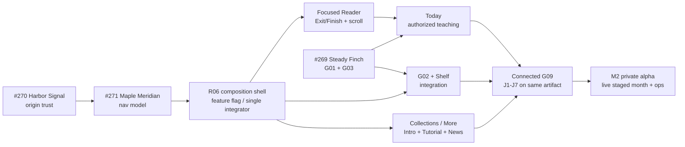

# Bibleberry — Product & Application Development Roadmap

> **CURRENT EXECUTION ROADMAP — November 21, 2026.** The **one** authoritative six-phase engineering sequence, modernized from the actual merged implementation and accepted R06 architecture. This document maps remaining dependencies and acceptance milestones **through public launch**; it is not a blanket coding assignment or a release authorization.
>
> **Readiness is evidence-based:** a design approval, merged PR, feature-gated module, prototype, local test, or green but skipped GitHub Actions job does not establish integrated, hosted, mobile-device, or launch readiness. See [Current Project Status](../project/current-status.md), [Internal Alpha Readiness](../project/internal-alpha-readiness.md), [R06 decisions #22](https://github.com/Bibleberry/Bibleberry/issues/22) and exact PR/CI artifacts.
>
> **Baseline checked November 21:** Bibleberry `main` `0059fcbc6f7ffb1054a8c2cf8ba1a2acdb37f90a`, **0 open PRs**, 16 open Issues; companion BerryMark `main` `4c6fca446e3374add3e72a2bf57fbef05a7c6a40`. Recheck live refs before dispatch or claiming completion. Owner: Aaron (scope, merges, environments, releases); Alexis (substantive teaching/editorial and relevant ministry presentation).
>
> **Accepted R06 milestones:** [Paper Compass #264](https://github.com/Bibleberry/Bibleberry/pull/264) consolidated product requirements; [Glass Atlas #267](https://github.com/Bibleberry/Bibleberry/pull/267) merged an **isolated prototype**, pending separate hands-on owner UX acceptance; [Ivory Sextant #268](https://github.com/Bibleberry/Bibleberry/pull/268) merged the corrected **architecture blueprint**. None implemented the production R06 shell. First three prepared engineering Issues are [Steady Finch #269](https://github.com/Bibleberry/Bibleberry/issues/269), [Harbor Signal #270](https://github.com/Bibleberry/Bibleberry/issues/270) and [Maple Meridian #271](https://github.com/Bibleberry/Bibleberry/issues/271); their Issue descriptions currently say **not dispatched**, and assignment management must update actual ownership/authorization before code work.
>
> **Delivery milestones:** M1 connected R06 production reader → M2 protected web / guest-only private internal alpha → M3 hosted-account + native beta readiness → M4 public-launch readiness → M5 controlled public launch. These **do not replace** the six phases below. Engineering phases overlap when interfaces and file ownership permit.

### Six-phase orientation — implementation versus acceptance

| Approved phase | Existing foundation (on `main`, not blanket acceptance) | Remaining qualification / delivery |
| --- | --- | --- |
| **01. Shared architecture contracts** | R08A source-of-truth, identity/release contracts; compatibility consumer changes [#68](https://github.com/Bibleberry/Bibleberry/pull/68); accepted R06 blueprint [#268](https://github.com/Bibleberry/Bibleberry/pull/268) | Preserve cross-system contracts, trusted in-session navigation origin, and release/award invariants during integration |
| **02. Monthly publishing and editorial content** | Monthly Studio schema/workspaces [#73](https://github.com/Bibleberry/Bibleberry/pull/73), readiness inspector [#126](https://github.com/Bibleberry/Bibleberry/pull/126) | One complete, real, private-staging month; repeatable editorial review/finalization, correction and withdrawal |
| **03. Secure monthly delivery and reader** | Gateway local-day release [#81](https://github.com/Bibleberry/Bibleberry/pull/81), month/preview/News endpoints [#84](https://github.com/Bibleberry/Bibleberry/pull/84), controlled reader/Month [#90](https://github.com/Bibleberry/Bibleberry/pull/90)/[#92](https://github.com/Bibleberry/Bibleberry/pull/92) | R06 connected Month/Challenge/return, full-month preview/release/embargo evidence against *live private staging* |
| **04. Participation, Discoveries and Cards** | Guest Finish/awards [#107](https://github.com/Bibleberry/Bibleberry/pull/107), Notebook [#127](https://github.com/Bibleberry/Bibleberry/pull/127), application integration [#147](https://github.com/Bibleberry/Bibleberry/pull/147) | R06 earned-only integration, durable notices and real staged month → Finish → earned Card; trusted hosted awards for beta |
| **05. Navigation and accounts** | Feature-gated Shelf/Library [#231](https://github.com/Bibleberry/Bibleberry/pull/231), Hub Continue [#237](https://github.com/Bibleberry/Bibleberry/pull/237), real-*local* account verification [#249](https://github.com/Bibleberry/Bibleberry/pull/249), OTP adapter [#255](https://github.com/Bibleberry/Bibleberry/pull/255) | R06 composition shell and G09 journeys; later real hosted accounts, secure persistence and merge/recovery |
| **06. Release, operations and launch** | News foundation, browser/native CI and emulator/simulator probes | Access-protected alpha, operational recovery; later real-device/mobile stores, privacy/security, production content, monitoring/support and signed launch |

## 0. How to use this roadmap — one source of implementation order

**This file is the single authoritative sequencing and dependency roadmap for Bibleberry.** There is no parallel active CMS build roadmap or reader-experience build roadmap. Amend **this file** by an approved PR when priorities change; use Git history and dated records for earlier sequencing. Older Issue bodies, reports, archived roadmaps and chat handoffs do not independently establish a competing queue of work.

Different documents have different authority:

| Question | Authoritative document or evidence |
| --- | --- |
| What reader behavior and integrated reader acceptance have been approved? | [Approved Reader Experience, Navigation & Acceptance Specification](2026-11-08-approved-reader-experience-and-month-screen.md) (November 8 + November 20–21 R06/G01–G09 consolidation) |
| What editorial content, CMS workflows, and models are planned? | [November 9 CMS content and publishing architecture](../architecture/content-management-and-publishing.md), including its 80-decision register |
| **Which work comes first, and what depends on what?** | **This roadmap alone** |
| What is implemented, deployed, or independently verified? | [Current Project Status](../project/current-status.md), current GitHub commits, accepted Issue/PR evidence and relevant service checks |
| What may an AI agent actually modify? | [AI Development Protocol](../ai-development-protocol.md) plus an **explicitly authorized, scoped** assignment Issue and branch/PR |

The CMS architecture document retains its original **Phase A–G** planning discussion as historical design rationale; that sequence is **not a second executable roadmap**. Its approved editorial requirements remain applicable. The November 8 reader document governs its domain when older texts conflict. This roadmap controls implementation order, **not** substantive theology or a unilateral reduction of approved product behavior.

Existing **R01–R21** workstream IDs and **R08A** are retained below for continuity. A phase is a dependency grouping, **not** a giant PR, a fixed release promise, or a ban on sensible parallel tracks. A proposed stage may be split into multiple narrowly scoped assignments. Scope any early beta or feature deferral explicitly with Aaron; phase placement alone does not authorize omissions.

## 1. Product operating model and non-negotiable boundaries

Bibleberry is a free, ministry-first biblical formation app for **installed iOS and Android**, with hosted web supplementary. Alexis's substantial teaching and editorial integrity lead; reader participation and collectible systems serve that teaching, never dictate its length, format, topic or pace.

- **Editors operate ordinary publishing without code changes.** Aaron and Alexis prepare, review, preview, schedule and publish monthly Challenges, introductions, finished Scripture Cards, News, Special Experiences, instructional content and resources through Sanity. A genuinely new interaction type may need engineering.
- **Exactly two allowed Sanity Growth datasets:** `production` (actual editorial content) and `staging` (private synthetic development/testing). The former `berrymark-development` dataset was deliberately removed; **do not recreate it** or add any third dataset without a new explicit budget/architecture decision. Existing BerryMark write protections must be adapted intentionally, not casually disabled.
- **Clear authority split:** BerryMark prepares supported teaching and metadata; Sanity is authoritative for editorial content and approval after import; the private **Cloudflare gateway/backend** authorizes preview, embargo, withdrawal and release; the app renders reader content; the separate reader participation/account system stores personal state. No private reader records belong in Sanity.
- **Controlled publication:** Sanity-published is not the same as reader-released. Future Challenge manuscripts and hidden monthly discovery answer keys must not leak through APIs, client bundles, assets, search or cache. A sanitized future-title/preview feed is distinct from a released-teaching feed.
- **Reader-local calendar dates:** the approved reader-local release contract now has gateway implementation (R08A [#81](https://github.com/Bibleberry/Bibleberry/pull/81)); a complete real-staging month with timezone/travel/preview/withdrawal cases remains **not verified**. Preserve server-side release authority; do not trust a changeable device clock or arbitrary user offset as a standalone access decision.
- **Permanent participation:** distinct Challenge completions, saved Scripture, earned-card identities and credible earned dates remain independent of transient UI and editable CMS documents. `Finish` (not viewing the last screen) records Challenge completion; idempotent awards must survive account merges and historical reading.
- **Accessibility and device reach:** preserve meaningful text for finished graphic cards, robust navigation and large text, and low-end Android performance. Do not shorten Alexis's material to satisfy card or screen limits.
- **Change control:** separate narrowly scoped branches and PRs, review/tests, explicit Aaron merge/deploy approvals; no unrelated service mutations or production content writes.

## 2. Current verified baseline and outstanding integration gaps

**Evidence types used below:** **Integrated on main** = reachable in a tested ordinary app configuration; **feature-gated / isolated** = source and narrower tests exist, not the finished app; **real-staging verified (limited)** = tested with actual private service for a specific scope; **not verified** = needed acceptance not shown; **pending decision** = Aaron must settle before implementing that particular contract. The [status register](../project/current-status.md) records dated evidence; this roadmap records the consequences for sequencing.

| Subsystem | November 21 verified status | Specific remaining gap / next proof |
| --- | --- | --- |
| **R06 global reader** | **Not implemented as production shell.** `src/main.tsx` still mounts the legacy `App`; `src/App.tsx` renders fixture-backed legacy views, with many separate feature flags. Glass Atlas is under `docs/prototypes/` only. | New feature-gated composition root mounts **existing** hosts, `Today \| Library \| Collections \| More`, focused Reader and real data; integrated G09 acceptance at one exact build SHA |
| **Shelf, Hub Continue, history** | **Feature-gated integration** [#231](https://github.com/Bibleberry/Bibleberry/pull/231)/[#237](https://github.com/Bibleberry/Bibleberry/pull/237); [Ivory Sextant audit](../project/r06-production-implementation-audit.md) reproduced rollover Active Focus eviction and G01 wrong fallback | [Steady Finch #269](https://github.com/Bibleberry/Bibleberry/issues/269) targeted fixes; later G02 orchestration and atomic Shelf focus-choice **policy + UI**; no engine rewrite |
| **External links and navigation state** | Native/deep-link parsers and controllers exist; cold `?origin=` could forge return context in audited source. `BrowserRouter` is already installed/wrapped but existing navigation is manual hash/history. | [Harbor Signal #270](https://github.com/Bibleberry/Bibleberry/issues/270) fail-closed origin trust → [Maple Meridian #271](https://github.com/Bibleberry/Bibleberry/issues/271) reducer/route model → single shell integrator; no second browser-history owner |
| **Monthly Sanity and gateway** | Schemas/Studio/readiness inspector and gateway monthly APIs **merged**; [R05 #63](https://github.com/Bibleberry/Bibleberry/issues/63) **real-staging verified limited** to a released single Challenge + an embargoed counterexample | A complete month authored, reviewed and finalized in existing private `staging`; genuine preview/current/historical release, withdrawal, content/privacy negative checks and browser return; no assertion this full chain has passed |
| **Challenge formats and content rendering** | Shared screen player, CB1–CB9 block types, tested explicit Finish/resume on existing paths | Seven **distinct Challenge experiences are envisioned but are not seven proven implementations**; approve exact formats and intrinsic Finish contract before claiming full catalogue; do not constrain Alexis's teaching to synthetic screen lengths |
| **Guest state, Cards, Saved Scripture** | Guest participation, distinct Finish, award projections, Notebook/Card viewer/share, Saved Scripture and app-shell adapters exist; component and mocked browser tests | One connected released-month completion and earned-only/announcement/New-state proof; no duplicate awards, leaks or loss on interruption; G07 eligible categories remain a separate content/source contract |
| **Account identity and sync** | Auth/sync/verifier code, [real-local Supabase #249](https://github.com/Bibleberry/Bibleberry/pull/249), [GoTrue OTP adapter #255](https://github.com/Bibleberry/Bibleberry/pull/255) | **No verified hosted OTP/SMTP/templates, second-client restore, secure native token store or hosted verifier**; local/fake tests are not hosted service proof; this is **beta/public**, not guest-only first alpha |
| **Native and accessibility/performance** | Capacitor `android/` and `ios/`, unsigned Android/iOS CI and browser accessibility checks; [Birch Falcon #256](https://github.com/Bibleberry/Bibleberry/issues/256) constrained connected browser metrics | `capacitor.config.ts` still says `com.example.bibleberry.r20poc`; establish final identifiers/signing, installed physical iPhone/Android, VoiceOver/TalkBack, low-budget Android [#37](https://github.com/Bibleberry/Bibleberry/issues/37), deep links and performance. [Granite Lantern #257](https://github.com/Bibleberry/Bibleberry/issues/257) is open CI simulator reliability |
| **BerryMark import** | Companion repo `ContraPhilosophy/BerryMark` has experimental parser, compiler, planners and guarded create-only *staging draft* apply; [README](https://github.com/ContraPhilosophy/BerryMark) explicitly says not a production importer | Manual Sanity Studio is **approved** for first alpha. Later make repeatable one-way authorized import/editorial review without claiming complete format parity or permitting production writes |
| **CI, environments, release operations** | GitHub CI, Collections, Android and iOS workflows; [CI coverage matrix](../testing/ci-coverage-matrix.md); initial [release/rollback plan](../release/release-readiness-and-rollback.md) | Verify actual tests executed for exact candidate SHA (not skipped jobs); connected G09 harness wired into CI; protected web staging; credentials, monitoring, logs, content withdrawal/rollback, backups and restore tests; later production/store release operations |

**Service truthfulness:** GitHub source establishes configuration *intent* and past recorded runs, not current external Sanity/Cloudflare/Supabase service state. No fresh live-service access, hosted OTP, complete full-month staging rehearsal, native physical-device or production deployment was conducted by this roadmap review. Reconfirm live services during the applicable acceptance package.

**Current boundaries approved in [Roosting Falcon #260](https://github.com/Bibleberry/Bibleberry/issues/260#issuecomment-7042529764):** **first internal alpha** is a private **Cloudflare Access-protected web** candidate, local **guest-only** participation with truthful unrecoverable browser/device-local limitations, and **manual Sanity Studio authoring in the existing private `staging` dataset** using synthetic/approved material. Accounts, hosted awards, native devices and BerryMark production importer are deferred to later applicable gates, **not cancelled**. Exactly `staging` and `production` are authorized Sanity datasets.

**Live administrative baseline (point-in-time):** [Paper Compass PR #264](https://github.com/Bibleberry/Bibleberry/pull/264), [Glass Atlas #267](https://github.com/Bibleberry/Bibleberry/pull/267) and corrected, Gamma-approved [Ivory Sextant #268](https://github.com/Bibleberry/Bibleberry/pull/268) are merged. #269/#270/#271 were created as **proposed, not dispatched**; their builder choice is an assignment-management decision (a subsequent planning handoff proposed **Claude Opus** for #270 while its original Issue text says Codex). [Glass Atlas #265](https://github.com/Bibleberry/Bibleberry/issues/265) remains open; owner hands-on visual acceptance was not found in its Issue. Recheck these facts before allocating work.

## 3. Authoritative dependency-based implementation phases

### Phase 01 — Shared architecture contracts: R08A-0

**Status (Nov 21):** R08A-0 contract design and consumer-compatibility work are accepted and merged; the numbered items below are the governing **historical contract**, not authorization to repeat R08A-1. Continue to enforce canonical content IDs, reader-local release and trusted origin during R06 integration.

**Objective:** Establish one common content identity, release, participation and visibility model before expanding CMS schemas or constructing calendar APIs.

**Historical R08A-0 design obligations — [Revision 2 technical architecture](../architecture/r08a-0-monthly-publication-release-contract.md), preserved for traceability; initial contract and six implementation PRs are merged, but ongoing acceptance continues:**
1. Inventory actual `challenge`, `challengeSeries`, BerryMark importer, `production`/`staging` configuration, gateway catalog/detail, and stable completion IDs. No mutations in this assignment.
2. Choose the single **calendar-month roster authority**, provisionally `monthlyPublication` with stable `YYYY-MM` identity; reconcile it explicitly with existing thematic `challengeSeries` and importer series lookups. Do not establish two competing membership sources.
3. Define date-slot identity, Challenge relationship and stable IDs, finalization and later correction/rescheduling impacts without retroactive loss of legitimately earned awards.
4. Specify a server-enforced reader-local release policy (timezone provenance, travel, DST, clock manipulation, first-time readers, guest users, offline cache) and migration from UTC `releaseAt` semantics.
5. Define **two reader-safe disclosure contracts**: approved month preview (preceding 28th / Feb 27: theme, intro subset, future titles and dates) versus active/historical month (calendar, eligible Challenges, visible discovery titles/progress). Future bodies, hidden card art and qualifying Challenge IDs never appear in unauthorized client data.
6. Align reader-specific completion/award IDs and record ownership; explicitly reserve space for signed-in merge rules and account-bound storage without requiring those implementations in this contract assignment.
7. Identify migration tests, rollout strategy, negative embargo cases and narrow subsequent GitHub assignments. Record confirmed actual staging environment/evidence, not unsupported assumptions.

**Acceptance:** One reviewed schema and API contract, source-of-truth/identity diagram, release test matrix, migration/rollout strategy and a list of small implementation PRs. **No implementation** is implied by accepting this design.

**Parallel design:** Account/native identity requirements (R13/R20), seven daily format taxonomy (R04/R10), and Field Notebook visual prototypes can progress without modifying the gateway.

### Phase 02 — Monthly Publishing foundation (Sanity + controlled authoring)

**Status (Nov 21):** `monthlyPublication`, Studio workflows and readiness inspector are implemented; **real full-month private-staging editorial acceptance is not verified** (M2 Alpha A). Manual Studio authoring is enough for first alpha; BerryMark is not silently considered complete.

**Objective:** Make a complete month an editable, verifiable editorial unit without forcing content changes through an app rebuild.

**Scope:** Minimal `monthlyPublication` and associated introduction/roster schemas; date slots, uniqueness, stable references, finalized roster; Studio review and scheduling workflow; compatibility with existing `challenge`/`challengeSeries` and CB1–CB9; existing source fidelity and rights checks; controlled BerryMark-to-`staging` test path, plus an intentional safe production draft path or direct Sanity authoring. Add enough editorial validation to detect missing/duplicate dates, wrong relations, unsupported content and false approval attribution. Use **only** the permitted datasets.

**Acceptance:** On private staging, prepare representative 30-, 31-, and February-month fixtures, review assigned Challenges, inspect truthful preview/readiness and finalize the roster without publishing embargoed material to an unauthorized channel. Test an ordinary postapproval typo edit without altering completion identity. A custom polished dashboard can improve later; safe manual Studio workflow is acceptable first.

**Dependencies:** Phase 01 authority, stable identities, privacy and review contracts. BerryMark expansion beyond supported authored teaching is *incremental*, not a launch prerequisite.

### Phase 03 — Secure Month Screen vertical slice (R08A + essential News)

**Status (Nov 21):** local-day gateway/month preview and feature-gated Month Screen/News foundation merged. Outstanding: real connected R06 routes and full-month **live staging** gateway/embargo/withdrawal/replay proof, not another R05 single-Challenge experiment.

**Objective:** Deliver the first substantial connected reader experience using the approved calendar on current **and historical** months.

**Scope:** Extend the proven R05 gateway with sanitized month/preview projection, current/historical Month Screen calendar states and navigation into the ordinary Challenge reader, origin-aware Finish return, month completion ticker, correctly timed introduction/Welcome/replay, and **only the News schema/feed needed for the recurring next-month preview**. Provide a minimal way to navigate into historical Month Screens; the polished Library/Shelf UX follows later.

**Acceptance:** A reader sees all month Challenge titles and which are completed/available/Coming Soon; cannot access future teaching; Feb 27 and ordinary preceding-28th preview show permitted material without premature Welcome or discovery goals; month start unlocks Welcome and eligible discovery titles; historical-first-time and preview-return intro paths work; finishing returns to origin and updates state silently. Secure negative tests cover direct slug guesses, search/cache/asset leakage, timezone changes, unpublished content and server fallback.

**Dependency warning:** Do **not** wait for an elaborate full News system to support monthly previews, but do not omit the preview-News link from this vertical slice.

### Phase 04 — Discoveries, Scripture Cards and lasting collections

**Status (Nov 21):** guest awards, notebook, viewer, sharing and saved content are in source/isolated integrations. Need G09 connected participation/earned-only/announcement tests and private staging proof; account-trusted awards remain a beta/launch requirement.

**Objective:** Connect the author's month definitions to permanent, earned-only reader accomplishments.

**Scope:** CMS `scriptureCard` graphic-first model with accessible transcription/search metadata; month-owned `monthlyDiscovery` thematic qualifying rules and finalized-roster full-month rule; server-safe hidden mappings; idempotent award identity and credible earned date; earned thumb/full-card viewer and share-image attribution; Field Notebook year/month and unified newest-earned-first All Earned Cards; distinct combined inline **Hub-only** card announcements and New markers, with presentation opt-out semantics. Preserve cards earned from historical Library work. Per [Issue #22 G06/G07](https://github.com/Bibleberry/Bibleberry/issues/22#issuecomment-7058548963), permanently earnable Cards from explicitly designated Foundations/ministry teaching belong in a separate earned-only **Foundations & Learning** Field Notebook collection (distinct from time-limited **Special Experiences**, with no `Special Collections` parent), and the skippable G06 interface `App Tutorial` awards no Cards.

**Acceptance:** One Challenge may count toward several discoveries; completing all finalized month Challenges guarantees all thematic plus full-month card; unrewarded art and qualifying locations never leak; duplicate Finish/offline/account merges do not duplicate awards; earned date is preserved; Month Screen updates progress silently; announcements occur **on Hub arrival only**; no new card is revoked by ordinary editorial corrections.

**Dependency:** Phase 01 record contract and Phase 02 finalized roster. Account-sync foundation must be designed concurrently, and genuine multi-device permanence cannot be promised until R13 acceptance.

### Phase 05 — Coherent navigation and personal reading experience

**Status (Nov 21):** approved R06 IA and Glass Atlas prototype exist, but the **four-tab production shell does not**. Priority is source corrections #269/#270, navigation model #271, then feature-gated composition and integrated G09 acceptance. Hosted accounts, native secure state and recovery are later beta/public gates under approved guest-only web first-alpha scope.

**Objective:** Complete the connected reader environment rather than six independent screens.

**Scope:** Hub teaching-first hierarchy; one unobtrusive Continue suggestion; properly connected current and historical Month Screens; historical **Shelf (0–3)** with protected reader-selected months and limited auto-admission; always-accessible **Library** and origin-aware return; personal Saved Scripture; optional accounts and automatic guest-to-account merges; first-use and replayable onboarding; applicable Foundation content and award presentation. The **Hub** is where combined earned-card announcements surface, never a permanent achievement backlog.

**Acceptance:** Completed old-month Challenges earn identically via Shelf/Library; putting away Shelf months never erases content/progress; a completed or interrupted Challenge resumes appropriately; account merge retains distinct completions, dates, Scripture and existing account's Shelf choices on conflict; no hidden drafts appear on browsing routes; new readers can begin teaching promptly; navigation works accessibly on actual devices.

**Parallelization:** Auth/native storage and account security (R13/R20), stable deep links (R12), and Saved Scripture (R09) should start their contract work earlier than this phase; do not serially postpone prerequisite security or durable-state work merely because complete UX integration is listed here.

### Phase 06 — Expanded editorial systems and operational release

**Status (Nov 21):** some News, CMS, native and CI building blocks exist; operational deployment/backup/restore, public content, device distribution and launch readiness are **not** demonstrated. Distinguish approved minimum launch requirements from unapproved specific Events, broad search and optional push campaigns.

**Objective:** Make the complete ongoing ministry operation sustainable while preserving reader and deployment safety.

**Scope:** Finish standalone News archive, resources/Foundations, Hub editorial slots, ministry pages, in-app notices and searchable reader-eligible content; editorial notification authoring and **separate** audience/preference/permission/delivery/cancel infrastructure; reusable time-limited Special Experience CMS/eligibility/session framework when authorized; Studio monthly readiness/preview ergonomics; monitoring/backup/restore, native app packaging and release qualification.

**Acceptance:** Editors can prepare ordinary new content without code changes; future releases require no daily Sanity mutations; dependent unsent notifications cancel or reschedule safely; withdrawn content is suppressed; backups include Sanity documents **and media** separately from private reader records; accessible graphics and low-end Android remain usable; a full content-to-reader-to-award flow is rehearsed before public release.

**Scope guard:** Specific Special Experience campaigns are **not automatically authorized** by an architecture for events. Full push delivery depends on native channel and explicit launch scope. Production/launch sequencing and any beta omissions require a distinct Aaron decision.

## 4. Cross-phase parallel requirements (not a postponed backlog)

| Track | Required work across phases |
| --- | --- |
| **CMS/editorial** | Independent artwork and theological review; Studio ergonomics and preview; safe import/direct draft choices; monthly publishing rehearsal |
| **R04/R10 formats** | Reconcile all seven Challenge experiences and format-specific Finish semantics; keep optional study truly optional and preserve CB1–CB9 |
| **R07/R13 continuity** | Canonical distinct IDs, async/native storage, guest-account merge, user authorization, earned-date reconciliation and minimal data collection |
| **R16–R18 engineering** | CI/lint/regression, protected staging and rollback, privacy/release negative tests; reuse verified staging, don't start R05 over |
| **R19/R21 devices** | Accessible images, screen readers, real older/budget Android performance, network/interruption recovery |
| **R20 release** | Production permissions, credentials, native iOS/Android choices, deployment/incident runbook, backups and recovery |
| **Editorial communications** | Minimal monthly preview-News **early**; full News/push later after safe content link and reader destination contracts |

## 5. Legacy workstream index — preserved identifiers, not a second priority order

The IDs below retain Issue and documentation traceability; **Phase 01–06 above determines implementation order**. Existing Issues may contain dated, superseded terminology and must be reconciled with current product authority before coding.

| ID | Workstream | Active alignment |
| --- | --- | --- |
| **R01** | BerryMark → Sanity draft import acceptance | Historical dev-dataset live tests accepted; current two-dataset/production pathway Phases 01–02 |
| **R02** | Live Sanity-to-reader integration | Nov 3 local proof; extended by accepted R05 staging evidence; Phases 02–03 |
| **R03** | Ordinary CMS Challenge player integration | Controlled route demonstrated in staging #63; full navigation/discovery Phases 03–05 |
| **R04** | Unified Challenge content contract | Phases 01–02, incremental formats cross-phase |
| **R05** | Server-enforced content release | Secure gateway and staging proof **accepted #62/#63**; new local-day/preview contract Phases 01–03 |
| **R06** | Hub and whole-app information architecture | Phases 03–05 |
| **R07** | Durable distinct reader progress | Foundation exists; phase-spanning state and award integration |
| **R08** | Shelf, Library, Field Notebook and personal collections | Phases 04–05 |
| **R08A** | Month Screen and monthly welcome | R08A-0 accepted and R08A-1..6 implementation merged; full staged monthly proof still required |
| **R09** | App-wide Saved Scripture | Phase 05; contracts earlier |
| **R10** | First-class formats and Biblical Discovery | Contracts Phases 01–02; incremental implementation cross-phase |
| **R11** | Ministry News/What's New | **Minimal preview News Phase 03**; full feed Phase 06 |
| **R12** | Deep links and replayable onboarding | Phases 03 and 05; destinations before push |
| **R13** | Optional accounts and cross-device sync | Early data contract; Phase 05 experience and launch qualification |
| **R14** | Nonpunitive discoveries, cards, permanent awards | Phase 04 and final integration |
| **R15** | Real device reminders/notifications | Phase 06, after platform/permissions and safe destination contracts |
| **R16** | ESLint and CI enforcement | Parallel enabling track |
| **R17** | Automated reader regression | Parallel enabling track, add tests each slice |
| **R18** | Protected environments, access and rollback | Proven staging foundation; parallel operations |
| **R19** | Mobile accessibility/usability validation | Parallel design/testing and launch gate |
| **R20** | Release engineering, native packaging and operations | Start architecture early; production launch gate |
| **R21** | Low-end Android inclusive performance | Parallel measurable baseline and launch gate |

The additional CMS models (monthly publication, graphic-first cards, discoveries, introductions, News, resources, events, tutorials, notices, editorial notifications and ministry pages) are governed by the [November 9 content architecture](../architecture/content-management-and-publishing.md), **not independent competing workstream numbers**.

## 6. Dependency-aware remaining engineering program

**Work-package selection rule:** Only the **next 2–3 bounded, authorized** assignments should be active. Engineering Planning selects candidate scopes from this sequence; Assignment Management gives unique codenames, verifies no duplicate Issues, sets owners/board and dispatches after Aaron approves. A roadmap entry is **not** an Issue, branch, coding order, service-change authority, or approval to merge. Re-evaluate interfaces after each accepted PR; do not pre-open all future packages.

### 6.1 Critical path to a connected R06 reader (M1)

**Current first three prepared Issues (do not duplicate):**
1. **[Steady Finch #269](https://github.com/Bibleberry/Bibleberry/issues/269)** — G03 rollover active-focus protection plus G01 Hub Continue fallback, tests and legacy host compatibility. **Exclude** Put Away/replacement focus policy and new dialog, which must land atomically with its UI later.
2. **[Harbor Signal #270](https://github.com/Bibleberry/Bibleberry/issues/270)** — ignore untrusted URL-origin return targets while preserving authentic in-session origin, hash links and native ingress; externally entered authorized Challenges exit/finish to Today; invalid/embargoed/withdrawn targets fail closed. No external **Month**-link return decision.
3. **[Maple Meridian #271](https://github.com/Bibleberry/Bibleberry/issues/271)** — pure `Today | Library | Collections | More` stack/scroll/reducer/route model; final trusted origin integration depends on #270. Must coexist with existing `BrowserRouter` without creating a second history owner. No visual shell, `App.tsx` rewrite, or duplicate engines.

**Production package map after those three (candidate work, not dispatched):**

| Package / source blueprint | Delivery and reuse | Dependencies, concurrency and ownership boundary | Principal risk and acceptance evidence |
| --- | --- | --- | --- |
| **R06-Shell** ([Ivory Sextant WP-02b](../project/r06-production-implementation-audit.md)) | Feature-gated four-tab R06 composition root, wrapping **existing** Month, Challenge, Shelf, Notebook, Saved Scripture, News hosts; legacy off-flag path preserved | #271 and accepted origin contract; one **designated Shell Integrator** owns `src/main.tsx`, shared shell route/chrome and `src/App.tsx` switch. Glass Atlas hands-on acceptance gates **visual treatment** | Dual-shell drift, history conflicts; flag on/off production builds and tab/back/reload smoke |
| **Reader + controls** (WP-03a/b) | Focused Challenge outside chrome; safe origin-aware Exit/Finish, Month scroll; proper Previous/Next, Read Again, Start from Beginning | Shell + #270; shared Challenge host changes owned by one package; controls may be independently prepared | Loss/duplication of participation, inconsistent formats; existing lifecycle and G09 J1/J2/J3 regression tests |
| **Today** (WP-04) | Use existing authorized current-month gateway source; true primary Challenge, Completed/Read Again or Explore This Month, compact Month, single focus continuation | Shell, Reader, Steady Finch; presentation depends on owner Glass Atlas acceptance | Static fixture leakage, wrong Continue/duplicate card; J1/J4 + release-failure tests |
| **Rollover + Library/Shelf** (WP-05a/b/c) | G02 one-time interrupted continuation; Shelf-centered Library, Browse All Months, Foundations; focus-first ordering, search, Add/Keep/Put Away with **one atomic UI+policy** replacement confirmation | #269 → G02 owner tie-break decision; shell for landing; serialize `src/shelf/policy.ts` edits; catalogue gateway search must be server-safe | Active focus eviction, silent data loss, embargo search leaks; J4/J5 + preservation/negative tests |
| **Month Screen presentation** (WP-05d) | Continuous weekly agenda/current-week positioning, correct first intentional Introduction, Feb 27/28 preview, return scroll; existing Month data/intro host reused | Focused Reader scroll contract; visual acceptance; no parallel modification to the same Month component | Future-content leak or reset; J3 plus 320/375px, large text, date edge tests |
| **Cards / Collections / Today notices** (WP-06a/b; G07 projections separately scoped) | Earned-only Notebook and Saved Scripture, durable `New Discoveries`, inline Hub-only announcement and contextual Foundations & Learning/Special Experiences **only when genuinely earned** | Shell/Today + authoritative participation; one additive schema migration owner; G07 mapping requires source/award contract, not fictional seeded awards | Duplicate award, migration loss or unearned art disclosure; J6, image failure and persistence tests |
| **First use, external ingress, reader profile** (WP-07a/b) | Independent Introduction/Tutorial state, existing onboarding reuse, external Challenge before pending onboarding, durable guest prefs/dismissal | Shell, #270, isolated profile store; do not touch account service or fake auth; owner decides later re-offer policy when needed | False completed onboarding, lost records, unsafe ingress; J1/J2 and replay tests |
| **Guided tutorial + More/News/preferences** (WP-07c/WP-08) | Accessible short spotlight for **actually shipped controls**, More feature/news routes, appearance, guest-local disclosure, invitation eligibility | Stable shell and landing anchors, profile; visual approval for presentation; News reused | Dead-end tutorial, invented news/account backup claims; J7 with keyboard/screen-reader checks |
| **Connected test harness and G09 acceptance** (WP-09a/b) | One R06 flag-on, production-code browser harness with realistic synthetic gateway fixtures; J1–J7, failures and release negatives, legacy-off regression | Start harness **with the shell**; complete after above packages. CI integration is separately reviewed. **J8 real hosted accounts is later** | False-green / mocks mistaken for staging; exact code SHA and executed tests, full G09 matrix, viewport/focus/reduced-motion proof |

**Critical dependencies:** #270 → #271 → shell → focused Reader → Today → connected G09. #269 (G01/G03) must join Today/Library. G02 and atomic Shelf focus-choice must join G09. A usable early connected vertical slice is Today → released Challenge → Finish → originating context; it is **not** full M1 acceptance until all applicable G09 journeys pass.

**Safe parallel lanes:** #269 vs #270; pure #271 preparation alongside origin contract; reader-profile store and G09 harness scaffolding apart from shell-owned files; **one synthetic/authorized full-month editorial fixture plan and Studio review preparation** alongside R06 shell; CI coverage and Access/rollback planning; beta-hosted auth/native security **design and test plans** without changing services. Do **not** parallelize multiple PRs editing `src/App.tsx`, the route table, `src/shelf/policy.ts`, participation schema, or the same shell integration files. Tests of existing host consumers accompany policy changes.

### 6.2 The distinct private-alpha acceptance work (M2)

The first alpha is **private web + local guest + manual Studio**, not an iOS/Android or hosted-account claim. Reuse accepted [R05 one-Challenge staging #63](https://github.com/Bibleberry/Bibleberry/issues/63) without reimplementing it. Commission these **acceptance** packages after approving actual operation/scopes:

| Package | Work and prerequisite | Demonstrable exit / mapped [alpha gates](../project/internal-alpha-readiness.md) |
| --- | --- | --- |
| **Alpha A — real complete staging month** | In existing **private `staging` only**, prepare/approve synthetic content through **manual Sanity Studio**, roster/intro/discoveries/cards, readiness and schedule, correction/withdrawal playbook. Can **prepare in parallel** with shell. No new dataset or unauthorized publish. | One full real editorial month + replayable authoring procedure; local 28/29/30/31 calendar variants; A2/A5 |
| **Alpha B — private gateway and connected reader** | With M1 candidate and Alpha A, exercise actual Sanity→Cloudflare gateway→R06 Month/Challenge/Finish→guest progress→earned Card; preview, embargo, withdrawn/invalid direct URLs, cache/privacy, historical + date-boundary negatives | Real candidate/live-private-staging evidence, distinct from mocked browser tests; A1/A3/A4 |
| **Alpha C — protected web candidate and operations** | Versioned R06 build behind verified Cloudflare Access; approved flag set, no dev Studio/lab; test 320/375 and tablet layouts, 200% text, keyboard/screen-reader, current CI and explicit skipped-test audit, logs, rollback/withdrawal and backup expectations | One specific candidate SHA/env and A1–A5, A8–A10 evidence; guest-local limitation displayed; no false auth claims. Aaron records Alpha GO / HOLD / NO-GO |

**No hosted sign-in/OTP or native device gate is secretly passed by a guest-only web alpha.** These obligations remain mandatory for beta/public where approved.

### 6.3 Beta and launch packages (not yet separate commissioned Issues)

| Stage / workstream | Reused foundations; missing deliverable | Prerequisites and proof / key risk |
| --- | --- | --- |
| **Beta B1 — hosted identity and recoverability** | Existing R13 AuthProvider/GoTrue adapter, sync coordinator, real-local PostgREST/RLS. Configure approved actual hosted OTP email templates, SMTP/rate limits, verified identity/session, safe session storage/refresh, guest→account merge, G08 notice, account Shelf precedence and cross-device restore | Approved hosted environment/security configuration; real two-client E2E with wrong-code/retry/revocation/collision/zero-data-loss. Resolve furthest-valid-screen vs missing trusted screen order before asserting merge correctness |
| **Beta B2 — trusted account Cards** | Local private verifier / security tests; deploy least-privileged **hosted private verifier** tied to approved Sanity content, RLS and authoritative award sources | Hosted identity and secure service role separation; forged/replayed/withdrawn award negatives; credible earned date and recovery; no client-side award authority |
| **Beta B3 — installed mobile channel** | Existing Capacitor iOS/Android projects, lifecycle bridge and emulator/simulator CI. Replace POC IDs/assets/signing only through approved release work; real app-link/universal-link ingress, auth token Keychain/Keystore, lifecycle/notification permissions when in scope | Real device smoke on supported iOS/Android, second-client auth, background/foreground/relaunch, user-data durability, Apple/Google package/signing validation; [Granite Lantern #257](https://github.com/Bibleberry/Bibleberry/issues/257) CI instability needs operational disposition |
| **Beta B4 — accessibility, performance and external testing** | Existing browser tests and [Birch Falcon performance #256](https://github.com/Bibleberry/Bibleberry/issues/256) baseline; realistic rich monthly content/media | Real low-memory/older Android [#37](https://github.com/Bibleberry/Bibleberry/issues/37), physical iPhone, TalkBack/VoiceOver, long-form formats, network loss/reentry; controlled testers/support and monitored issue resolution. Browser throttling cannot substitute for physical devices |
| **Beta B5 — approved editorial content breadth** | Existing CB1–CB9 renderer + structured CMS; Reader format test matrix; Foundations and News partial models | Aaron/Alexis decide the actual seven-format taxonomy and Finish semantics **before claiming it**; distinct live content/rules for supported formats, visible safe empty/error states, appropriate resources and rights; no invented Special Experience campaign |
| **Launch L1 — repeatable editorial production** | Sanity monthly publishing + BerryMark partial draft preparation | Alexis-approved real teaching, final Cards/illustrations, Bible translation/media rights, manual or bounded authorized importer workflow, safe routine content publication and withdrawal; repeat monthly without app code changes. BerryMark full-language parity is **not automatically** a launch blocker |
| **Launch L2 — operational security, privacy and recovery** | Gateway/CI/host patterns and release plan | Approved production hosting/domain, access/provisioning, private content controls, account deletion/privacy disclosures, quotas/costs, monitoring/error alerts, documented backup **and real restore** for Sanity docs/media and personal data, incident/on-call process, rollback/withdrawal rehearsal |
| **Launch L3 — distribution and support** | Native CI/device evidence from B3/B4 | Apple/Google developer accounts and current store privacy/distribution requirements verified at submission, reproducible signed artifacts, metadata/screenshots, accessible onboarding and support, staged rollouts/update strategy; store review and device signoff |
| **Launch L4 — final candidate qualification** | M1/M2/M3 evidence + real content and operations | Exact production candidate SHA and environment, all required CI/integrated/device/rights/security evidence, no unresolved critical release-blocking findings, owner-recorded residual exceptions, Aaron's separate launch GO/NO-GO, controlled monitoring after release |

**No invented commitments:** A specific time-limited Special Experience, full push delivery, full-text global search, novel memorization machinery, new cloud dataset or third-party publishing pipeline is not automatically approved. Preserve approved capabilities, but defer *particular campaigns and optional implementations* only with explicit scope records. Do not turn a target calendar date into authority to skip quality gates.

## 7. Acceptance milestones, exit evidence and program critical path

These are **release-management gates within Phases 01–06**, not another engineering roadmap. Use [Internal Alpha Readiness](../project/internal-alpha-readiness.md) for gate-by-gate status; [Release Readiness and Rollback](../release/release-readiness-and-rollback.md) for operator acceptance; [G09](2026-11-08-approved-reader-experience-and-month-screen.md#102-whole-application-acceptance-journeys-g09) for connected reader scenarios.

| Milestone | Definition and required evidence | Authority and decision boundary |
| --- | --- | --- |
| **M1 — Connected R06 reader** | One real flag-on production-code app: `Today | Library | Collections | More`, correct origin, current Month/Challenge/Finish, historical Shelf/Library, earned-only collections, News/More and independent replay; **applicable J1–J7 G09 on a single build** with security/accessibility negatives and flag-off legacy suite. Synthetic/mocked gateway allowed for M1 only. | Aaron/visual owner acceptance where relevant; **not** live staging or private-alpha Go |
| **M2 — First private internal alpha** | Protected **web** candidate, approved synthetic full **real Sanity `staging`** month, real gateway and eligible content, guest-local progress/Cards, candidate CI and Access/rollback/incident checks; A1–A5/A8–A10 evidenced in exact build and A6 guest-only scope/disclosure recorded. | Aaron decides internal-alpha GO/HOLD/NO-GO; hosted account and physical-device requirements retained for later stages |
| **M3 — Controlled beta readiness** | Approved tester channels, real hosted OTP/accounts and recovery/merge, hosted trustworthy Card awards, signed test mobile artifacts + physical device qualification, privacy/accessibility/performance, monitoring and support/rollbacks. Limitations documented without false cross-device guarantees. | Aaron authorizes external tester rollout; not public-store release |
| **M4 — Public launch readiness** | Editorial/translation/media rights signoff, repeatable real editorial publication, verified production host and isolation, native signing/store prerequisites, current platform compliance, least privilege, deletion/privacy, backup **restore** and recovery, actual integrated/channel tests, incident/support ownership, exact candidate SHA and risk disposition. | Alexis approves teaching/editorial; Aaron authorizes candidate release or blocks it |
| **M5 — Public launch** | After M4, controlled rollout, post-release content/release checks, error/health monitoring, support response, rollback readiness and final recorded launch GO outcome. | Aaron's explicit deployment/release decision; no inferred automatic launch |

**Critical path:** trusted origin (#270) → navigation model (#271) → shell (single integrator) → focused Reader + real Today → full connected G09 acceptance (**M1**); meanwhile #269 and Shelf/G02 and monthly editorial prep join the path. **M1 + full private staging month (Alpha A)** → live monthly gateway/guest Card proof (Alpha B) → protected web/operations (Alpha C) → **M2**. Hosted accounts/trusted verifier + physical installed devices + operational beta qualification → **M3**; production content/rights, runbooks, store/distribution and recovery → **M4/M5**.

**Parallel plan:** (i) first three disjoint small engine/security/nav modules; (ii) Studio monthly rehearsal preparation alongside shell work, with only separately approved staging writes; (iii) CI, accessibility and threat/rollback planning while integration proceeds; (iv) hosted auth/native design and local tests while alpha runs, but real service configuration and beta launch require separate approvals. Phases **overlap by dependency**, not rigid finish-everything-before-next-phase.

**Claims and evidence policy:** *merged* ≠ *connected*; *prototype* ≠ *production code*; *fake/local Supabase* ≠ *hosted*; *simulator* ≠ *physical phone*; *local Vite fixture* ≠ *private staged publication*; *green skipped job* ≠ *executed tests*; *successful merge* ≠ *deployment or release*. Every acceptance report names the commit, environment, test selection, failures/omissions and approving owner.

## 8. Genuine decision gates, risks and coordination rules

| Decision or gap (source) | Blocking point / safe interim |
| --- | --- |
| [Glass Atlas #265](https://github.com/Bibleberry/Bibleberry/issues/265) hands-on visual acceptance | Required before final visual four-tab shell/landing style; pure engine and navigation work can proceed without it |
| Named single Shell Integrator and shared routing ownership | Required **before** shell PR; avoid simultaneous `src/App.tsx`, `src/main.tsx` and shared `src/readerShell/**` edits |
| G02 one-time rollover consumption, multiple unfinished tie-break | Resolve before G02 orchestrator and M1 J4. Active Focus priority and max-one Continue are already approved |
| Shelf Kept unprotect and reread position from Month Screen | Do not silently invent interactions; hide optional unprotect if still undecided. Resolve when relevant UX work needs it |
| Foundations content source, ordered first reading and resumable position | Needed for real Foundations data and genuine resume behavior, not for static prototype proof |
| External **Month Screen** deep-link return / referring-app OS Back | Not covered by external **Challenge** return approval. Do not activate direct Month external link flow until owner contract; verify actual platform OS Back convention |
| Multi-device reading-position conflict / trusted screen order | Must reconcile the [R06 spec §12](2026-11-08-approved-reader-experience-and-month-screen.md#12-residual-contradictions-open-boundaries--deferred-decisions) with R13 transaction backend before hosted account merge is accepted |
| Seven content formats / intrinsic Finish and `readerGuidance` contract | Decide actual approved format experiences and awards before promising them at public release; G06 skippable App Tutorial never awards Cards |
| Approved editorial season palettes/art, G07 foundations/special award source, card rights | Presentation and eligible earning require genuine sources; no fabricated Cards or future campaign. Seek Alexis's appropriate editorial approval |
| Channel-specific account, privacy, app-store and notification choices | Confirm final beta/public channel boundaries, real permission methods and current store obligations before claiming readiness; not a reason to delay unrelated reader engines |

**Highest-risk integration failures to prevent:** (1) untrusted navigation origin/embargo leakage; (2) Shelf focus eviction, silent replacement or lost guest progress; (3) dual shell/router history drift; (4) duplicate/unearned/undurable Cards; (5) false-green CI or mocked-as-live acceptance; (6) hosted account data loss/forged trusted awards; (7) beta physical-device and launch operational evidence being postponed until the end. Keep legacy regression and negative security tests in the package that changes the behavior.

**Workstream governance:** The canonical roadmap establishes **sequence and dependencies**; [R06 spec](2026-11-08-approved-reader-experience-and-month-screen.md) establishes approved UX; [CMS architecture](../architecture/content-management-and-publishing.md) establishes editorial contracts; [Ivory Sextant](../project/r06-production-implementation-audit.md) provides package/source guidance; [Current Status](../project/current-status.md) reports verified implementation; [Alpha Readiness](../project/internal-alpha-readiness.md) reports gate evidence; **one scoped authorized Issue/branch/PR** gives an agent permission to modify code. Gamma independently reviews *final current SHA*; Checks & Merge checks status, open findings and required CI (not only displayed green); **Aaron alone** authorizes merges, cloud mutations, deployments and release. Proposals and Issues alone authorize none of those.

**Maintenance after each milestone:** Project Status gets dated accepted evidence; alpha/release registers get actual gate results by reviewed PR; this file changes **only when sequencing or substantive dependencies change** (not after every test or small PR). Archive superseded plans through Git history and dated status links. Future engineering planning should pick at most 2–3 lowest-dependency nonoverlapping packages, reconcile the exact merged source and actual owner decisions, then request narrow scoped GitHub Issues/PRs. No artificial percent-complete or calendar deadline should be inferred.

## 9. Change history and maintenance

- **November 21, 2026 — Roadmap modernization proposal:** Reconciled live `main` `0059fcbc6f7ffb1054a8c2cf8ba1a2acdb37f90a` and companion BerryMark, accepted Paper Compass/Glass Atlas/Ivory Sextant evidence, first three prepared R06 Issues, G09 and internal-alpha gates. Kept six approved phases and historical R01–R21 index; replaced obsolete active R08A-1 handoff with cross-phase remaining-work packages, critical dependencies, separate M1–M5 exit evidence and beta/public operating requirements. No source, hosted services, issues or board changed as part of this documentation proposal.

- **November 21, 2026:** Consolidated all November 20–21 R06 navigation/UX approvals and [G01–G09](https://github.com/Bibleberry/Bibleberry/issues/22#issuecomment-7058590005) into the single [Approved Reader Experience, Navigation & Acceptance Specification](2026-11-08-approved-reader-experience-and-month-screen.md), reconciled `Special Collections` and tutorial taxonomy in [CMS Architecture](../architecture/content-management-and-publishing.md), and aligned [Internal Alpha Readiness](../project/internal-alpha-readiness.md) with the November 20 [#260](https://github.com/Bibleberry/Bibleberry/issues/260#issuecomment-7042529764) first-alpha scope decisions. Six-phase sequencing unchanged.
- **November 9–10, 2026 (historical):** R08A-0 technical architecture Revision 2 submitted and reviewed; its six consumer-first implementation assignments were *candidates at that time*, and have since merged. The original text remains traceable through Git history.
- **November 9, 2026:** Aaron selected the integrated **six-phase** reader + CMS dependency order as the project's new guidance; kept the existing roadmap path canonical, incorporated 80 CMS content decisions through a supporting specification, and identified R08A-0 contract work first. Reconciled November 8 Stage 3C staging success so already completed integration is not reissued.
- **November 8, 2026:** The [approved reader-experience specification](2026-11-08-approved-reader-experience-and-month-screen.md) introduced the calendar Month Screen, Shelf/Library terminology, hybrid Monthly Discoveries, Hub-only earned-card announcements and monthly preview/welcome.
- **November 5, 2026:** Initial multi-workstream roadmap and engineering inventory were established. Their old priority grouping and "next milestone" language are now **superseded**, not a parallel plan; Git history preserves the original.

**Maintenance rule:** After an accepted milestone, update [Current Project Status](../project/current-status.md) with dated evidence. Change sequencing only in this canonical roadmap by reviewed PR. Older completed milestones retain their exact dated acceptance in Issues/PRs; don't rewrite history as though they never occurred.
