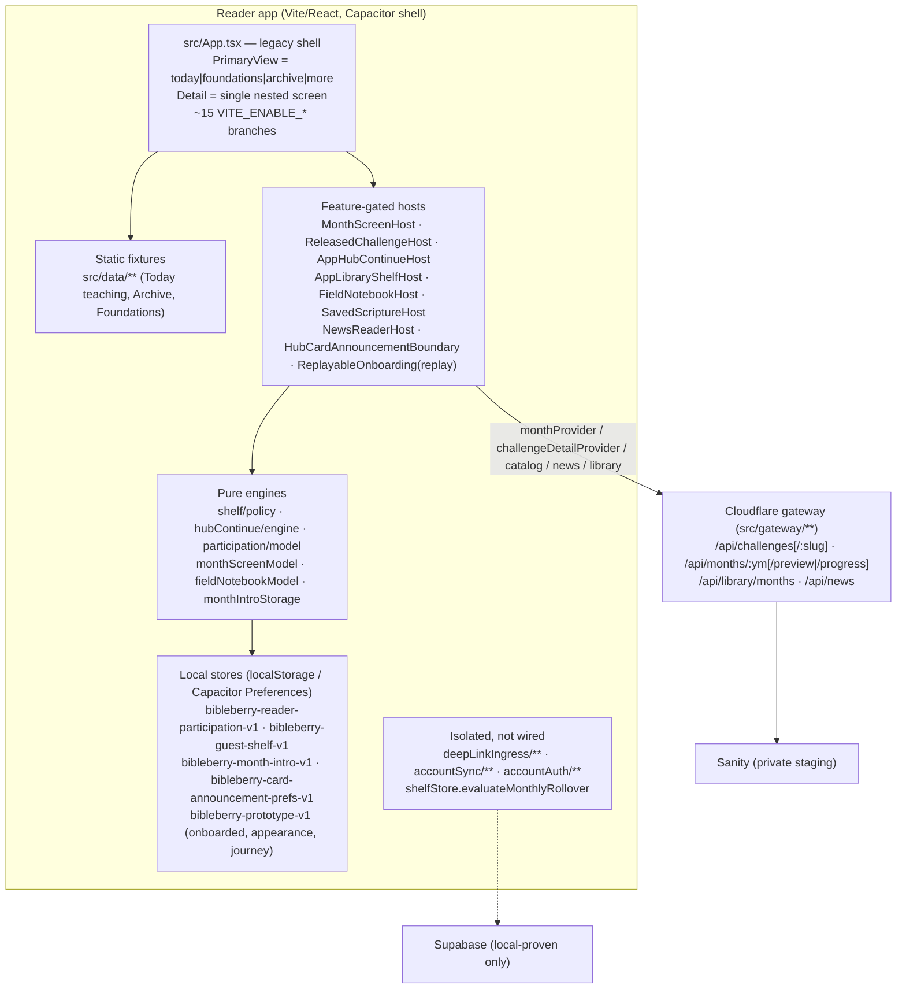
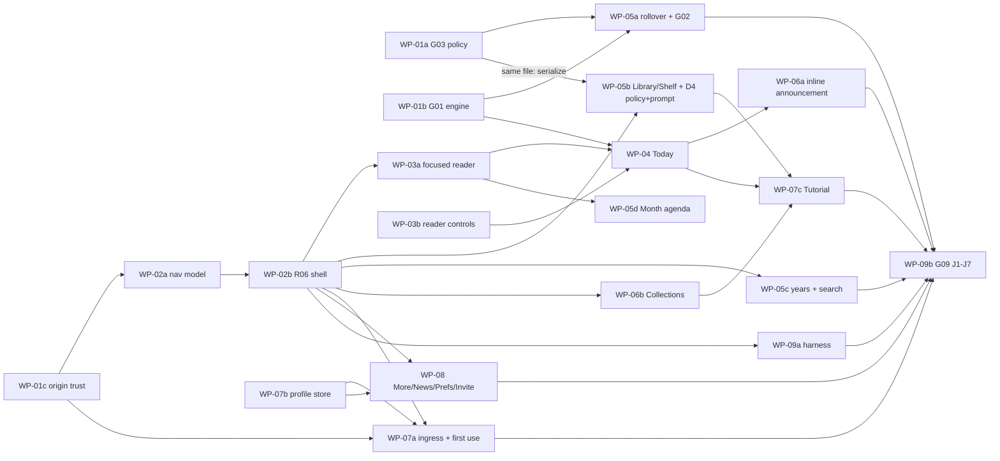

# Bibleberry — R06 Production Implementation Audit & Integration Blueprint (Ivory Sextant)

> **Assignment:** [Ivory Sextant — Issue #266](https://github.com/Bibleberry/Bibleberry/issues/266) · **Type:** documentation-only architecture audit and proposed work breakdown.
> **Governs nothing by itself.** Reader behavior is governed by the [consolidated R06 specification](../product/2026-11-08-approved-reader-experience-and-month-screen.md) (Paper Compass [PR #264](https://github.com/Bibleberry/Bibleberry/pull/264)); sequencing by the [six-phase roadmap](../product/application-development-roadmap.md); implementation claims by code and tests. This report proposes architecture and packages. It **does not** authorize implementation, create Issues, change owner decisions, or declare any internal-alpha gate PASS.
> **Revision 2 (Independent Review [#268]):[#268](https://github.com/Bibleberry/Bibleberry/pull/268#pullrequestreview-6007752873)):** (1) D4 moved out of the first package into WP-05b as one atomic policy + UI + host change; R06-E1 is now G03 + G01 only, with explicit legacy-compatibility constraints. (2) AD-2 corrected: the installed root `<BrowserRouter>` (`react-router ^7.6.1`) is acknowledged, retained unchanged, and compared on real trade-offs. (3) §12.1 #4: no external Month-link return contract is proposed; external Month links stay unactivated and out of first-alpha scope until owner decision.
> **Baseline:** `main` @ `979b3e5a14b01744d2088577696a781bad11caf2` (Glass Atlas [PR #267](https://github.com/Bibleberry/Bibleberry/pull/267) merge, committed 2026-11-21T13:21:08-05:00). Audit performed 2026-11-21 ~18:35–19:30 UTC. Open PRs at audit time: **none**.

---

## 1. Executive summary

### 1.1 Firm recommendation

**Build R06 as a new, feature-gated composition root (`R06ReaderShell`) that reuses every existing engine, store, gateway provider and screen host, and keep the legacy `src/App.tsx` path frozen behind the flag until R06 acceptance.** Navigation is owned by a **single pure navigation reducer** (per-tab stacks, per-route scroll, focused-reader state, entry provenance) that projects to the **existing hash routes**. Return origin is trusted **only from in-session state**, never from URL query parameters. Keep the already-installed root `<BrowserRouter>` (`react-router ^7.6.1`, `src/main.tsx`) exactly as it is — no application code uses router APIs today — and do **not** make it the R06 route owner in this series (trade-offs in AD-2). Do **not** rewrite engines, and do **not** keep growing the 2,142-line `App.tsx` in place.

Why this, in one paragraph: `App.tsx` is a single component that mixes the legacy `Today | Foundations | Archive | More` IA, static fixture teaching (`novemberTeaching`, `archiveFixtures`, `foundations`), Developer Studio simulation, pilots, and ~15 hand-written feature-gated route branches that are each duplicated three times (initial parse, `popstate`/`hashchange` sync, and `finishOnboarding` replay). R06's Today must be CMS/gateway-backed, its tabs must hold nested stacks, and its reader must render outside the global chrome — none of which fits the current `view` + single `detail` model without touching nearly every branch. A parallel composition root lets the hosts (`MonthScreenHost`, `ReleasedChallengeHost`, `AppLibraryShelfHost`, `FieldNotebookHost`, `SavedScriptureHost`, `NewsReaderHost`, `AppHubContinueHost`, `ReplayableOnboarding`) be mounted unchanged, gives one owner for global routing, and keeps a clean rollback (flag off = today's app).

### 1.2 What the audit found (headline)

| Class | Finding |
|---|---|
| **Confirmed defects vs approved spec (runtime-reproduced)** | **D1 G03:** `applyMonthlyRollover` evicts an auto-admitted **Active Focus** month and leaves `activeFocusMonth` pointing off-Shelf. **D2 G01:** Hub Continue guesses "next unfinished" Challenge when the focus has no saved position (should open the focus Month Screen) and, for a completed focus, recommends a **different** Shelf month (should be *Review This Month*). **D3 G04-A:** both `parseInternalDestination` and `parseExternalDeepLink` turn a caller-supplied `?origin=…` into the return origin on a cold load with no session state. **D4 §6.2:** `putAwayShelfMonth` silently retains an off-Shelf Active Focus (no reassign/no-focus choice). |
| **Confirmed conflicts (source inspection)** | Legacy four tabs; global nav still rendered during Challenge reading; first-run onboarding gates external links (violates G04-B); legacy first-run onboarding is a separate copy of the 3-screen Intro that routes to `Foundations`; Hub Card announcement is an `aria-modal` dialog (spec: inline, never blocking); `New Discoveries` clearing is in-memory React state only; Shelf order is insertion order (spec: focus first, then newest); Month calendar is a 7-column grid on wide viewports; per-month scroll is reset (`scrollTop()`) on return; Shelf exposes `Remove Protection` (an explicitly undecided §12.2 interaction). |
| **Isolated (built and tested, never invoked by the app)** | Monthly rollover (`evaluateMonthlyRollover` is called only by tests); external deep-link ingress controller (`src/deepLinkIngress/**` has no app importer); account sync/auth (`src/accountSync/**`, `src/accountAuth/**` not wired to UI). |
| **Reusable and sound** | Participation store (Finish-only, idempotent, `earnedOn`, separate `hubAnnouncementAcked`/`cardViewed`), gateway release/preview (incl. 28th / Feb 27 rule), Month Screen host + intro storage (G05-compatible), Shelf reducer API, Library catalogue host, Field Notebook projection, Saved Scripture, News reader, Card viewer/share, `ReplayableOnboarding` (has a `first-use` mode). |
| **Genuinely new** | Navigation reducer/shell, Today primary-action adapter, Guided App Tutorial, reader-profile store (onboarding/tutorial flags, invite dismissal, appearance mode), View Discoveries gallery, Library year/search surface (needs a search contract), G02 rollover-visit record, G07 earned-collection projection (deferrable — see §6.6). |

### 1.3 Recommended first production Issue

**"R06-E1 — Engine conformance: G03 rollover focus protection and G01 Hub Continue fallback"** (pure `src/shelf/**`, `src/hubContinue/**`, `src/components/hubContinue/**`, `src/appIntegration/AppHubContinueHost.tsx` + tests). It fixes two runtime-confirmed defects (D1, D2), touches no global route or `App.tsx` (it keeps the `HubContinueSuggestion` type `App.tsx` consumes), and does **not** need Glass Atlas acceptance. D4 (Put Away focus) is deliberately **not** in E1: it changes a contract the current Shelf host calls, so it ships atomically with its prompt in WP-05b. Outline in §7.4. In parallel, **WP-02a (navigation model, pure)** can start.

### 1.4 Glass Atlas status (assignment drift)

The Issue describes Glass Atlas as in progress. It **merged** into `main` at `979b3e5` ~1h before this audit (`docs/prototypes/r06-connected-experience/**`, 0 production files). [Issue #265](https://github.com/Bibleberry/Bibleberry/issues/265) is still **open**, and its stated "Aaron Waid's final merge **and hands-on product/editorial acceptance**" has a merge but **no recorded acceptance**. This report therefore treats Glass Atlas as **merged reference, acceptance pending**, and marks every package that depends on its presentation decisions accordingly (§7, column "GA").

---

## 2. Baseline verification and integration inventory

### 2.1 Baseline record

| Item | Value |
|---|---|
| `main` SHA | `979b3e5a14b01744d2088577696a781bad11caf2` |
| Paper Compass on `main` | Yes — `8504a90` (#264) |
| Glass Atlas on `main` | Yes — `979b3e5` (#267); #265 open, acceptance not recorded |
| Open PRs | None |
| Relevant open Issues | #22 (R06 ledger), #260 (alpha scope), #265 (Glass Atlas), #266 (this), #37 (low-end Android) |
| Stale docs noticed (not edited) | [`current-status.md`](current-status.md) latest dated section is Nov 19; [`internal-alpha-readiness.md`](internal-alpha-readiness.md) cites code snapshot `21ea10d` |

### 2.2 Tests actually executed (this audit, sandbox container, Node v22.23.5, Chromium 1243)

`npm ci --ignore-scripts` from the lockfile (no tracked files changed). No source or test edits. Browser suites run through **scratchpad wrapper configs** that only set `executablePath` to the pre-installed Chromium (the repo pins a newer Playwright build); test files were unchanged.

| Command / suite | Result | Notes |
|---|---|---|
| `npm run build` (tsc -b + vite) | **PASS** | chunk-size warning only |
| `npm run lint` | **PASS** | |
| `node --test tests/{shelf,hubContinue,shelfPersistence,participation,deepLinkIngress,appIntegration,onboardingReplay,gateway,libraryShelf,accountSync,sanity}/*.test.ts` | **PASS** 40/18/22/20/15/2/5/112/7/32(of 34)/276 | accountSync: 2 not reported as pass/fail (local-service-dependent cases); not investigated |
| Playwright `tests/hubContinue` (chromium) | **11 passed** | |
| Playwright `libraryShelf` / `shelfUI` / `news` / `notebook` / `onboardingReplay` / `announcements` / `appIntegration` / `savedScripture` / `cardViewer` | **16 / 5 / 8 / 2 / 6 / 3 / 20 / 3 / 2 passed** | |
| Playwright `tests/monthAccessibility` | **NOT RUN** (2 errors `ERR_CONNECTION_REFUSED`) | requires an externally started flagged preview server on :4173; not a product failure |
| Glass Atlas `tests/smoke.mjs` (copy with `executablePath`) | **12/12 PASS** | prototype-only evidence |
| Scratchpad probes against `main` source (not committed) | **D1, D2, D3, D4 reproduced** | output in §5.2 |

Everything else in this report is **source inspection**, labelled as such. Nothing here is hosted, staging, or device evidence.

### 2.3 System / context diagram (current `main`)



### 2.4 Source-level inventory (what R06 builds on)

| Area | Files / exports | Gate | Persistence | Status |
|---|---|---|---|---|
| Shell & routes | `src/App.tsx` (`PrimaryView`, `Detail`, `parseInitialRoute`, `navigate`, `open*/exit*` handlers, `AppShell`, `Onboarding`); `src/appIntegration/appRoutes.ts` (`#/notebook`, `#/saved-scripture`, `#/library`, `#/shelf`, `#/news`); `src/native/internalDestination.ts` (`#/month/:ym`, `#/challenge/:slug?origin=…`); `src/cms/reader/challengeOrigin.ts` | per-route flags | `history.state` (`originView`, `challengeOrigin`, `monthReturnTo`, `hubContinueDocumentId`) + `bibleberry-prototype-v1` | legacy IA; **conflicting** |
| Hub Continue | `src/hubContinue/engine.ts` `deriveHubContinueSuggestion`; `src/appIntegration/hubContinueInput.ts` `createHubContinueAppInput`; `AppHubContinueHost`, `HubContinueChallengeHost`; `src/components/hubContinue/**` | `VITE_ENABLE_HUB_CONTINUE` (+ challenge/month) | reads shelf + participation | integrated behind flag; **G01 defect, G02 absent** |
| Shelf | `src/shelf/policy.ts` (`selectShelfMonth`, `putAwayShelfMonth`, `setShelfMonthProtection`, `setActiveFocusMonth`, `applyMonthlyRollover`, `findOldestAutoAdmittedMonth`, `reconcileShelfWithAccountPrecedence`); `src/shelfPersistence/**` (`createGuestShelfStore`, FIFO queue, rollover watermark); `src/components/shelf/**` (`ShelfHost`, `ShelfView`, `ShelfCard`, `ShelfReplaceDialog`, `shelfModel`) | `VITE_ENABLE_HISTORICAL_LIBRARY` | `bibleberry-guest-shelf-v1` | partial; **G03 defect; rollover isolated** |
| Library catalogue | `src/components/library/**` (`HistoricalLibraryHost/View/Card`, `historicalLibraryModel`); `src/components/libraryShelf/**`; `src/cms/reader/libraryMonthIndexProvider.ts`; gateway `/api/library/months` (`limit`, `cursor` only) | same | none | partial (paginated flat list; no years, no search) |
| Month Screen | `src/components/month/**` (`MonthScreenHost`, `MonthScreenView`, `MonthIntroductionView`, `monthIntroStorage.resolveMonthIntroDecision`, `monthScreenModel`); `src/cms/reader/monthProvider.ts`; gateway `monthlyProjection.ts`, `localRelease.computeAdvancePreviewStartDate` | `VITE_ENABLE_MONTH_SCREEN` | `bibleberry-month-intro-v1` | integrated behind flag; partial (layout, scroll) |
| Challenge reader | `src/cms/reader/ReleasedChallengeHost.tsx`; `src/participation/PersistedChallengeHost.tsx`; `src/components/challenge/ChallengePlayer.tsx` | `VITE_ENABLE_RELEASED_CHALLENGE_ROUTE` / month | participation `saveChallengeProgress`, `completeChallenge` | integrated behind flag; partial (controls, nav hiding) |
| Participation & awards | `src/participation/**` (`types.ts` `EarnedAwardRecord{kind:'thematic'|'fullMonth', earnedOn, hubAnnouncementAcked, cardViewed}`, `model.ts`, `store.ts`, `awards.ts`); `src/cms/reader/monthAwardReconciliation.ts` | — | `bibleberry-reader-participation-v1` (schema v2) | sound; monthly awards only |
| Announcements | `src/components/announcements/**` (`useHubCardAnnouncements`, `hubCardAnnouncementModel`, `HubCardAnnouncementDialog`, preferences store) | `VITE_ENABLE_HUB_CARD_ANNOUNCEMENTS` (defaults on with Notebook) | `bibleberry-card-announcement-prefs-v1` | **conflicting** presentation (modal) |
| Collections | `src/components/notebook/**`, `src/components/cards/**`, `src/components/cardSharing/**`, `src/components/savedScripture/**`, `ProvisionalCollectionsEntryBar` | `VITE_ENABLE_FIELD_NOTEBOOK`, `VITE_ENABLE_SAVED_SCRIPTURE` | participation | partial (monthly only; no Collections landing) |
| Onboarding | `App.tsx` `Onboarding` (first run); `src/components/onboardingReplay/ReplayableOnboarding.tsx` (`mode: 'first-use' | 'replay'`) | — | `bibleberry-prototype-v1.onboarded` | partial; tutorial absent |
| External ingress | `src/deepLinkIngress/**` (`parseExternalDeepLink`, `authorizeExternalDeepLink`, `createDeepLinkIngressController`) | — | none | **isolated**; D3 |
| News / More | `src/components/news/**`, `ProvisionalNewsEntryBar`; `App.tsx` `MoreView`, `AppearanceView`, `JourneyView` | `VITE_ENABLE_NEWS_READER` | `bibleberry-prototype-v1` | partial |
| Accounts | `src/accountSync/**` (`coordinateGuestSync`, reconcile), `src/accountAuth/**`, `src/accountVerification/**` | — | Supabase (local) | isolated; outside guest alpha |

---

## 3. Architectural decision register

Each decision: **Recommended / Alternatives / Rationale / Costs & risks / Affected seams / Verification / What would change it.**

### AD-1 App composition — parallel R06 composition root behind one flag

- **Recommended.** Add `src/readerShell/**` with `R06ReaderShell` (chrome: bottom bar < breakpoint, rail ≥ breakpoint, exact order `Today | Library | Collections | More`) and per-tab landing components. `src/main.tsx`/`App.tsx` gain exactly one branch: `VITE_ENABLE_R06_SHELL === 'true'` → `<R06ReaderShell/>`, else legacy `<App/>`. The R06 shell **requires** the existing host flags' capabilities as fixed configuration (released Challenge, Month, Hub Continue, Library, Notebook, Saved Scripture, News) rather than re-checking ~15 flags per branch.
- **Alternatives.** (a) Mutate `App.tsx` in place: every route branch exists in three copies and all handlers read the single `detail`; tab stacks, reader-outside-chrome, and the Today data source change would touch most of the file and collide with every concurrent package. (b) Full rewrite of hosts into a new app: discards tested hosts — rejected.
- **Rationale.** Maximum reuse (all hosts mount unchanged via props), one integration seam, trivial rollback, legacy keeps passing its existing suites.
- **Costs / risks.** Two shells co-exist temporarily; risk of fixes landing only in the legacy path. Mitigation: freeze legacy `App.tsx` to bug-fix-only once WP-02b lands; delete it in a later owner-approved retirement PR after A1 evidence.
- **Seams.** Host props already in use (`onOpenChallenge`, `onExit`, `exitLabel`, `onOpenMonth`, `onReturn`, `onNotebookOpened`, `onCategoryChange`).
- **Verification.** Legacy suites stay green with flag off; new connected suite (WP-09) runs with flag on; build both ways.
- **Would change it:** if Aaron prefers to retire the legacy shell immediately (then WP-02b edits `App.tsx` directly but still uses the reducer from AD-2).

### AD-2 Route and state ownership — pure navigation reducer; URL is a projection; origin is session-trusted

- **Recommended.** One reducer `navigationReducer(state, action)` in `src/readerShell/navigation/` owning:
  - `activeTab: 'today' | 'library' | 'collections' | 'more'`
  - `stacks: Record<Tab, RouteEntry[]>` (nested screens per tab; landing = empty stack)
  - `scroll: Record<RouteKey, number>` (per-tab landing, per-`month:YYYY-MM`, per gallery/search)
  - `focused: { kind:'challenge', slug, origin: ChallengeOrigin, entry: 'internal'|'external', expectedDocumentId? } | { kind:'intro'|'tutorial'|'monthIntro' } | null`
  - Actions: `selectTab` (same tab → reset to landing + top), `push`, `pop`, `openChallenge`, `exitChallenge`, `externalEntry`, `restoreFromHash`.
  - Projection: a `hashCodec` that serializes the top route to existing hashes (`#/month/:ym`, `#/challenge/:slug`, `#/library`, `#/shelf`, `#/notebook`, `#/saved-scripture`, `#/news`) and parses them back. In-session tab stacks + scroll are persisted to `sessionStorage` (survives reload within a session; a fresh launch starts at Today, per §2.3). Durable reader data stays in existing stores.
  - **Origin trust rule:** the reducer's `focused.origin` comes only from an in-session `openChallenge` action or a matching `history.state` written by the shell. A hash/URL `?origin=` is accepted for backward-compatible parsing but **never** used as a return target; a cold or external entry gets `entry:'external'` → Exit/Finish returns to **Today** (G04-A).
- **Current routing baseline (corrected).** `src/main.tsx` already renders `<StrictMode><BrowserRouter><App/></BrowserRouter></StrictMode>` and `package.json` already depends on `react-router ^7.6.1`. However, `main.tsx` is the **only** file in `src/` that imports `react-router`: there are no `<Routes>`, route objects, `useNavigate`/`useLocation`, or links. All navigation today is hand-written: hash parsing (`parseInternalDestination`, `parseAppIntegrationRoute`), `window.history.pushState/replaceState` with typed `history.state`, and `popstate`/`hashchange` listeners in `App.tsx`. The router is therefore an installed but **inert** root wrapper; because the app mutates history directly, the router's internal location is not authoritative for anything.
- **Retaining the wrapper.** WP-02b renders `R06ReaderShell` **inside the existing `<BrowserRouter>` unchanged**, and the shell uses no router APIs. History has exactly one owner — the shell's reducer — and no second router is introduced. Rule for the series: no package adds router hooks or `<Routes>` while the reducer owns navigation, because the router would observe a stale location after direct `pushState` calls. Whether to remove the unused wrapper, or later adopt the router, is a separate owner-approved cleanup (WP-11), not part of R06 integration.
- **Alternatives.** (a) **Adopt the installed `react-router` as the route owner.** Advantages: no new dependency, mature history handling, declarative route table, data-router loaders. Real costs: (i) it does not provide per-tab nested stacks, per-tab scroll memory or active-tab-retap reset, so the reducer's core state would still have to be written, as a layer over router state; (ii) the installed `BrowserRouter` is path-based, while every existing deep link, host test and `history.state` origin protocol is hash-based (`#/month/:ym`, `#/challenge/:slug`, `#/notebook` …), so adoption means either converting the root to a hash router (changing the root wrapper and all route parsing) or migrating to path URLs (which then depend on SPA fallback on Cloudflare static hosting and on the Capacitor WebView origin — **not verified** in this audit); (iii) the legacy shell's feature-gated parsers and ~20 `appIntegration` browser cases would need porting or would co-exist with a second routing model. Not chosen for the R06 series because it widens migration scope without removing the reducer. It remains a legitimate option for WP-11 once A1 evidence exists. (b) **A different router library** (e.g. TanStack Router): the same costs plus a new dependency next to the installed one — rejected. (c) Keep `view` + `detail` and add arrays — perpetuates the triple-copy branching and implicit origin inference from `detail` (e.g. `openMonthScreen` infers `returnTo` from whatever `detail` is current).
- **Rationale.** Tab restoration, active-tab reset, origin-aware return and external-entry rules become pure, unit-testable transitions; browser Back maps to `pop`; no false inference from URL metadata.
- **Costs / risks.** Browser history and reducer can drift (Back/Forward). Mitigation: shell writes a monotonically increasing `navId` into `history.state` and treats `popstate` as `restoreFromHash` + stack truncation; covered by WP-09 Back/Forward tests. Native Android hardware Back needs mapping to `pop` (Capacitor `backButton`), in scope of WP-03a but verified on device only later (A8 beta gate).
- **Seams.** `src/native/internalDestination.ts` (reuse `buildInternalDestination`/`parseInternalDestination` minus origin trust), `src/appIntegration/appRoutes.ts` (reuse), `src/main.tsx` root `<BrowserRouter>` (retained unchanged; single-line flag switch is the only `main.tsx`/`App.tsx` edit).
- **Verification.** Reducer unit tests for every §2.3 row; Playwright: tab switch restores nested screen+scroll, retap resets, reload restores, fresh launch → Today, Back never re-shows announcements outside Today.
- **Would change it:** a product decision requiring shareable URLs for every nested state (e.g. Notebook gallery filters), a native navigation stack requirement from R20 packaging, or an owner decision to standardize on the installed `react-router` (then the reducer becomes a per-tab stack layer over router state, and the hash codec becomes the router's route table).

### AD-3 Existing engines remain authoritative — minimal, targeted changes only

| Engine | Keep | Minimal change |
|---|---|---|
| `shelf/policy.ts` | All reducers and invariants | **WP-01a:** `findOldestAutoAdmittedMonth(months, { activeFocusMonth })` exclusion (G03) — no caller-visible API change. **WP-05b only (atomic with its UI):** focus decision when putting away or replacing the focus month (§5.2 D4) — never landed policy-first, because current `ShelfHost.handlePutAway`/`handleSelectMonth` callers supply no focus choice |
| `hubContinue/engine.ts` | Input validation, catalog authorization, slot normalization | Result kinds become `resumeChallenge` / `openFocusMonth` / `reviewFocusMonth` / `rolloverResume`; delete cross-month fallback; add G02 branch fed by a rollover-visit record |
| `shelfPersistence` | Store, queue, watermark | Called by a new rollover orchestrator (WP-05a); no API change |
| `participation` | Finish-only, idempotency, award flags | Add durable "notebook entered" watermark for `New Discoveries` (schema v3) in WP-06b only |
| `monthIntroStorage` | `resolveMonthIntroDecision` (already Month-Screen-anchored, preview never marks Welcome seen) | none |
| Gateway | Release, preview, progress | Optional library search parameter (WP-05c, needs owner/gateway decision) |
| `fieldNotebookModel` | Projection, `earnedOn` ordering | Hierarchy additions only; G07 deferred (§6.6) |
| `deepLinkIngress` | Parser/authorizer/controller | Drop origin trust (D3); wire into shell (WP-07a) |

**No shadow stores.** Today's News shortcut, Month-Screen card viewer, and Collections preview read the same providers/stores.

### AD-4 Today primary action — derive from the authorized current month, no new endpoint

- **Recommended.** `todayPrimaryAction(currentMonthDetail, participation)` (pure, `src/readerShell/today/`): find the slot whose `date === serverContext.authorizedLocalDate` and `availability === 'available'` → *Open* / *Continue* (resume) / *Completed + Read Again*; otherwise **Explore This Month** → current Month Screen. Source: existing `GET /api/months/:currentYearMonth` via `monthProvider`.
- **Alternatives.** New `/api/today` endpoint (adds gateway surface for no new data); reusing the static fixture `TeachingView` (not CMS, not release-authorized — must not be the R06 Today).
- **Risks.** Month detail unavailable before month publication or on gateway error → neutral unavailable state + Explore This Month (if preview exists) per G09 §10.1. *Read Again* needs a "start from beginning without resetting completion" entry flag on the reader (WP-03b).
- **Verification.** Unit tests for available/unfinished/in-progress/completed/unavailable/embargoed; Playwright Today journeys with synthetic gateway fixtures.

### AD-5 Focused reader renders outside the chrome

The shell renders `focused` routes (Challenge, App Introduction, Tutorial, Monthly Introduction) **instead of** the chrome, not inside it. Today on `main` the reader is a child of `AppShell`, so the bottom bar/rail are visible during reading (spec §5.1 conflict). Inert background + focus to reader heading on open; restore focus to the invoking control on return.

### AD-6 Announcements — reuse model/hook, replace modal presentation

Keep `useHubCardAnnouncements`/`hubCardAnnouncementModel` (batching, ack semantics, opt-out catch-up). Replace `HubCardAnnouncementDialog` (`role="dialog" aria-modal="true"`) with an inline Today component; add a **View Discoveries** route that renders only the batch's awards using existing Notebook card thumbnails/viewer. Hub-only placement is enforced structurally (only the Today landing mounts it) rather than by the current `isHubActive` prop on a global overlay.

### AD-7 External ingress — controller in front of the onboarding gate

Wire `createDeepLinkIngressController` at shell bootstrap **before** first-use evaluation. An authorized Challenge link dispatches `externalEntry` (focused reader, `entry:'external'`), leaves Intro/Tutorial flags `pending`, and Exit/Finish → Today. Unavailable → neutral state with **Return to Today**. Today on `main`, `if (!state.onboarded) return <Onboarding/>` runs first and the hash is replayed only after onboarding (G04-B conflict).

### AD-8 Reader profile store — one small new durable store

`src/readerProfile/**` (versioned envelope like participation, Capacitor Preferences driver): `introStatus`, `tutorialStatus` (`pending|completed|skipped`), `guestInviteDismissed`, `appearanceMode` (`followSeasons|chooseColors` + chosen palette id), `contrastMode`, `textScale`, reminder preference. One-time migration reads `bibleberry-prototype-v1` (`onboarded→introStatus`, `appearance`, `textSize`, `reminder*`). Guest invite eligibility is **derived** (≥3 distinct `completedChallenges`) — never stored as a counter.

### AD-9 Prototype-to-production handoff

- Glass Atlas is **presentation and interaction reference only**: layout, hierarchy, copy placeholders, control placement, focus/keyboard patterns, 200% reflow patterns.
- **Never port** `docs/prototypes/r06-connected-experience/js/state.js` logic, `fixtures.js` data, simulated release/embargo checks, simulated merge, or its `localStorage` key. Production rules come from the engines and gateway listed above; where the prototype's state machine *differs* from an engine, the spec decides and the engine is fixed with tests (e.g. G01/G03 engines are wrong today and the prototype is right).
- Prototype CSS tokens may inform the semantic token set, but palette values remain deferred (§12.2).
- **Safe before acceptance:** engines/policies (WP-01), navigation model (WP-02a), ingress wiring logic (WP-07a), reader-profile store (WP-07b), rollover orchestration (WP-05a), connected test harness scaffolding (WP-09a). **Needs acceptance:** tab landing compositions and visual chrome (WP-02b visuals), Today layout (WP-04), Library/Collections/More landings, inline announcement, Tutorial spotlight design (WP-07c).

### AD-10 Integration ownership

**One integration owner** (recommended: a single Codex assignment chain, "Shell Integrator") owns `src/main.tsx`, `src/App.tsx` (one-line switch only), `src/readerShell/**` (shell, reducer wiring, tab landings), shared shell CSS, and `tests/readerShell/**` connected harness. Other agents deliver **pure modules or self-contained hosts with a props contract** in their own directories; the integrator alone mounts them. No two open PRs may edit `src/readerShell/R06ReaderShell.tsx` or the route table simultaneously.

---

## 4. R06 requirement-to-source evidence / gap matrix

Status vocabulary: **Integrated** (reachable in some flagged build and matches spec) · **Feature-gated** · **Isolated** (built/tested, not invoked) · **Partial** · **Conflicting** · **Not implemented** · **Not verified**. Approach: Keep / Adapt / Wire / New. Risk S/M/L. "Evidence" cites existing tests or this audit's runs; it does not claim connected acceptance.

### 4.A Shell, routing, restoration (§2; G09 cross-cutting)

| Requirement | Current implementation | Status | Evidence | Delta | Approach | Dep | Risk | Proof |
|---|---|---|---|---|---|---|---|---|
| Four tabs, exact order, bottom bar/rail (§2.1) | `App.tsx` `navItems` = Today/Foundations/Archive/More; `AppShell` | Conflicting | source | New shell chrome | New (AD-1) | GA for visuals | M | tab order + `aria-current` + 320/375/1024 Playwright |
| Per-tab nested screen + scroll restore; retap resets (§2.3) | single `detail`; every handler calls `scrollTop()` | Not implemented | source | reducer stacks + scroll map | New (AD-2) | — | M | reducer units; Playwright switch/retap/reload |
| Fresh launch → Today | `parseInitialRoute` restores hash detail | Partial | source | fresh launch clears session stack | Adapt | — | S | cold-launch test |
| Nav hidden in Challenge reader (§5.1) | reader rendered inside `AppShell` | Conflicting | source | AD-5 | Adapt | — | S | Playwright: no `nav[aria-label="Primary navigation"]` during reading |
| Legacy deep links preserved without legacy nav | `#/teaching/:id`, `#/entry/:id`, `#/library`, `#/shelf`… | Partial | source | codec maps `#/shelf`/`#/library` → Library tab; `#/notebook`/`#/saved-scripture` → Collections; `#/news` → More; `#/teaching|entry` → Today landing (fixture content not in R06) | Adapt | — | S | codec table test |
| Browser/native Back never loses state or re-announces | `popstate` handler re-parses hash | Partial | `tests/hubContinue` Back/Forward case (11 passed) | `navId` + reducer pop; Android `backButton` | Adapt | — | M | Back/Forward Playwright; device later (A8) |

### 4.B Today Hub (§3; G01, G02)

| Requirement | Current implementation | Status | Evidence | Delta | Approach | Dep | Risk | Proof |
|---|---|---|---|---|---|---|---|---|
| Primary action opens today's authorized Challenge directly; resume | Today renders static fixture `latestEntryThrough(ordinaryEntries)` `TeachingView` | Conflicting | source | AD-4 adapter over current month detail | New (pure) + Wire | WP-03a | M | unit + Playwright with gateway fixture |
| Completed → Completed + Read Again (no reset) | none | Not implemented | — | reader "from beginning" flag | Adapt reader | WP-03b | S | completion/award counts unchanged after reread |
| Unavailable → neutral + Explore This Month | fixture empty state ("Choose another… from the Archive") | Conflicting | source | adapter branch | New | — | S | unavailable & embargo fixtures |
| Compact current Month link, no calendar on Today | `MonthScreenEntryBar` (provisional) | Partial | source | restyle/mount in Today landing | Wire | GA | S | presence test |
| G01 focus: saved position → resume directly | `deriveHubContinueSuggestion` `resumeInProgress` | Integrated (flag) | `tests/hubContinue` | keep | Keep | — | S | existing + new |
| G01 focus, nothing saved → focus Month Screen | engine returns `continueNextInFocus` (first unfinished Challenge) | **Conflicting (D2, reproduced)** | probe §5.2 | `openFocusMonth` kind | Adapt | — | S | unit: fresh focus → month kind |
| G01 completed focus → Review This Month | engine returns `continueOtherHistoricalMonth` (another Shelf month) | **Conflicting (D2, reproduced)** | probe §5.2 | `reviewFocusMonth`; delete fallback | Adapt | — | S | unit + UI copy |
| G02 one-time post-rollover interrupted prior-month continuation | `createFirstPostRolloverResumeSeam` returns `deferredExtensionPoint`; never called by app | Not implemented | source | rollover-visit record + engine branch subordinate to focus | New | WP-05a; §12.2 tie-break | M | units: shown once, never with focus, never two cards |
| Legacy Resume card replaced | `ResumeCard` legacy fallback | Conflicting (R06) | source | not mounted in R06 | Keep legacy only | — | S | absence test |
| Hub-only combined inline announcement, View Discoveries | `HubCardAnnouncementDialog` modal; "Open in Field Notebook" | Conflicting | `tests/announcements` (3 passed, modal behavior) | AD-6 | Adapt | GA | M | inline, non-modal, batch gallery, ack ≠ viewed |
| Guest invite after 3 distinct Finishes; permanent dismissal; never with pending announcement | none | Not implemented | — | derived eligibility + profile flag | New | WP-07b | S | units + Playwright |
| Restrained News shortcut | `ProvisionalNewsEntryBar` | Partial | `tests/news` | mount in Today landing | Wire | GA | S | presence + same feed |

### 4.C Library, Shelf, rollover, historical progress (§6; G03)

| Requirement | Current implementation | Status | Evidence | Delta | Approach | Dep | Risk | Proof |
|---|---|---|---|---|---|---|---|---|
| Library landing = Shelf overview + Browse All Months + Foundations | `LibraryShelfHost` surfaces `shelf`/`library` toggled; Foundations is a separate legacy tab | Partial | `tests/libraryShelf` (16), `tests/shelfUI` (5) | landing composition | Wire + Adapt | GA | M | landing test 0–3 |
| 0–3 Shelf, never padded, current month excluded | `MAX_SHELF_CAPACITY`, `isHistoricalPublicationYearMonth` | Integrated (flag) | `tests/shelf` (40) | keep | Keep | — | S | existing |
| Focus first, then newest-first order | `buildShelfViewModel` keeps array order | Conflicting | source | presentation sort | Adapt | — | S | unit |
| Visible Set as Active Focus / Clear; Keep on Shelf → Kept on Shelf | `ShelfCard` "Set as Focus"/"Clear Focus", "Keep on Shelf"/"Remove Protection" | Partial | source | copy; hide unprotect pending decision | Adapt | owner Q1 | S | label tests |
| Put Away focus → explicit reassign or no focus; Cancel preserves | `putAwayShelfMonth` keeps focus; `ShelfView` shows "Active Study Focus … not on Shelf" | **Conflicting (D4, reproduced)** | probe §5.2 | policy param + prompt + host call sites, one PR | Adapt | WP-05b (after WP-01a) | M | unit + dialog Playwright + legacy Shelf suites |
| Full-Shelf 4th month chooser + confirm/Cancel | `selectShelfMonth` requires `replaceMonth`; `ShelfReplaceDialog` | Integrated (flag) | `tests/shelfUI` | mark focus/Kept in chooser; route focus prompt | Adapt | — | S | existing + focus case |
| Add to Shelf from Library **and** historical Month Screen | Library card only | Partial | source | Month Screen action using same store | Wire | — | S | both entrances same state |
| G03 rollover never evicts Active Focus | `findOldestAutoAdmittedMonth` ignores focus | **Conflicting (D1, reproduced)** | probe §5.2 | exclude `activeFocusMonth` | Adapt (1 function) | — | S | unit matrix incl. temporary nature |
| Rollover actually runs | `GuestShelfStore.evaluateMonthlyRollover` only in tests | Isolated | `tests/shelfPersistence` (22) | orchestrator on Today bootstrap using gateway `authorizedLocalDate` + watermark | Wire | — | M | idempotent across reloads |
| Browse All Months: expandable years, newest year open | flat paginated list (`historicalLibraryModel`) | Partial | `tests/library*` | group by year | Adapt | GA | M | unit + Playwright |
| Month/theme search, flat newest-first results | none; gateway `/api/library/months` has no query param | Not implemented | source | search contract (see WP-05c) | New | owner/gateway Q | M | negative: no embargoed months, no body text |
| Compact text rows (not cover tiles) | `HistoricalLibraryCard` illustrated card | Conflicting | source | row variant | Adapt | GA | S | visual review |
| Credit without Shelf membership | origin-independent `completeChallenge` | Integrated | `tests/participation` | keep | Keep | — | S | connected J5 |
| Foundations overview, Resume vs Begin | legacy static `FoundationsView`; no resume persistence | Partial | source | overview inside Library; resume persistence (§12.2) | Adapt + New | owner (content source) | M | no fabricated resume |

### 4.D Month Screen, reader, release boundaries (§4, §5; G05)

| Requirement | Current implementation | Status | Evidence | Delta | Approach | Dep | Risk | Proof |
|---|---|---|---|---|---|---|---|---|
| Continuous weekly agenda panels with full titles (not 7-col grid) | `month-week__grid` 7 columns ≥ breakpoint; 1 column on narrow | Partial | source | agenda rows at all widths | Adapt CSS/markup | GA | S | 1024px + 200% test |
| Titles visible; Coming Soon leaks nothing | `MonthScreenView` non-interactive Coming Soon | Integrated (flag) | gateway tests (112) | keep | Keep | — | S | existing negatives |
| Current week positioning; historical starts at top | none | Not implemented | source | initial scroll in host via shell scroll map | Adapt | WP-02 | S | Playwright |
| Return from Challenge restores per-month scroll | `exitReleasedChallenge` → `scrollTop()` | Conflicting | source | shell `scroll['month:YYYY-MM']` | Adapt | WP-02 | S | Playwright |
| Discoveries title+progress only; full-month last; earned opens Card | `MonthScreenView` discoveries; `EarnedScriptureCardViewer` | Integrated (flag) | `tests/cardViewer` (2) | keep | Keep | — | S | existing |
| G05 intro on first intentional Month visit; never before direct Challenge | `resolveMonthIntroDecision` on Month Screen mount only | Integrated (flag) | source + intro storage tests | keep; ensure Today primary/ingress never mount Month Screen | Keep | — | S | J1/J2/J3 |
| Preview 28th / Feb 27, withhold Welcome/manuscripts/discoveries | `computeAdvancePreviewStartDate`, preview projection | Integrated | gateway tests | keep | Keep | — | S | Feb 27 (28/29-day) cases |
| Reader: Exit, `Screen n of N`, subtle bar | `ChallengePlayer` exit button + `n of N` + segmented bar | Partial | source | copy "Screen n of N" | Adapt | — | S | a11y snapshot |
| Previous / Next + optional swipe; never auto-finish | "Back"/"Continue"; no swipe | Partial | source | labels; optional swipe guarded | Adapt | GA | S | swipe never finishes |
| Autosave on every move; auto-resume | `saveChallengeProgress` in `PersistedChallengeHost` | Integrated (flag) | `tests/participation` | keep | Keep | — | S | reload mid-Challenge |
| Start from Beginning (position only) | none | Not implemented | source | reset resume record only | New (small) | — | S | completions/cards unchanged |
| Explicit Finish only, idempotent | `completeChallenge` | Integrated | `tests/participation` | keep | Keep | — | S | double-tap Finish |
| Origin-aware Exit/Finish (Today/Month/Shelf/Library) | `exitReleasedChallenge` with `monthReturnTo` inference | Partial | `tests/appIntegration` (20) | move to reducer | Adapt | WP-02 | M | per-origin Playwright |
| External Exit/Finish → Today; never trust URL origin | URL `?origin` trusted on cold load | **Conflicting (D3, reproduced)** | probe §5.2 | AD-2 trust rule | Adapt | — | S | cold external link with `origin=month` returns Today |
| Invalid/withdrawn/embargoed links fail closed | `authorizeExternalDeepLink`, `createUnavailableContentOutcome`; reader host errors | Isolated (ingress) / Integrated (host) | `tests/deepLinkIngress` (15) | wire ingress | Wire | WP-07a | S | neutral copy, Return to Today |

### 4.E Collections and earning semantics (§7; G07)

| Requirement | Current implementation | Status | Evidence | Delta | Approach | Dep | Risk | Proof |
|---|---|---|---|---|---|---|---|---|
| Collections landing: earned preview + Field Notebook + Saved Scripture | `ProvisionalCollectionsEntryBar` | Partial | `tests/appIntegration` | landing | New (thin) | GA | S | empty/earned states |
| Lifetime status (distinct Finishes) at top | `buildNotebookLifetimeDisplay` | Integrated (flag) | `tests/notebook` (2) | placement; copy deferred | Keep | — | S | count = distinct |
| Search Your Cards (earned only) illustrated rows | `searchQuery`/theme filter in `FieldNotebookView` | Partial | source | row presentation | Adapt | GA | S | unearned never matched |
| Year → month galleries; All Earned Cards by `earnedOn` desc | `NotebookBrowseMode 'yearMonth'|'allCards'` | Integrated (flag) | `tests/notebook` | grid presentation | Keep/Adapt | GA | S | ordering tie-break |
| Foundations & Learning / Special Experiences (earned-only, conditional) | `MonthlyAwardKind = 'thematic'|'fullMonth'` only | Not implemented | source | see §6.6 | New (deferred) | §12.1 #1, #6 | M | hidden when zero earned |
| `New Discoveries` clears on Notebook entry (durable) | `clearedAwardIds` `useState` in `App.tsx` | Conflicting (not durable) | source | durable watermark | Adapt (participation v3) | — | S | reload keeps cleared |
| Per-Card `New` clears only on full view | `markEarnedCardViewed` | Integrated | participation tests | keep | Keep | — | S | thumbnail never clears |
| Full single-scroll Card; Share only in full view; export-time mark | `EarnedScriptureCardViewer`, `EarnedCardShareControl` (exports with "attribution") | Partial / Not verified | `tests/cardViewer` | verify watermark vs §7.3 (wording/placement deferred) | Adapt | §12.2 | S | export image check |
| Missing art honest fallback | viewer handles absent snapshot | Not verified | source | test | Keep | — | S | broken URL fixture |
| Saved Scripture recent-first, book browse, search | `savedScriptureCollectionModel` | Integrated (flag) | `tests/savedScripture` (3) | keep | Keep | — | S | existing |
| CMS card existence ≠ earning | awards created only from gateway progress (`persistGatewayMonthProgressAwards`) | Integrated | source + gateway tests | keep as invariant for G07 | Keep | — | S | negative test |
| Tutorial awards nothing | no tutorial exists | Not implemented | — | assert in WP-07c | New | — | S | 0 awards after tutorial |

### 4.F First use, App Tutorial, external ingress (§8.4; G04-B, G06)

| Requirement | Current implementation | Status | Evidence | Delta | Approach | Dep | Risk | Proof |
|---|---|---|---|---|---|---|---|---|
| App Introduction (3 screens) at ordinary first use | legacy `Onboarding` in `App.tsx` (step 3 routes to Foundations; copy names Archive) | Conflicting | source | use `ReplayableOnboarding mode="first-use"` | Wire | — | S | Intro → Tutorial → Today |
| Guided App Tutorial (skippable, nonvisual equivalent, no dead ends, shipped controls only) | none | Not implemented | — | new component + anchors registry | New | GA acceptance | M | a11y + resize + skip |
| Independent Intro/Tutorial flags; replay from More returns to More | `onboarded: boolean` | Partial | `tests/onboardingReplay` (6) | profile flags | New store | WP-07b | S | flags independent |
| External Challenge before onboarding; onboarding stays pending | onboarding gate first | Conflicting | source | AD-7 | Wire | WP-07a | M | J2 |
| Cold/warm launch parity | controller supports both; not wired | Isolated | `tests/deepLinkIngress` | wire `lifecycleAdapter` | Wire | — | M | warm-launch test; device later |
| Re-offer of deferred onboarding | — | Open (§12.1 #2) | — | owner decision | — | owner | S | — |

### 4.G More, News, preferences, accounts (§8, §9.3; G08)

| Requirement | Current implementation | Status | Evidence | Delta | Approach | Dep | Risk | Proof |
|---|---|---|---|---|---|---|---|---|
| More: featured latest update + approved links list | `MoreView` (Journey, Reminder, Scripture, Privacy…) | Conflicting | source | new landing; Journey retired from R06 | New (thin) | GA | S | link set |
| View All News newest-first + categories + error/retry | `NewsReaderView` | Integrated (flag) | `tests/news` (8) | featured direct-open article route | Adapt | — | S | existing + featured |
| Follow Bibleberry Seasons (default) vs Choose My Colors | `appearance: light|dark|system` | Not implemented | source | mode model now; palette values deferred | New | §12.2 palettes | S | manual choice survives season change |
| Review Introduction / App Tutorial replay | Intro replay only | Partial | `tests/onboardingReplay` | tutorial | Wire | WP-07c | S | return to More |
| Account & Progress always reachable | none | Not implemented | — | entry with guest disclosure (guest alpha) | New (thin) | — | S | presence |
| Guest device-local disclosure | Privacy copy in `InformationView` | Partial | source | R06 wording | Adapt | — | S | copy review |
| G08 verified-merge confirmation; Shelf precedence | `coordinateGuestSync`, `reconcileShelfWithAccountPrecedence` | Isolated (local-proven) | `tests/accountSync` (32), PR #249 | UI after hosted auth | New (post-alpha) | A6/A7 | L | hosted gate |

### 4.H Shared nonfunctional contracts (§10.1, §10.3)

| Contract | Current | Status | Proof needed on the connected candidate |
|---|---|---|---|
| 320/375, 200% text, keyboard, SR, reduced motion | per-host Playwright (e.g. hubContinue keyboard/320/375/200%) | Partial (isolated per host) | WP-09 matrix on R06 shell |
| Truthful empty/loading/error | per host | Partial | G09 §10.1 rows per tab |
| Portrait-first, centered tablet landscape | `App.css` rail at ≥ breakpoint | Partial | 768×1024, 1024×768 |
| Release/embargo zero leakage | gateway projections + tests | Integrated (unit) | live staging A3 |
| Unchanged data on failure; no duplicate awards | stores' FIFO/idempotency | Integrated (unit) | connected failure injection |

---

## 5. Minimal-change / reuse plan and confirmed conflict inventory

### 5.1 Do not rewrite

`src/participation/**`, `src/gateway/**`, `src/cms/reader/*Provider.ts`, `ReleasedChallengeHost`/`PersistedChallengeHost`, `MonthScreenHost`/`MonthIntroductionView`/`monthIntroStorage`, `src/shelf/**` (except the two functions named), `src/shelfPersistence/**`, `src/components/library/**` data model, `fieldNotebookModel`, `savedScriptureCollectionModel`, `EarnedScriptureCardViewer`, `EarnedCardShareControl`, `NewsReaderHost`, `ReplayableOnboarding`, `src/deepLinkIngress/**` (except origin handling), `src/accountSync/**`. Legacy `App.tsx` stays as-is behind the flag.

### 5.2 Confirmed defects (runtime-reproduced on `979b3e5`)

Probe scripts lived in the session scratchpad and imported `main` source directly; output:

```
G03 disposition: replacedOldestAutoAdmitted evicted: 2026-08 focusAfter: 2026-08 focusStillOnShelf: false
PutAway focus: 2026-08 onShelf: false
G01 fresh focus: suggestion nextUnfinishedInActiveFocus continueNextInFocus s-2026-10-1
G01 completed focus: suggestion nextEligibleMonthAfterCompletedFocus continueOtherHistoricalMonth suggestedMonth: 2026-10 formalFocus: 2026-09
internal: {"type":"releasedChallenge","slug":"october-14","origin":{"kind":"month","yearMonth":"2026-10"}}
external: {..."internalHash":"#/challenge/october-14?origin=shelf&yearMonth=2026-10","origin":{"kind":"shelf","yearMonth":"2026-10"}}
```

| ID | Defect | Location | Narrow fix |
|---|---|---|---|
| **D1** | G03: rollover evicts auto-admitted Active Focus | `src/shelf/policy.ts` `findOldestAutoAdmittedMonth` / `applyMonthlyRollover` step 4 | Pass `state.activeFocusMonth`; filter `entry.yearMonth !== activeFocusMonth`. Keep "temporary" semantics (no `isProtected` write). If only focus/Kept remain → `retainedInLibraryAllProtected` (consider a distinct disposition name `retainedInLibraryProtectedOrFocus`). |
| **D2** | G01: guessed next Challenge; cross-month fallback after completed focus | `src/hubContinue/engine.ts` `deriveHubContinueSuggestion` | Replace `continueNextInFocus` with `openFocusMonth` (no Challenge); replace fallback loop with `reviewFocusMonth`; update `HubContinueCard` copy and `AppHubContinueHost` to call `onOpenMonth` for month kinds. |
| **D3** | G04-A: URL `origin` trusted as in-app history | `src/native/internalDestination.ts` `parseInternalDestination` (query/search branches); `src/deepLinkIngress/parser.ts` (preserves `origin`) | Origin only from `options.challengeOrigin` (session state); URL query parsed but ignored for return → `DEFAULT_CHALLENGE_ORIGIN` plus an `entry:'external'` marker; ingress parser emits `origin: null`. Update the tests that currently assert URL-origin round-trip. |
| **D4** | §6.2: Put Away of focus silently keeps off-Shelf focus | `src/shelf/policy.ts` `putAwayShelfMonth`; `ShelfHost.handlePutAway` | Return `requiresFocusDecision` when target is focus and no `nextFocus` supplied; UI prompt (reassign / no focus / Cancel). Same for `selectShelfMonth` replacing the focus month. **Must ship atomically** with the prompt and with updated call sites in `ShelfHost.handlePutAway` and `ShelfHost.handleSelectMonth` / `ShelfReplaceDialog` (WP-05b); a policy-only refusal would turn today's working Put Away and full-Shelf replacement into errors. |

### 5.3 Confirmed conflicts (source inspection)

| ID | Conflict | Location |
|---|---|---|
| C1 | Legacy tab set and labels | `App.tsx:59,228` |
| C2 | Global nav rendered during Challenge reading | `App.tsx` `AppShell` wraps `content` incl. `ReleasedChallengeHost` |
| C3 | Onboarding gate precedes external Challenge (G04-B) | `App.tsx:1420` `if (!state.onboarded)` |
| C4 | Duplicate first-run Intro copy routes to Foundations and names Archive | `App.tsx` `Onboarding` (`finish('foundations')`) |
| C5 | Today primary content is static fixture, not authorized CMS Challenge | `App.tsx:2054` `latestEntryThrough(...)` |
| C6 | Announcement is a modal dialog | `HubCardAnnouncementDialog.tsx:159-160` |
| C7 | `New Discoveries` clearing not durable | `App.tsx:978-992` `clearedAwardIds` state |
| C8 | Shelf order not focus-first/newest | `shelfModel.ts` `buildShelfViewModel` |
| C9 | 7-column week grid on wide viewports | `monthScreen.css:207-211` |
| C10 | Scroll reset on Month return | `App.tsx` `exitReleasedChallenge` → `scrollTop()` |
| C11 | `Remove Protection` exposes an undecided interaction (§12.2) | `ShelfCard.tsx:131`, store `unprotect` |
| C12 | `Active Focus` may be set to an off-Shelf month by design | `setActiveFocusMonth` doc ("independent from Shelf membership") vs §6.1/§6.2 focus-on-Shelf model — UI-only entry points are Shelf cards, so restrict in R06 UI; keep reducer tolerant for account merge |
| C13 | Library rows are illustrated cards, no year grouping/search | `HistoricalLibraryCard.tsx`, `historicalLibraryModel.ts` |
| C14 | Journey/streak-free but legacy "Journey" activity log in More | `App.tsx` `JourneyView` — not part of approved More list; exclude from R06 More |

### 5.4 Plausible risks (not proven)

- **P1** History/reducer drift under rapid Back/Forward (AD-2). **P2** Rollover orchestration timing: first `Today` render before shelf/participation hydration could double-evaluate; watermark should make it idempotent (tests exist for repeat calls), not verified end-to-end. **P3** `createHubContinueAppInput` returns `null` unless *every* Shelf month's detail loads — a single failing historical month suppresses Continue entirely (fail-closed, but may hide a valid focus). **P4** Gateway `authorizedLocalDate` differs from device date near midnight; Today adapter must use gateway date only. **P5** Two shells allow fixes to drift (AD-1).

### 5.5 Insufficient evidence

- Card export watermark matches §7.3 (export says "attribution"; image not inspected).
- Missing-art fallback in full viewer.
- Reader behavior for all seven Challenge formats (§5.2 says contracts still unspecified).
- Native Back and warm-launch ingress on devices.
- `tests/monthAccessibility` not run here.

---

## 6. Paper Compass §12 residual boundaries

| # | Topic | Blocks first guest-only alpha? | Safe boundary now | Minimal decision / evidence | Owner package |
|---|---|---|---|---|---|
| 12.1 #1 | `readerGuidance` award-eligible exit contract | **No** — no award-eligible `readerGuidance` content or reader exists | Do not build a `readerGuidance` reader; G06 Tutorial and Intro always skippable, award nothing | Aaron: "seamless Exit + Finish-only" vs "no exit after entry" | post-alpha WP-06c |
| 12.1 #2 | Re-offer of deferred onboarding after G04-B | **Partially** — J2 can pass (flags stay pending), but the next fresh launch behavior must be *something* | Interim (engineering default, flagged): pending flags remain; nothing auto-shown until decision; More replay always available. This is the most conservative, does not invent a prompt | Aaron picks: next ordinary fresh launch / gentle Today prompt / More-only | WP-07a |
| 12.1 #3 | Narrow Library search vs future CMS search | **No** | Month name + published theme only, authorized months only | Engineering contract (WP-05c): gateway `q` on `/api/library/months` vs full authorized index client-side; no product decision needed | WP-05c |
| 12.1 #4 | External Month deep links / OS Back at entry boundary | **No**, provided external Month-link activation stays **out of first-alpha scope**. G09 J2 and G04-A/B cover external **Challenge** links only | **No in-app return contract is proposed here.** WP-07a activates external **Challenge** links only; the existing parser's external Month support stays dormant (not routed by the R06 shell) until Aaron decides how an externally entered Month Screen returns, and how a not-yet-activated Month link is presented. Keep two things separate: (a) **platform OS/browser Back** at the external-entry boundary — observe and record against platform conventions as evidence (web now; native at A8), without asserting a product rule; (b) the **in-app Back / exit control** after an external Month entry — owner decision, not implemented by default | Owner decision on (b), then a scoped follow-up to WP-07a; (a) is evidence only | WP-07a (Challenge links); follow-up package after decision |
| 12.1 #5 | Multi-device partial-position merge | **No** (guest-only alpha) | Keep R13-TX1 `unresolved_conflict` behavior | Authoritative screen-order lookup | post-alpha accounts |
| 12.1 #6 | `cardCategory` "tutorial" and Studio grouping | **No** — collections hidden when zero eligible earned Cards | Never derive earning from `cardCategory`; Field Notebook G07 entries render only from earned award records | Mapping: `foundation`+substantive `tutorial` → Foundations & Learning; `specialExperience` → Special Experiences; Studio grouping relabel is CMS work | WP-06c + CMS |
| 12.2 | Unprotect `Kept on Shelf` | No | Hide `Remove Protection` in R06 shell until decided (conservative; existing reducer kept) | Aaron yes/no | WP-05b |
| 12.2 | G02 consumption & multi-unfinished tie-break | **Yes for J4 G02 path** | Proposed default for review: consume on first Today render after rollover watermark advances; tie-break = most recently saved (`inProgressUpdatedOn`), matching existing engine | Aaron confirm or replace | WP-05a/WP-01b |
| 12.2 | Reread entry position from Month Screen | No | Completed Challenge opened from Month Screen resumes at screen 1 (no saved position exists post-Finish); Today Read Again = beginning | Aaron confirm | WP-03b |
| 12.2 | Palettes, tiers, copy, artwork | No (non-blocking visual) | Semantic tokens with one placeholder palette per mode | Design/editorial | WP-08 |

Glass Atlas `OPEN-01…06` map 1:1 to the rows above; no new product decisions are made here.

### 6.6 Why G07 collections can be deferred without violating the spec

G07 entries are *earned-only and visible only after ≥1 eligible Card is earned*. The participation model has no non-monthly award kinds, and no gateway path issues Foundations or Special Experience awards. Therefore an R06 alpha candidate that shows **neither** entry is spec-compliant, as long as it also never shows locked placeholders. Building the projection now would require inventing award issuance for content that does not exist. Recommendation: defer WP-06c until a Foundations-eligible content contract (12.1 #1, #6) is decided.

---

## 7. Production work breakdown (proposed — not opened)

### 7.1 Package table

GA = depends on Glass Atlas hands-on acceptance (presentation). Sizes: S ≤ ~400 LOC incl. tests, M ≤ ~1,200, L larger (split before commissioning).

| ID | Package | Owns (anticipated paths) | Excludes | Prereq | GA | Fit | Size | Risk | Parallel with |
|---|---|---|---|---|---|---|---|---|---|
| **WP-01a** | G03 rollover focus protection only (no public API change; D4 is **not** here) | `src/shelf/policy.ts` (`findOldestAutoAdmittedMonth`, `applyMonthlyRollover`), `src/shelf/types.ts` (disposition name only if added), `tests/shelf/**` | Put Away / replacement semantics, UI, persistence | — | No | Codex | S | S | all |
| **WP-01b** | Hub Continue G01 result kinds (D2) | `src/hubContinue/**`, `src/components/hubContinue/**`, `src/appIntegration/AppHubContinueHost.tsx`, `tests/hubContinue/**` | G02, `App.tsx` | — | No (copy placeholder) | Codex | S | S | all |
| **WP-01c** | Origin trust (D3) | `src/native/internalDestination.ts`, `src/deepLinkIngress/parser.ts`, `src/cms/reader/challengeOrigin.ts` (if helper), `tests/deepLinkIngress/**`, `tests/appIntegration/**` origin cases | shell | — | No | Codex | S | M (legacy routes rely on history.state — verify) | WP-01a/b, WP-02a |
| **WP-02a** | Navigation model + hash codec (pure) | `src/readerShell/navigation/**`, `tests/readerShell/navigation*.test.ts` | React | WP-01c contract | No | Codex | M | S | WP-01*, WP-05a, WP-07b |
| **WP-02b** | R06 shell composition root + chrome + flag switch; mount existing hosts as tab stacks (landings minimal) | `src/readerShell/R06ReaderShell.tsx`, `src/readerShell/chrome/**`, `src/readerShell/readerShell.css`, `src/main.tsx` or one-line `App.tsx` switch, `tests/readerShell/shell.spec.ts` | host internals | WP-02a | Visuals yes; structure no | **Shell Integrator** (Codex) + Antigravity visual pass | M–L | M | WP-05a, WP-07b |
| **WP-03a** | Focused reader outside chrome; origin-aware Exit/Finish via reducer; per-month scroll restore; external → Today | `src/readerShell/reader/**`, shell wiring | `ChallengePlayer` internals | WP-02b, WP-01c | No | Shell Integrator | M | M | WP-03b |
| **WP-03b** | Reader controls: Previous/Next copy, `Screen n of N`, Start from Beginning, Read Again entry, optional guarded swipe | `src/components/challenge/**`, `src/participation/PersistedChallengeHost.tsx`, participation command if needed, tests | shell | — | Yes (swipe/visual) | Codex | M | M (shared with legacy) | WP-03a |
| **WP-04** | Today landing: primary action adapter (AD-4), Explore This Month, compact Month link, Continue (WP-01b), News shortcut slot, announcement slot | `src/readerShell/today/**`, tests | announcement internals | WP-02b, WP-03a, WP-01b | Yes | Shell Integrator | M | M | WP-05b, WP-06a |
| **WP-05a** | Rollover orchestrator + G02 visit record + engine G02 branch | `src/readerShell/rollover/**` (or `src/shelfPersistence/rolloverOrchestrator.ts`), `src/hubContinue/engine.ts` (G02 branch only, after WP-01b), tests | UI | WP-01a, WP-01b; owner G02 tie-break | No | Codex | M | M | WP-02*, WP-07b |
| **WP-05b** | Library landing (Shelf overview + Browse All Months + Foundations entry), focus-first order, copy, hide unprotect, Add to Shelf from Month Screen, **and D4 as one atomic change**: `putAwayShelfMonth`/`selectShelfMonth` focus decision + reassign/no-focus/Cancel prompt + updated `ShelfHost.handlePutAway`/`handleSelectMonth`/`ShelfReplaceDialog` call sites + legacy Shelf regressions | `src/shelf/policy.ts` + `src/shelf/types.ts` (D4 only; after WP-01a merges), `tests/shelf/**`, `src/components/shelf/**`, `tests/shelfUI/**`, `tests/libraryShelf/**`, `src/components/libraryShelf/**`, `src/components/month/MonthScreenView.tsx` (action slot only), `src/readerShell/library/**` landing (integrator mounts) | gateway | WP-01a, WP-02b | Yes (landing visuals; D4 logic+prompt can be split into its own sub-PR **R06-L2a** that needs no GA, as long as policy and host changes stay in that one PR) | Antigravity (visual) + Codex (logic) | M | M | WP-04, WP-06b |
| **WP-05c** | Browse All Months years + narrow search (+ gateway search param if chosen) | `src/components/library/**`, `src/cms/reader/libraryMonthIndexProvider.ts`, optionally `src/gateway/handler.ts` + `monthlyProjection.ts` library route, tests | Shelf | WP-02b; search contract decision | Yes | Codex (gateway) | M | M (embargo negative tests) | WP-05b |
| **WP-05d** | Month Screen agenda layout + current-week positioning | `src/components/month/MonthScreenView.tsx`, `monthScreen.css`, `tests/monthAccessibility/**` | data | WP-03a (scroll contract) | Yes | Antigravity | S | S | most |
| **WP-06a** | Inline Hub announcement + View Discoveries gallery | `src/components/announcements/**` (new inline view; dialog kept for legacy), `src/readerShell/today/announcementSlot.tsx` (integrator) | Notebook model | WP-04 | Yes | Antigravity + Codex | M | M | WP-05* |
| **WP-06b** | Collections landing + Field Notebook hierarchy + durable `New Discoveries` watermark | `src/components/notebook/**`, `src/participation/{types,model,persistence}.ts` (v3 migration), `src/readerShell/collections/**` landing | G07 | WP-02b | Yes | Codex | M | M (schema migration) | WP-05* |
| **WP-06c** | G07 projections (deferred) | notebook model, participation award kinds, gateway award source | — | §12.1 #1/#6 decisions, content | — | Codex | M | M | — |
| **WP-07a** | Ingress wiring + first-use sequencing (Intro via `ReplayableOnboarding first-use`, defer on external) | `src/readerShell/entry/**`, `src/native/lifecycleAdapter.ts` usage | Tutorial UI | WP-02b, WP-01c, WP-07b | No | Shell Integrator | M | M | WP-04 |
| **WP-07b** | Reader profile store + migration from `bibleberry-prototype-v1` | `src/readerProfile/**`, tests | UI | — | No | Codex | S–M | S | all |
| **WP-07c** | Guided App Tutorial (spotlight + nonvisual list mode, anchor registry of shipped controls only) | `src/components/appTutorial/**`, anchor attributes added by integrator | — | WP-02b, WP-04, WP-05b, WP-06b landings exist | Yes | Antigravity + Codex a11y | M | M | WP-08 |
| **WP-08** | More landing, featured News direct open, appearance modes, Account & Progress (guest disclosure), guest invite | `src/readerShell/more/**`, `src/components/news/**` (featured route), `src/readerShell/appearance/**`, invite in Today slot | accounts backend | WP-02b, WP-07b | Yes | Antigravity + Codex | M | S | WP-06*, WP-07c |
| **WP-09a** | Connected acceptance harness (synthetic gateway fixtures, flag-on build, Playwright config incl. pinned browser path) | `tests/readerShell/**`, `tests/readerShell/fixtures/**`, CI wiring proposal (separate approval) | product code | WP-02b | No | Codex | M | S | from WP-02b on |
| **WP-09b** | G09 J1–J7 connected suite + cross-cutting matrix; evidence doc | `tests/readerShell/**`, `docs/testing/r06-connected-acceptance.md` | — | all above | No | Codex + independent QA | M | S | — |
| **WP-10** | Account UX + G08 confirmation (post-guest-alpha) | `src/readerShell/account/**`, `src/accountSync/**` wiring | — | hosted A6/A7 | — | Codex | L (split) | L | — |
| **WP-11** | Legacy shell retirement (owner-approved, after A1) | `src/App.tsx`, `src/data/**` fixture removal | — | A1 evidence | — | Shell Integrator | M | M | — |

### 7.2 Dependency diagram and critical path



**Critical path:** WP-01c → WP-02a → WP-02b → WP-03a → WP-04 → WP-06a / WP-07c → WP-09b. A **usable connected reader** (Today → Challenge → Finish → Today; Month round trip; tabs) exists after **WP-04**.

### 7.3 Concurrency and file-ownership rules

- **Shell Integrator** alone edits `src/main.tsx`, the `App.tsx` switch line, `src/readerShell/R06ReaderShell.tsx`, `src/readerShell/navigation/routeTable.ts`, `src/readerShell/readerShell.css`, `tests/readerShell/playwright.config.ts`. Integrator PRs are serialized.
- Feature agents deliver into their own directories and expose a host/props contract; the integrator mounts in a follow-up commit or a small wiring PR. Feature PRs must not import from `src/readerShell/**` except types in `src/readerShell/contracts.ts`.
- Shared components with legacy consumers (`ChallengePlayer`, `ShelfCard`, `MonthScreenView`, announcements) change only through their owning package; legacy suites must stay green in the same PR.
- `src/participation/**` schema change (WP-06b) is the only participation migration in the R06 series; no other package bumps the envelope.
- `src/shelf/policy.ts` is touched by WP-01a (G03), WP-05b (D4) and WP-05a (reads only). Merge in that order. A policy contract change that existing hosts call must land in the same PR as those hosts' call-site updates.
- `src/main.tsx` keeps its existing `<BrowserRouter>`; only the Shell Integrator edits that file, and only for the flag switch.
- Glass Atlas files are read-only references.

### 7.4 Ready-to-commission Issue outlines (not created)

> Each outline: purpose · decisions honored · reuse / do-not-duplicate · files · acceptance (positive / negative) · exit criteria.

**R06-E1 (= WP-01a + WP-01b) — Engine conformance: G03 & G01** — *recommended first*
- Purpose: make the Shelf rollover engine and the Hub Continue engine match G03 and G01 before any R06 UI depends on them.
- Decisions: G01, G03. **Explicitly excluded:** §6.2 / D4 Put Away and replacement focus decision. It changes the contract of `putAwayShelfMonth`/`selectShelfMonth` that `ShelfHost.handlePutAway` and `ShelfHost.handleSelectMonth` call today without any focus choice, so it ships atomically with its prompt and call-site updates in WP-05b (R06-L2a).
- Reuse: existing reducers and engine; **do not** add a second Shelf or Continue engine; **do not** touch `App.tsx`, `src/main.tsx`, `src/components/shelf/**`, or the Glass Atlas prototype.
- Files: `src/shelf/policy.ts` (`findOldestAutoAdmittedMonth`, `applyMonthlyRollover` only), `src/shelf/types.ts` (only if a distinct disposition name is added), `src/hubContinue/{engine,types}.ts`, `src/components/hubContinue/**`, `src/appIntegration/AppHubContinueHost.tsx`, `tests/shelf/**`, `tests/shelfPersistence/**` (rollover expectations only), `tests/hubContinue/**`.
- Why it is safe for the legacy shell: (i) G03 changes only which entry rollover may replace; no caller passes new arguments, and the app never invokes rollover today (§4.C). (ii) G01 changes Hub Continue result kinds, and its only consumers are inside this package (`HubContinueCard`, `AppHubContinueHost`). Month kinds call the existing `onOpenMonth` prop; when the legacy app does not supply it (Month Screen flag off), the host renders nothing (fail closed) instead of a dead control. **Type-compatibility constraint:** `src/App.tsx:50,1625` imports `HubContinueSuggestion` and reads `challengeSlug`/`challengeDocumentId` in `openHubContinueChallenge`. E1 must keep `HubContinueSuggestion` as the Challenge-carrying (resume) shape and add the month kinds as a **separate** variant type, e.g. `HubContinueMonthSuggestion`, inside a widened `HubContinueResult`. `onContinueChallenge` then still receives only `HubContinueSuggestion`, and `App.tsx` compiles unchanged. If that cannot be done, E1 must include the matching `App.tsx` type edit and be routed through the Shell Integrator. It must not be merged while silently breaking `tsc -b`.
- Intentional test changes: existing `tests/hubContinue` cases that assert today's non-conforming behavior (e.g. "renders cross-month fallback suggestion", guessed next-in-focus Challenge) are **rewritten to the G01 expectation in the same PR**, with the change called out in the PR description. This is a deliberate spec correction, not a regression. All other legacy suites (`appIntegration`, `libraryShelf`, `shelfUI`, `shelfPersistence`) must pass unmodified.
- Acceptance: (+) Full Shelf where the auto-admitted focus is the oldest entry → the next-oldest unprotected non-focus entry is evicted. Only focus/Kept entries remain → no eviction. Clearing focus restores eligibility without immediate eviction. Focus never becomes `isProtected`. (+) Fresh focus → `openFocusMonth`; saved position → `resumeChallenge` with screen; completed focus → `reviewFocusMonth`; never another Shelf month. (−) Malformed inputs fail closed as today. Put Away / replacement behavior is unchanged by this PR.
- Exit: unit + Playwright suites green (with the declared `tests/hubContinue` rewrites only); D1 and D2 probe scenarios from §5.2 encoded as tests; no change to the persisted envelope format.

**R06-E2 (WP-01c) — External/URL origin is never trusted**
- Decisions: G04-A; §5.3 reconciliation note.
- Acceptance: (+) cold `#/challenge/x?origin=month&yearMonth=…` with no session state → origin hub/Today, `entry:'external'`; (+) in-session Month-opened Challenge still returns to Month after reload (history.state). (−) ingress parser emits `origin:null` for every external URL.
- Exit: legacy app behavior unchanged for in-app flows (appIntegration suite green).

**R06-S1 (WP-02a) — Navigation model & hash codec (pure)**
- Acceptance: reducer tests for every §2.3 row (tab switch restore, retap reset, internal/external Exit/Finish, Card Back origin, More replay return), codec round-trip for all existing hashes and legacy aliases, malformed hashes → Today landing.
- Exit: 100% branch coverage of reducer actions; no React imports.

**R06-S2 (WP-02b) — R06 shell behind `VITE_ENABLE_R06_SHELL`**
- Acceptance: flag off → byte-identical legacy behavior (all existing suites); flag on → four tabs in order, bottom bar < breakpoint, rail ≥ breakpoint, existing hosts reachable inside correct tabs, active-tab retap, 320/375/200% no clipping.
- Exit: Shell Integrator named; route table documented in `src/readerShell/README.md`.

**R06-R1 (WP-03a)**, **R06-R2 (WP-03b)**, **R06-T1 (WP-04)**, **R06-L1 (WP-05a)**, **R06-L2 (WP-05b; with R06-L2a = D4 policy + prompt + Shelf host call sites as one PR)**, **R06-L3 (WP-05c)**, **R06-M1 (WP-05d)**, **R06-C1 (WP-06a)**, **R06-C2 (WP-06b)**, **R06-F1 (WP-07a)**, **R06-F2 (WP-07b)**, **R06-F3 (WP-07c)**, **R06-O1 (WP-08)**, **R06-Q1/Q2 (WP-09a/b)**: purpose, files, prerequisites and acceptance are as in §7.1 and the proof columns of §4; each exit criterion = its §4 rows' "Proof" passing on the flag-on build plus all legacy suites green. Security/negative tests required in every package that touches content: no embargoed body/art/qualifying list in DOM, network responses, or error text; no duplicate awards on repeat Finish/reload; no data loss on store failure.

---

## 8. G09 coverage and connected alpha verification matrix

| G09 journey | Existing automated evidence (isolated) | Missing connected tests | Fixture needs | Packages | Exit criteria on one flag-on candidate |
|---|---|---|---|---|---|
| **J1** First use → Intro → Tutorial → Today → Exit/resume/Start from Beginning/Finish | `tests/onboardingReplay` (replay), `tests/participation` (Finish, resume) | Intro→Tutorial sequencing; Today primary via gateway; Start from Beginning; Read Again | synthetic current month with today released | WP-07a/b/c, WP-03a/b, WP-04 | Flags independent; 0 awards from Tutorial; completion only on Finish; return Today |
| **J2** External Challenge first use; fail-closed | `tests/deepLinkIngress` (parser/authorizer/controller) | ingress before onboarding; Exit/Finish → Today; pending flags; cold vs warm | released, embargoed, withdrawn, invalid slugs | WP-01c, WP-07a | No Intro/Tutorial/Month Intro before teaching; neutral unavailable + Return to Today; same result cold/warm (web) |
| **J3** Month & preview | gateway preview tests; `MonthScreenHost` | first-intentional intro; agenda; Finish → same Month & scroll; Feb 27 (28/29-day) preview | current month, preview month, Feb/Mar fixtures with server date injection | WP-03a, WP-05d | Intro once; scroll restored; preview withholds Welcome/manuscripts/discoveries |
| **J4** Historical continuity & rollover | `tests/hubContinue` (11), `tests/shelf` (40), `tests/shelfPersistence` (22) | G01 kinds; G02 once; G03 full-Shelf rollover in app; no double card | Shelf seeds; rollover date injection via gateway fixture `authorizedLocalDate` | WP-01a/b, WP-05a, WP-04 | Single Continue; G02 shown once; focus never evicted |
| **J5** Library & Shelf | `tests/libraryShelf` (16), `tests/shelfUI` (5), library tests | Library landing; focus prompt; Add from Month; years/search; Foundations overview | ≥3 years of historical months, sparse pages | WP-05b/c | Browsing/earning never alters focus or Shelf |
| **J6** Earned collections | `tests/announcements` (3), `tests/notebook` (2), `tests/cardViewer` (2), `tests/savedScripture` (3), collections CI | inline announcement; View Discoveries; durable New Discoveries; broken art; share from full view | discovery-earning month; broken image URL | WP-06a/b | Zero unearned art; no duplicates; New semantics distinct |
| **J7** More/News/Appearance/Replay | `tests/news` (8), `tests/onboardingReplay` | More landing; featured article; seasons vs manual; invite after 3 + dismissal | news feed fixtures incl. empty/error | WP-08, WP-07c | Replay returns to More; zero data loss; invite never with pending announcement |
| **J8** Accounts (conditional) | `tests/accountSync` (32 local), PR #249 real-local | hosted OTP/sync; G08 UI | hosted staging project | WP-10 | **Out of guest-only first alpha** (#260 A6/A7); never simulated in alpha candidate |

**Cross-cutting (every journey):** 320px, 375px, 768×1024, 1024×768, 200% text, keyboard-only, screen-reader names/live regions, reduced motion, Back/Forward/reload, no embargo leakage, idempotent Finish. Run on the **same** build used for the alpha candidate (A1 requirement).

### 8.1 Alpha boundary (#260) — what a connected browser build cannot prove

| Gate | Still requires | Not provable by WP-09 alone |
|---|---|---|
| A1 | WP-09b on the deployed candidate configuration | — (WP-09 is the core evidence) |
| A2 / A5 | One full synthetic month authored manually in Sanity `staging` | yes |
| A3 | Live staging gateway: preview, reader-local release, embargo/withdrawn negatives for that month | yes |
| A4 | Connected J1–J6 against **staging** content, local guest persistence across restart | partly |
| A6 | Guest-only disclosure reviewed in candidate | — |
| A7 | Excluded from guest alpha; not waived for beta | yes |
| A8 | Cloudflare Access-protected web candidate smoke (320/375/tablet) | yes (deployment) |
| A9 | CI on the candidate commit; R06 harness wired into CI (separate approval) | partly |
| A10 | Host, dataset, Access policy, logs, rollback rehearsal | yes |

---

## 9. Risk register, unknowns, owner questions, first Issue

### 9.1 Risk register

| Risk | Likelihood | Impact | Mitigation |
|---|---|---|---|
| Parallel shells diverge | M | M | Freeze legacy; WP-11 retirement after A1 |
| Back/Forward vs reducer drift | M | M | `navId` in history.state; dedicated tests |
| Participation v3 migration loses guest data | L | **H** | Additive field, migration tests, keep v2 readable, failure → keep old envelope |
| Rollover double-evaluation / wrong month near midnight | M | M | Gateway date only; existing watermark; repeat-call tests |
| Shared component changes break legacy | M | M | Legacy suites mandatory in same PR |
| Library search leaks embargoed months | L | **H** | Server-side filter on authorized index only; negative tests |
| Tutorial points to absent controls | M | M | Anchor registry populated only by mounted controls; skip on missing anchor |
| Glass Atlas acceptance changes presentation late | M | S | Presentation-dependent packages queued after acceptance; logic packages unaffected |
| Single integrator becomes bottleneck | M | S | Keep integrator PRs small; feature packages land independently first |

### 9.2 High-impact unknowns

1. Whether Aaron accepts Glass Atlas as-is (#265 open).
2. Foundations content source for R06 (static `src/data` fixtures vs CMS) and resume storage.
3. Library search contract (gateway param vs authorized full index).
4. Whether the alpha candidate keeps `VITE_ENABLE_DEVELOPER_STUDIO` off (should; Developer Studio is legacy-shell only).
5. Seven Challenge format `Finish` contracts (only screen-stepped reading verified).

### 9.3 Owner questions (decisions only Aaron can make; none decided here)

1. Glass Atlas hands-on acceptance for #265 (blocks GA-marked packages).
2. §12.1 #2 deferred onboarding re-offer trigger (interim: nothing auto-shown).
3. §12.2 G02 consumption + tie-break (proposed default in §6).
4. §12.2 unprotect `Kept on Shelf` (interim: hidden in R06 shell).
5. §12.2 reread entry position from Month Screen.
6. Approve the R06 composition-root approach (AD-1) and name the Shell Integrator.
7. Foundations content source for alpha.
8. §12.1 #4: in-app return/exit behavior after an **external Month-link** entry, and how a not-yet-activated Month link is presented. Until decided, external Month links are not activated in the R06 shell and are out of first-alpha scope. Platform OS/browser Back at the entry boundary is only observed and recorded.

### 9.4 Recommended first production Issue

**R06-E1 — Engine conformance: G03 rollover focus protection and G01 Hub Continue fallback** (outline §7.4). It can be commissioned immediately (no Glass Atlas dependency), is Codex-sized (S), and converts two runtime-reproduced defects into regression tests. D4 follows in WP-05b (sub-PR R06-L2a), atomically with its Shelf prompt and host call sites. Commission **R06-E2** (origin trust) and **R06-S1** (navigation model) in parallel; they share no files with E1.

---

## 10. Limitations and evidence links

- **Scope:** documentation only; no source, test, schema, CI, native, or infrastructure change. No hosted service, credential, deployment, or external write was used.
- **Runtime evidence** is limited to the commands in §2.2 on a Linux container with pre-installed Chromium; browser runs used scratchpad wrapper configs that only changed the browser executable path. `tests/monthAccessibility` was not run. No physical device, native build, Cloudflare, Sanity, or Supabase evidence was produced.
- **Probe scripts** for D1–D4 were run from the session scratchpad and are not part of the repository; their logic is described in §5.2 so it can be re-encoded as tests in R06-E1/E2.
- **Glass Atlas** evidence (12/12 smoke) is prototype-only and does not validate production behavior.
- Line references are to `main` @ `979b3e5` and will drift.

**Evidence links:** [R06 specification](../product/2026-11-08-approved-reader-experience-and-month-screen.md) · [Issue #22 (G01–G09)](https://github.com/Bibleberry/Bibleberry/issues/22) · [G09 matrix](https://github.com/Bibleberry/Bibleberry/issues/22#issuecomment-7058590005) · [Paper Compass PR #264](https://github.com/Bibleberry/Bibleberry/pull/264) · [Glass Atlas PR #267](https://github.com/Bibleberry/Bibleberry/pull/267) / [Issue #265](https://github.com/Bibleberry/Bibleberry/issues/265) · [Glass Atlas residual register](../prototypes/r06-connected-experience/RESIDUAL_ISSUES_REGISTER.md) · [Roadmap](../product/application-development-roadmap.md) · [Internal alpha readiness](internal-alpha-readiness.md) · [Roosting Falcon #260](https://github.com/Bibleberry/Bibleberry/issues/260) · [AI Development Protocol](../ai-development-protocol.md) · [CMS architecture](../architecture/content-management-and-publishing.md) · [R13-TX1](../architecture/r13-tx1-account-transaction-backend.md) · [CI coverage matrix](../testing/ci-coverage-matrix.md).
