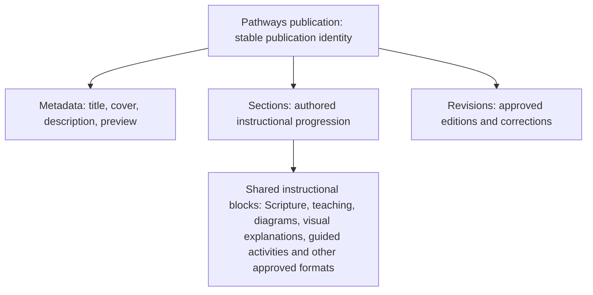
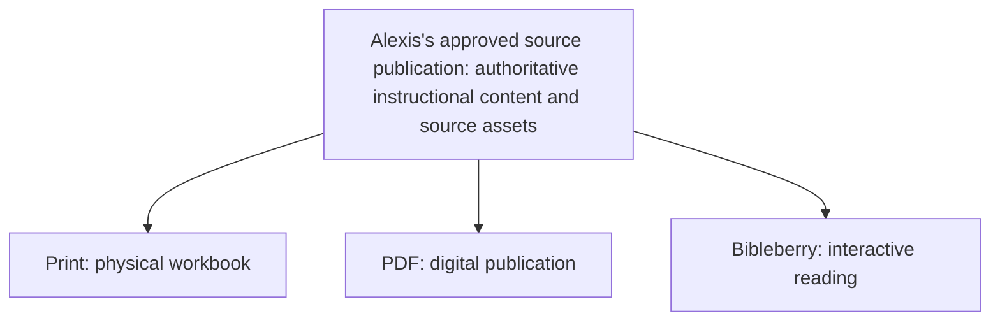
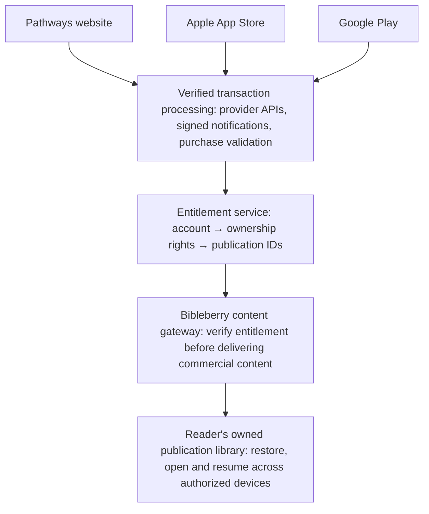
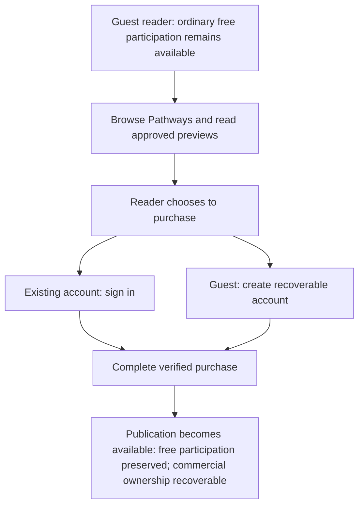

# Bibleberry | Pathways Integration
## Preliminary Product and Architectural Assessment

**Department:** Engineering Issue Planning  
**Original assessment date:** November 26, 2026 ET  
**Classification:** Exploratory architectural and product planning  
**Status:** Recommendations for investigation and owner consideration; not implementation authorization  
**Preservation assignment:** [Hollow Belfry #360](https://github.com/Bibleberry/Bibleberry/issues/360)

> Archival note: This document preserves the complete substantive 20-section assessment presented to Aaron in conversation, with interactive diagrams, navigation mockups and controls translated into portable Markdown. It is a historical research record, not an approved product specification, architecture decision, roadmap amendment, provider selection, cost forecast or implementation authorization. Repository evidence is anchored to the original checkpoints. The original response's external citation identifiers were conversation-local; their underlying URLs were not recovered for this archival transfer. Accordingly, commercial-service, pricing, platform-policy, legal and tax observations below are retained as preliminary research claims requiring current primary-source verification before reliance. No new external policy or legal verification is claimed by this preservation assignment. A subsequent owner constraint is recorded separately at the end.

---

## 1. Executive assessment

This is a significant expansion of Bibleberry's potential capabilities, but it is not necessarily a fundamental change to the application we have been building.

Having inspected the current repository, my preliminary architectural conclusion is:

**Bibleberry should become capable of delivering multiple classes of authored educational content, with Pathways constituting a separately purchasable publication class alongside its existing free ministry content.**

I would not build a conventional online course platform inside Bibleberry. Nor would I build a separate application simply to accommodate Pathways.

Our existing architecture already contains several of the most difficult foundational capabilities:

- Structured editorial content.
- Reusable instructional rendering components.
- A server-side content delivery gateway.
- Durable reader participation and resume state.
- Account authentication and synchronization foundations.
- Native application foundations.
- An established editorial approval and publication-release architecture.

However, we would be introducing two substantial new domains:

1. **Evergreen educational publications**, independent of the calendar-based Challenge model.
2. **Commercial ownership**, independent of ordinary reader participation.

These should be treated as distinct architectural additions rather than modifications that turn existing free functionality into paid functionality.

### Proposed future Bibleberry architecture

| Free ministry | Pathways publications |
| --- | --- |
| Daily Challenges | Evergreen studies |
| Monthly publications | Publication catalogue |
| Foundations | Purchased library |
| Scripture Cards | Independent study progress |
| Saved Scripture | Permanent-access entitlements |

Both domains share application foundations: navigation, instructional rendering, accessibility, reader identity and account infrastructure.

Both may share service infrastructure: Sanity, Cloudflare and Supabase.

Commercial authorization remains isolated from free ministry access. This is conceptual architecture only.

The most important immediate recommendation is **architectural accommodation without premature implementation**.

We should continue the current development roadmap while identifying decisions that might unnecessarily constrain Pathways later.

---

## 2. Verified application checkpoint

I inspected accepted Bibleberry main at:

[`a7b2c2de01e8c6abac9880d9f9895eeaa815066b`](https://github.com/Bibleberry/Bibleberry/commit/a7b2c2de01e8c6abac9880d9f9895eeaa815066b)

The investigation includes the canonical development roadmap, existing content architecture, gateway implementation, reader components, Sanity schemas, participation contracts, account foundations and current assignment inventory.

The current [roadmap](https://github.com/Bibleberry/Bibleberry/blob/a7b2c2de01e8c6abac9880d9f9895eeaa815066b/docs/product/application-development-roadmap.md) at that checkpoint remains:

| Milestone | Objective | Status in original assessment |
| --- | --- | --- |
| M1 | Connected production reader | Current development |
| M2 | Protected private web alpha | Guest-only |
| M3 | Controlled beta readiness | Owner-scoped |
| M4 | Public-launch readiness | Future |
| M5 | Controlled public launch | Future |

Pathways should not become an undeclared prerequisite for these existing milestones.

Our current M1 development and guest-only M2 alpha remain necessary and valuable independently of commercial integration.

## 3. Existing capabilities we can reuse

This is where the investigation becomes particularly encouraging. We have already invested in several architectural foundations that would support Pathways.

| Existing capability | Pathways applicability | Required work |
| --- | --- | --- |
| Structured teaching content | High | Extend publication structure |
| Instructional block rendering | High | Validate additional workbook formats |
| Sequential reading experience | High | Adapt navigation and completion |
| Editorial approval infrastructure | High | Establish cross-organization approval |
| Cloudflare content gateway | High | Add authenticated entitlement enforcement |
| Sanity CMS | High | Introduce evergreen publication models |
| Reader navigation and restoration | Moderate–high | Add publication-specific destinations |
| Durable reading progress | Moderate | Introduce independent study records |
| Supabase account infrastructure | High | Complete hosted qualification and extend account domain |
| Scripture Cards | Limited | Keep independent unless explicitly approved otherwise |
| Native iOS and Android foundations | High | Add purchasing and restoration integrations |
| Commercial transaction processing | New capability | Build or integrate |
| Publication ownership | New capability | Establish entitlement architecture |

### 3.1 Instructional rendering

The existing [CmsContentBlocks.tsx](https://github.com/Bibleberry/Bibleberry/blob/a7b2c2de01e8c6abac9880d9f9895eeaa815066b/src/components/challenge/CmsContentBlocks.tsx) already supports nine structured instructional block categories:

- Scripture.
- Teaching text.
- Statements.
- Contrasts.
- Visual cards.
- Connected sequences.
- Reflection choices.
- Optional study.
- Prayer.

This is an exceptionally useful starting point for authored educational publications.

We would need to evaluate additional requirements such as longer-form reading, guided written responses, diagrams, exercises and publication-level contents pages. But we do not need to build an instructional rendering system from nothing.

### 3.2 Reader architecture

The existing [ChallengePlayer.tsx](https://github.com/Bibleberry/Bibleberry/blob/a7b2c2de01e8c6abac9880d9f9895eeaa815066b/src/components/challenge/ChallengePlayer.tsx) is already designed as a controlled presentation component. Its host manages identity, persistence and related domain responsibilities.

That separation is valuable.

It means we can potentially reuse instructional presentation components while introducing a different host responsible for Pathways-specific navigation, progress and access.

My recommendation is to develop a sibling publication reader using shared instructional components, rather than forcing Pathways publications to pretend to be Challenges.

### 3.3 Account and security foundations

The repository already contains:

- A server-verified authentication session abstraction.
- A Supabase email OTP provider.
- Account reconciliation logic.
- PostgreSQL account tables and row-level security policies.
- Transactional guest-to-account reconciliation foundations.
- Separate mechanisms for trusted account Scripture Card verification.

These can be inspected under [src/accountAuth](https://github.com/Bibleberry/Bibleberry/tree/a7b2c2de01e8c6abac9880d9f9895eeaa815066b/src/accountAuth), [src/accountSync](https://github.com/Bibleberry/Bibleberry/tree/a7b2c2de01e8c6abac9880d9f9895eeaa815066b/src/accountSync) and [supabase/migrations](https://github.com/Bibleberry/Bibleberry/tree/a7b2c2de01e8c6abac9880d9f9895eeaa815066b/supabase/migrations).

We have not yet qualified the hosted account system for production commercial use. Nevertheless, the architectural groundwork is directly relevant.

**Pathways does not require a second application identity system.**

---

## 4. Recommended content architecture

### 4.1 Introduce a distinct evergreen publication domain

Bibleberry currently distinguishes ordinary Challenges, calendar-month publications, thematic Challenge series, News, ministry resources and associated content.

Pathways introduces something different: an authored publication that someone may purchase, retain and revisit independently of the calendar.

I would establish a separate logical publication class.

Logical structure for investigation, not an approved Sanity schema or workbook formula.

Pathways should not depend on:

- A publication month.
- Calendar slots.
- Daily Challenge scheduling.
- Monthly discovery criteria.
- A mandatory daily reading cadence.
- Existing Challenge completion rules.

A person should be able to purchase a publication in January, begin it in March and return to it in September without interacting with calendar-month logic.

### 4.2 Separate four different identities

This is an architectural decision that could prevent substantial future difficulties.

| Identity | What it represents |
| --- | --- |
| Publication ID | The enduring authored work |
| Edition or revision ID | A particular approved version of that work |
| Commercial product/SKU | A particular purchasable offering |
| Entitlement | A customer's right to access specified content |

For example, the same underlying publication might eventually be available as a printed workbook, a printable PDF and an interactive Bibleberry publication.

These could have different commercial SKUs while sharing one publication identity.

Conversely, a bundle could grant access to several publications through a single purchase.

We should not make a Sanity document ID, publication title, Stripe product ID or Apple purchase identifier serve all four purposes.

### 4.3 Sanity dataset strategy

The accepted Bibleberry [content architecture](https://github.com/Bibleberry/Bibleberry/blob/a7b2c2de01e8c6abac9880d9f9895eeaa815066b/docs/architecture/content-management-and-publishing.md) permits exactly two datasets:

- `production`
- `staging`

I see no demonstrated reason to create a third dataset merely because Pathways exists.

My preferred initial architecture is a distinct publication model within the existing dataset structure, subject to verification that editorial permissions and paid-content protection are adequate.

A separate Sanity project or dataset may become appropriate if the two organizations require stronger editorial isolation, different access-control boundaries or independent operational ownership. That would require a specific architectural and budget decision.

### 4.4 Reuse content, not necessarily layout

The format-independent publishing strategy makes architectural sense.

Each output receives appropriate presentation and approval without independently rewriting the underlying teaching.

This does not mean that Canva layouts should be automatically converted into application screens or that Alexis must author everything directly in Sanity.

The source format should be investigated jointly with Pathways.

A structured manuscript, accompanying assets and approved editorial metadata could provide a common foundation while allowing different presentations for each medium.

We should not build a complex automated publishing pipeline until representative publications establish what genuinely needs automating.

---

## 5. Reader experience and navigation

The accepted R06 navigation architecture establishes four persistent destinations:

**Today | Library | Collections | More**

I would not introduce a fifth permanent tab at this stage.

There are several credible ways to accommodate Pathways.

### Illustrative navigation approaches

The following text wireframes preserve the content and alternatives of the original interactive mockup. All labels, topics and progress values are illustrative; no visual or navigation decisions are approved.

| Library integration | More integration | Dedicated Pathways tab |
| --- | --- | --- |
| Your Shelf — Continue your monthly studies | News | Your Publications |
| Browse Months | Podcasts & Resources | Your current study — Section 3 of 8 (37.5%) |
| Foundations | Pathways Publications | Explore publications |
| Pathways: Your Publications — Return to purchased studies | Account & Progress | Family disagreement |
| Explore Pathways | Appearance | Handling anxiety |
| | App Tutorial | |
| Today / Library / Collections / More | Today / Library / Collections / More | Today / Library / Pathways / Collections / More |

- **Preferred initial investigation: Library.** Library integration provides natural access to authored publications without immediately restructuring global navigation.
- **Alternative: More.** Minimal disruption to the current Library, but purchased publications may become unnecessarily buried in secondary navigation.
- **Future possibility: Dedicated tab.** High visibility if the catalogue becomes substantial, but requires reconsideration of the approved navigation architecture and narrow-screen accessibility.

### My preferred approach

Investigate Library as the permanent home for purchased educational publications, with Pathways discovery accessible through a clearly distinguished Library section.

Today should remain principally devoted to ongoing free formation.

Occasional, appropriately approved editorial announcements about new publications could be investigated through existing News or other ministry communication surfaces. We should not turn Today into a sales dashboard.

### Interaction with existing features

| Feature | Recommended relationship |
| --- | --- |
| Today | Preserve free formation focus |
| Library | Potential home for discovery and owned publications |
| Shelf | Preserve existing month-specific membership rules |
| Collections | Preserve Scripture Cards and Saved Scripture |
| More | Account, purchase restoration and support |
| Pathways reader | Focused reading with independent progress |

The existing Shelf has specialized rules concerning calendar months, Active Focus and rollover.

I would not apply those rules to purchased publications.

A person might actively use three Pathways studies while also participating in the current Bibleberry month. That should be entirely normal.

---

## 6. Reading progress and participation

This is one area where existing infrastructure should be reused carefully rather than indiscriminately.

The current [participation/types.ts](https://github.com/Bibleberry/Bibleberry/blob/a7b2c2de01e8c6abac9880d9f9895eeaa815066b/src/participation/types.ts) explicitly models Challenge identities, screen positions, completion dates, saved Scripture and monthly earned awards.

Its domain assumptions are deliberately specific.

For Pathways, I recommend an independent progress model that shares the account and persistence infrastructure.

| Ordinary Bibleberry | Pathways |
| --- | --- |
| Challenge identity | Publication and section identity |
| Screen resume position | Publication reading position |
| Explicit Challenge Finish | Author-defined section or publication completion |
| Monthly progression | Independent evergreen progression |
| Earned Scripture Cards | No automatic award participation |
| Active Focus | Potential multiple simultaneous studies |

A Pathways completion should not accidentally count toward monthly Scripture Cards, ordinary Challenge totals or other free-ministry participation rules.

Similarly, a commercial entitlement should not depend on whether a reader has completed a study.

**Ownership and participation are independent.**

A person who has purchased a publication retains the applicable access entitlement whether they have completed none, some or all of its teaching.

---

## 7. Commercial infrastructure

The major architectural challenge is not accepting a credit card.

It is reliably establishing which account owns which publications, regardless of where the purchase took place.

### 7.1 Proposed commercial architecture

All purchase channels converge on a consistent server-authorized ownership model.

### 7.2 Build versus buy

There are at least three credible approaches.

| Approach | Engineering burden | Ongoing burden | Principal trade-off |
| --- | --- | --- | --- |
| Direct Stripe and native billing integration | High | High | Maximum control, considerable maintenance |
| Managed cross-platform commerce service | Moderate | Low–moderate | Vendor dependency and recurring fees |
| Managed web checkout/Merchant of Record with native purchase integration | Moderate–high | Moderate | Reduced tax administration, additional integration coordination |

#### Option A: Stripe Checkout and our own entitlement service

We could use hosted web checkout and establish publication ownership through verified server-side payment events.

Advantages include control over the catalogue, transaction-to-publication mapping and commercial administration.

The main disadvantage is that we would still need to manage native purchase verification, refunds, restoration and synchronization.

The original assessment noted Stripe's recommendation for event-driven fulfillment rather than granting access solely because a customer reaches a checkout success page. Verify against current Stripe documentation before implementation.

#### Option B: RevenueCat

RevenueCat is a particularly relevant candidate because the original assessment identified support for:

- Non-consumable purchases.
- Permanent-access entitlements.
- Apple and Android purchase integration.
- Purchase restoration.
- Web billing integrations.
- Capacitor integration.

These capabilities are directly relevant to our existing application technology and require current provider verification.

I would investigate RevenueCat even though we are not proposing a subscription-based business.

Its subscription-oriented branding should not obscure its support for individual permanent-access purchases.

However, we would need to investigate how efficiently it handles a growing publication catalogue, cross-channel bundles, account conflicts, restoration policies, refunds and server-side entitlement queries.

#### Option C: Merchant of Record

A Merchant of Record arrangement could reduce some of our administrative responsibilities for digital sales, including applicable indirect tax collection and remittance.

Stripe Managed Payments is one candidate identified in the original assessment as providing Merchant of Record services for eligible digital products.

This deserves investigation alongside other eligible providers, particularly if Pathways eventually sells internationally.

Eligibility for our particular publications and business structure must be confirmed. Physical workbook sales would require separate consideration.

### Preliminary provider recommendation

I would shortlist:

- Stripe or an eligible Merchant of Record for web commerce.
- RevenueCat for managed cross-platform purchase infrastructure.
- Supabase for Bibleberry account identity and appropriately separated application records.
- Cloudflare for server-authoritative content delivery.

This is not a recommendation to install or commission any provider now.

It is a realistic starting architecture that avoids rebuilding mature commercial infrastructure ourselves.

---

## 8. Apple and Google purchasing policies

**Archival qualification:** The original assessment stated that official platform guidance had been checked as of November 26, 2026. The underlying external sources and their retrieval dates are not recoverable in this transfer; the policy observations below must be independently reverified against official, current guidance before decisions or implementation.

This is a material architectural consideration because Bibleberry's approved direction is installed-mobile-first.

### Apple

Apple generally requires its in-app purchase mechanism for digital content purchased for use inside an app, subject to applicable exceptions and regional arrangements.

Two classifications are particularly relevant.

**Reader applications:** Certain apps whose primary functionality is delivering books, magazines, audio, video or similar specified content may permit access to previously purchased content.

**Multiplatform services:** Apps can recognize content purchased elsewhere, subject to requirements that generally include making the applicable items available through in-app purchase.

We must not assume that Bibleberry automatically qualifies for Apple's reader-app exception. Its interactive formation features make the classification something we should investigate explicitly.

### Google Play

Google explicitly permits consumption-only applications to provide access to digital content purchased elsewhere.

Purchasing inside a Play-distributed application generally requires Google Play Billing unless an applicable exception or regional program permits another method.

### Regional differences

| Market | Architectural implication from original assessment; verify before use |
| --- | --- |
| United States | Apple permits external purchase calls to action in its US storefront; Google offers applicable alternative billing and external-link programs |
| European Union / EEA | Both platforms have regional alternative purchasing arrangements, with program-specific obligations and fees |
| United Kingdom | Do not assume US or EU purchasing exceptions apply automatically |
| Japan | Apple provides additional purchasing options subject to specific requirements |
| Other markets | Default to applicable store requirements until regional eligibility is verified |

### Important consequence

We should separate the commercial catalogue from the purchasing mechanism presented on a particular platform.

The same publication could display different appropriate purchase actions depending on its platform, storefront, regional eligibility and existing ownership state.

A single universal checkout button that behaves identically everywhere is not a safe architectural assumption.

We should also not assume that linking to a physical workbook purchase permits automatically unlocking its digital companion inside the app without complying with the applicable digital-content rules.

This requires a specific policy assessment.

---

## 9. Guest participation and account ownership

The existing free-access requirement must remain intact.

Here is the purchasing journey I would investigate first.

### Why I favor account-linked purchasing

We should not make ownership of paid content dependent solely on the persistence of anonymous device storage.

Our existing guest-to-account architecture already contemplates preserving guest reading progress, earned Scripture Cards and Saved Scripture when a reader creates or enters an account.

That is valuable groundwork for this use case.

However, purchase ownership must not be merged using the same permissive reconciliation rules as ordinary guest participation.

An anonymous completion record and a verified commercial transaction represent very different kinds of authority.

### External purchases

Someone purchasing through Pathways independently should eventually be able to associate that purchase with their Bibleberry account.

Possible approaches include:

- Authenticating with Bibleberry before purchasing the digital edition.
- A secure, single-use post-purchase account association process.
- A commerce provider's verified redemption mechanism, where platform policies permit it.
- Support-assisted recovery for exceptional ownership conflicts.

An email address by itself should not be sufficient proof of ownership.

Account recovery, refunds, duplicate accounts and conflicting store-account associations must be explicitly designed before accepting real customer payments.

---

## 10. Security and privacy

### 10.1 Commercial content delivery

The existing [gateway/handler.ts](https://github.com/Bibleberry/Bibleberry/blob/a7b2c2de01e8c6abac9880d9f9895eeaa815066b/src/gateway/handler.ts) already retrieves content through a private Sanity credential and applies server-side release controls.

That is exactly the sort of foundation we want.

But existing editorial release authorization is not equivalent to customer ownership authorization.

The current Challenge catalogue and detail queries are specifically concerned with approved, released Challenges. Commercial publication requests would require a new authorization contract.

For every protected request, the server must establish:

**Access = Approved release AND Valid account AND Valid entitlement.**

Free content must retain its independent release policy without requiring a commercial account.

### Critical security safeguards

| Risk | Required approach |
| --- | --- |
| Guessing publication URLs | Server-side entitlement verification |
| Forged client ownership | Never trust a local purchase flag |
| Duplicate payment notifications | Idempotent transaction processing |
| Forged webhooks | Provider signature and transaction verification |
| Cross-account access | Account isolation and restrictive database policies |
| Refunds | Reconcile and revoke applicable entitlement |
| Paid content leaking through search | Separate public metadata and protected content |
| Content cached on shared infrastructure | Prevent unauthorized cross-user cache reuse |
| Direct asset URLs | Verify actual media protection; use controlled delivery where needed |
| Provider outage | Preserve entitlement records and reconcile safely |

The existing private Sanity architecture is helpful, but we must independently investigate whether commercially sensitive images, PDFs or other publication assets could remain accessible through direct CDN URLs.

Protecting the manuscript endpoint alone is insufficient if valuable commercial assets are delivered publicly.

### 10.2 Offline access

Paid publications are particularly well suited to offline reading.

However, offline access introduces a trade-off between reliable reader access and refund or revocation enforcement.

A possible eventual model uses locally cached publications associated with previously verified account ownership, with periodic entitlement revalidation.

The permitted offline period, device-storage protections and behavior after account sign-out or revocation remain product and security decisions.

I would not introduce elaborate digital rights management for the first release. Reasonable commercial access controls are achievable; guaranteeing that downloaded educational content can never be copied is not.

### 10.3 Private reflections

This deserves a separate architectural boundary.

A Pathways publication concerning anxiety, rejection, family conflict or other personal circumstances may invite deeply personal written responses.

**Private reflections should not automatically become application telemetry or administrator-accessible records.**

I recommend the following as the initial investigation baseline:

| Data | Proposed handling |
| --- | --- |
| Purchased publication IDs | Account-bound ownership records |
| Reading position | Minimal progress state |
| Completed sections | Optional durable progress |
| Written personal reflections | Local-first, or not collected at all |
| Sensitive personal circumstances | Not used for advertising or profiling |
| Payment card details | Handled by the payment provider |
| Aggregate usage metrics | Collected only under an approved privacy model |

Under UK GDPR, information revealing religious beliefs or health conditions can constitute special-category personal data, subject to additional processing requirements. This preliminary legal observation requires independent verification and appropriate specialist advice.

Consequently, even publication choices and associated behavioral data warrant thoughtful privacy treatment.

We should never develop a system that effectively tells administrators which individual Christians are struggling with particular personal circumstances unless a distinct, justified and lawful feature has been deliberately approved.

---

## 11. Publishing revisions and permanent access

Purchased publications require a different revision policy from ordinary ongoing free content.

Consider a reader who purchases a publication, completes four sections and returns six months later after Alexis has substantially revised it.

What should happen?

| Revision type | Potential treatment |
| --- | --- |
| Typographical correction | Automatically deliver corrected content |
| Updated visual presentation | Preserve existing progress |
| Additional instructional section | Make available without losing completed sections |
| Substantial restructuring | Map stable section identities or retain prior edition |
| Entirely new edition | Apply an explicit commercial access policy |
| Legal or editorial withdrawal | Preserve transaction history and apply approved customer remedy |

These are recommendations for investigation, not approved policies.

The fundamental requirement is that stable publication and section identities survive appropriate revisions.

We should avoid storing progress only as "page 17" or "section 4."

Those are presentation positions, not necessarily enduring content identities.

Pathways has already established revision-specific approval requirements for external manuscripts and other publication artifacts. Bibleberry's ingestion architecture should preserve the identity of the exact approved source revision received from Pathways.

---

## 12. Commercial analytics

Your proposed metric of annual commercial contribution per 1,000 active readers is technically measurable.

What matters is defining both the numerator and denominator.

### Illustrative commercial contribution model

Exploratory assumptions from the original assignment, not an approved forecast.

**Annual contribution before fixed operating expenses = active readers / 1,000 × annual contribution per 1,000 active readers.**

At the original interactive model's default values, 100,000 active readers and $2,500 per 1,000 readers correspond to $250,000 annually before fixed operating expenses.

The original controls allowed 10,000–500,000 active readers (in increments of 10,000) and $500–$10,000 contribution per 1,000 readers (in increments of $500). The formula preserves the calculation without a chat-specific interactive widget.

The technical analytics model should distinguish:

| Measurement | Proposed evidence |
| --- | --- |
| Active readers | Approved meaningful activity within a defined period |
| Guest participation | Privacy-conscious installation or browser-level measurement |
| Registered readers | Account records |
| Publication discovery | Minimal catalogue or preview events |
| Conversion | Verified purchases associated with appropriate discovery evidence |
| Repeat purchases | Transaction records |
| Commercial contribution | Reconciled transaction values, refunds and variable costs |
| Voluntary support | Independently classified support transactions |
| Assisted external sales | Approved attribution mechanisms |

There are several important limitations.

Guest installation counts are not automatically unique people. Cross-device activity introduces duplication. Attribution does not establish that Bibleberry caused an external purchase. Incremental commercial value requires a more deliberate measurement methodology than simply counting sales following an application visit.

I would avoid introducing a comprehensive behavioral surveillance system merely to calculate commercial performance.

The existing participation model explicitly excludes unnecessary behavioral event logs and reading timers. That is a meaningful design principle worth preserving.

---

## 13. Technical complexity and operating costs

My assessment is that Pathways integration is a **substantial additional workstream**, but not the equivalent of building another application.

### Relative implementation complexity

Qualitative Planning assessment, not measured implementation estimates.

| Work | Relative complexity (1–5) | Description |
| --- | --- | --- |
| Reuse instructional rendering | 2 | Low–moderate |
| Evergreen publication reader | 3 | Moderate |
| Catalogue and owned library | 3 | Moderate |
| Editorial ingestion and revisions | 3 | Moderate |
| Web purchase integration | 3 | Moderate |
| Entitlements and secure delivery | 4 | High |
| Native purchases and restoration | 5 | High |
| Account recovery and reconciliation | 4 | High |
| Commercial operations and support | 4 | High |

### Principal cost categories

| Cost | Expected characteristic |
| --- | --- |
| Existing Sanity infrastructure | Potentially reusable without additional dataset expense |
| Cloudflare delivery | Usage-dependent |
| Supabase accounts and database | Usage-dependent |
| Payment processing | Transaction-dependent |
| Native store charges | Storefront and program-dependent |
| Managed commerce provider | Potentially revenue-dependent |
| Tax administration | Dependent on provider and business obligations |
| Engineering implementation | Significant initial investment |
| Commercial customer support | Recurring operational responsibility |

The use of managed services could substantially reduce engineering and maintenance effort.

For example, the original assessment identified a RevenueCat free tracked-revenue allowance up to $2,500 per month and an Apple 15% commission rate for qualifying participants in its Small Business Program. Neither should be assumed to apply universally to our future transactions; current pricing, eligibility and terms require verification.

### Jurisdictional operating costs

We should separately establish responsibility for US sales tax, UK VAT, EU VAT and applicable consumer refund and digital-content withdrawal obligations.

One particularly relevant detail is that UK VAT treatment can differ between qualifying electronic books and interactive publications predominantly intended for completion. The precise classification of a Pathways workbook could therefore matter.

The EU's One Stop Shop system may simplify applicable cross-border VAT obligations, including for qualifying non-EU suppliers.

These are specialist commercial and compliance questions to route to Pathways and the owners. Bibleberry should ensure that the technical architecture can accommodate the resulting requirements. These historical research observations are not tax or legal advice.

I would not project a large fixed monthly infrastructure expense simply because the application gains commercial capabilities. Actual cost modeling requires provider selection, traffic assumptions, storage requirements and purchase volumes.

---

## 14. Implications for current Bibleberry development

This is the most consequential part of my assessment for our existing engineering program.

**I do not recommend interrupting the current M1 or M2 work.**

I do recommend a bounded architectural accommodation investigation before we finalize certain later account, content and navigation contracts.

### Decisions worth examining now

| Architectural area | Recommendation | Urgency |
| --- | --- | --- |
| Content identities | Avoid making every authored work a Challenge | High |
| Account identity | Keep a stable, provider-independent application account ID | High |
| Authorization | Preserve separation between free release and commercial access | High |
| Participation | Keep Challenge progress and awards independently scoped | High |
| Reader rendering | Avoid coupling reusable instructional blocks to Challenge-only behavior | Moderate–high |
| Deep links | Leave room for additional content destinations | Moderate |
| Library | Avoid permanently assuming every educational item is a calendar month | Moderate |
| Native app identifiers | Resolve before commercial store configuration | Before native commerce |
| Privacy | Avoid unnecessary collection of personal responses | Standing |
| Payment infrastructure | Defer actual implementation | Low immediate urgency |

### Current assignments at original checkpoint

I verified that the following relevant assignments remain in our active or forthcoming backlog.

| Existing assignment | Pathways consideration |
| --- | --- |
| [#319 Bronze Galleon](https://github.com/Bibleberry/Bibleberry/issues/319) | Foundations may reveal useful evergreen reading patterns |
| [#327 Arctic Sextant](https://github.com/Bibleberry/Bibleberry/issues/327) | Preserve optional free registration and truthful account capabilities |
| [#251 Sable Harbor](https://github.com/Bibleberry/Bibleberry/issues/251) | Hosted account qualification remains important |
| [#355 Silent Observatory](https://github.com/Bibleberry/Bibleberry/issues/355) | Shared reader accessibility benefits future publications |
| [#328 Saffron Pavilion](https://github.com/Bibleberry/Bibleberry/issues/328) | Complete existing connected-reader qualification independently |

The existing Foundations concept is particularly interesting. It is an opportunity to learn how non-calendar educational experiences fit naturally within Bibleberry.

That does not justify expanding its current assignment to include Pathways.

### Potentially expensive architectural mistakes

The following decisions would be costly to reverse if we allowed them to become deeply embedded:

1. Treating every educational publication as a calendar-based Challenge.
2. Treating every purchased item as equivalent to one publication.
3. Making the payment provider's customer ID the canonical Bibleberry user identity.
4. Combining paid entitlements with ordinary client-reconciled progress records.
5. Delivering commercial assets through uncontrolled public URLs.
6. Designing the free Library as incapable of supporting additional publication categories.
7. Collecting sensitive written reflections without deliberate privacy architecture.

I did not identify evidence requiring an immediate wholesale architectural redesign.

The appropriate response is to preserve clean extension boundaries, not to generalize the entire application prematurely.

---

## 15. Proposed incremental implementation strategy

I would refine the stages supplied in your assignment into the following progression.

| Stage | Approach | Scope and conditions |
| --- | --- | --- |
| A | Architectural accommodation | Read-only investigation initially. Identify relevant extension boundaries, account assumptions, content identities and potential conflicts with current development. No payment implementation. |
| B | Representative publication prototype | Independent of commercial transactions. Render an approved sample through a proposed publication structure. Evaluate reader experience, content fidelity, section navigation and progress. |
| C | Commercial access foundation | Private test environment. Establish stable catalogue identities, server-authoritative entitlement records, access-controlled delivery and negative-path security testing. |
| D | Web purchasing and restoration | Hosted account dependency. Integrate one authorized purchasing channel and prove payment, ownership, recovery, refund and cross-device access. |
| E | Native commercial integration | Store policy and physical-device qualification. Add approved iOS and Android purchasing mechanisms, restoration, storefront-specific behavior and consistent ownership recognition. |
| F | Expanded publishing capabilities | Demand and requirements driven. Investigate bundles, church licensing, additional formats, production automation and more sophisticated commercial operations. |

These are proposed investigative and delivery stages, not additions to the approved development roadmap.

### Important sequencing distinction

We could prototype the publication-reading experience before the hosted account system is production-ready.

We should not launch paid ownership before recoverable customer identity, entitlement verification and the relevant commercial operating procedures are qualified.

That permits meaningful architectural progress without making the entire Pathways initiative wait for every commercial dependency.

---

## 16. Recommended exploratory work packages

I would initially prepare the following candidate investigations for owner consideration.

No implementation Issues have been created or codenames allocated by the original assessment. Hollow Belfry #360 is solely the later documentation-preservation assignment.

| Candidate investigation | Principal output | Dependency |
| --- | --- | --- |
| Pathways architectural accommodation audit | Verified current constraints and narrowly bounded recommendations | Current accepted main |
| Evergreen publication content contract | Logical publication, section, edition and instructional-block model | Pathways representative requirements |
| Publication reader prototype | Interactive sample reader and progress experience | Approved sample content |
| Cross-organization publication delivery contract | Source revision, metadata, rights and approval interface | Pathways coordination |
| Commercial architecture comparison | Provider fit, costs, policy compatibility and maintenance analysis | Intended sales channels |
| Account and entitlement threat model | Ownership, restoration, authorization and security contract | Account foundations |
| Commercial privacy and analytics specification | Approved minimal data and measurement requirements | Owner privacy decisions |
| Protected publication delivery prototype | Verified entitlement-controlled content and asset access | Content and entitlement contracts |
| Web purchase vertical slice | Verified checkout through recoverable publication access | Hosted account qualification |
| Native purchase vertical slice | Store-compliant purchasing and restoration | Commercial and native prerequisites |

I would **not** create all ten Issues immediately.

The first investigation may establish that some candidates should be combined, deferred or absorbed into existing assignments.

Planning should prepare the next meaningful dependencies rather than prematurely establish an entire commercial engineering backlog.

---

## 17. Questions requiring answers from Pathways

I independently checked the Pathways repository at accepted main [5ba067f2e0f9a4f95bfb65e2d611e624100c29d8](https://github.com/Bibleberry/Pathways/commit/5ba067f2e0f9a4f95bfb65e2d611e624100c29d8).

Its [publication register](https://github.com/Bibleberry/Pathways/blob/5ba067f2e0f9a4f95bfb65e2d611e624100c29d8/catalogue/publication-register.md) still contains no authorized publications, and its [foundation](https://github.com/Bibleberry/Pathways/blob/5ba067f2e0f9a4f95bfb65e2d611e624100c29d8/foundations/vision-and-purpose.md) identifies several unresolved product decisions.

That means the Bibleberry organization needs representative requirements from Pathways before committing to a publication schema.

| Question | Why Bibleberry needs the answer |
| --- | --- |
| What constitutes a complete representative publication? | Determine content and reader structure |
| What kinds of instructional blocks are necessary? | Assess rendering reuse |
| How will source manuscripts and visual assets be maintained? | Design ingestion and revision handling |
| How flexible is publication progression? | Determine navigation and progress contracts |
| Are written responses part of the experience? | Establish privacy and storage requirements |
| What does a purchase grant? | Define commercial entitlements |
| How do physical and digital editions relate commercially? | Establish products and SKU mappings |
| What constitutes a revised versus new edition? | Preserve ownership and progress |
| What group or church arrangements are contemplated? | Identify future licensing requirements |
| Which sales channels are intended? | Select appropriate payment infrastructure |

Pathways does not need to resolve every commercial question before Bibleberry can undertake architectural investigation.

But we should avoid committing to detailed implementation requirements on Pathways' behalf.

---

## 18. Decisions reserved to Aaron and Alexis

### Aaron

The principal technical and organizational questions include:

- Whether the future commercial capability should influence any currently unresolved architectural contract.
- Which development milestone should accommodate the representative publication prototype.
- Whether hosted account qualification should eventually be prioritized to support commercial readiness.
- What level of commercial infrastructure should be managed rather than custom-built.
- Whether the existing service architecture remains appropriate after the investigation.

### Alexis

The principal authorial questions include:

- What the digital formative experience should actually accomplish.
- How authored material should be adapted between print and application presentation.
- Which instructional components and interactions are pedagogically appropriate.
- Whether readers should be able to record personal responses.
- What constitutes acceptable presentation fidelity and creative quality.

### Joint or applicable owner decisions

Pricing, commercial access rights, refund policy, supported markets, publication release, church licensing and related business commitments require the applicable owner decisions.

Neither development organization should independently settle these matters.

---

## 19. Cross-organizational coordination

We now have an unusual but potentially very effective organizational arrangement.

| Pathways — publishing organization | Bibleberry — application organization |
| --- | --- |
| Authorial content | Reader architecture |
| Publication definitions | Content delivery |
| Commercial research | Account integration |
| Production and pricing | Commerce technology |
| Editorial approval | Security and verification |

**Shared interface:** Publication identities, approved revisions, structured source content, delivery requirements, access rights and acceptance evidence.

**Aaron and Alexis:** Applicable product, authorial, technical and commercial authority.

The objective is not to merge the two organizations' operational responsibilities.

It is to establish a reliable interface between them.

Within AppDev, I recommend Planning investigate and prepare the candidate work packages, Dev assess implementation implications and dependencies, Review independently challenge the proposed security and architectural contracts, and Admin coordinate any necessary accepted governance or cross-organizational changes.

No new organizational structure is required for this investigation.

---

## 20. Final Planning recommendation

There is an important distinction between what we have been developing and what this opportunity would make possible.

Bibleberry was originally designed around ongoing free biblical formation, supported by a substantial publishing and instructional rendering system.

Pathways could allow us to use that same infrastructure to deliver permanent, authored educational publications.

The existing separation of editorial content, presentation, reader participation, account identity and gateway authorization makes this a credible architectural extension.

My recommended immediate posture is:

| Action | Disposition |
| --- | --- |
| Continue current M1 development | Proceed unchanged |
| Continue guest-only M2 alpha preparation | Proceed unchanged |
| Investigate architecture accommodation | Recommended |
| Obtain representative Pathways requirements | Coordinate |
| Prototype evergreen publication reading | Consider after authorization |
| Complete hosted account foundations | Preserve existing obligations |
| Establish real payment infrastructure | Defer |
| Change global navigation | Defer pending investigation |
| Introduce commercial release requirements | Defer |
| Introduce mandatory free-reader accounts | Do not pursue |

### Verification limitations

This is a source-grounded architectural assessment, not a completed proof of technical or commercial feasibility.

I inspected accepted repository records and relevant source implementations, but did not execute application tests, inspect live service configuration, validate provider account eligibility, obtain legal or tax advice, or test a representative Pathways publication.

The exact implementation effort remains dependent on requirements and prototype evidence.

No repository files, Issues, PRs, roadmaps, services or active assignments were modified during the original read-only investigation.

---

## Departmental conclusion

I would characterize this initiative as **architecturally compatible, materially significant, and suitable for incremental integration**.

And there is a broader observation worth making.

The infrastructure we have been building for Bibleberry is not merely infrastructure for delivering daily devotionals. The structured instructional components, controlled publication architecture, durable participation and recoverable accounts are foundational capabilities for delivering authored biblical education.

Pathways gives those existing capabilities another substantial potential application.

We should preserve everything that makes Bibleberry a free ministry, while deliberately leaving room for it to become a distribution environment for an expanding publishing catalogue.

**We do not need to build Pathways into Bibleberry today. We do need to understand Pathways well enough that the Bibleberry we build today can accommodate it tomorrow.**

---

## Subsequent owner direction — commercial tax administration

Following the original assessment, Aaron stated that substantial manual tax administration is a deal breaker and that he wants to automate tax work as much as possible. This is subsequent owner direction, not part of the original 20-section assessment, a selection of any provider, or authorization to implement commerce.

For future provider evaluation, prioritize eligible Merchant of Record services or other appropriate managed/outsourced arrangements for applicable tax calculation, collection, filing and remittance; investigate actual coverage for native transactions, web digital sales and physical sales separately. Automate bookkeeping and transaction reconciliation where practical; assign uncovered obligations to qualified professionals rather than assuming that every tax obligation can be eliminated. Provider coverage, eligibility, fees and remaining business obligations must be verified. Pathways and the owners retain applicable commercial decision authority.

The owner also identified cognitive load and decision fatigue as important constraints on human supervision of AI-enabled organizations. Consider financial cost, recurring operational work and cognitive burden when evaluating commercial architecture. This observation does not independently amend either organization's governance.
