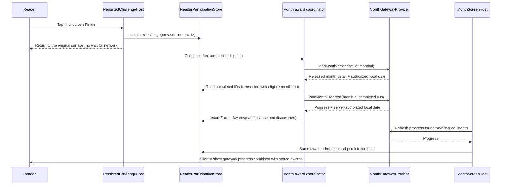

# R14-4: Finish-to-Award Integration

## Flow and triggers

Only the existing final-screen **Finish** action starts the finish reconciliation. Reaching the final screen, opening, saving, or abandoning a Challenge does not. The existing finish controller still enforces one completion dispatch per mounted Challenge and preserves origin-aware navigation. The coordinator is initiated before return navigation and does not await network work in the reader interaction.

## Trust and month-binding checks

- The candidate month comes from the admitted released Challenge's validated `calendarSlot.monthId`; caller origin, hash, device date, and slug are not used as award authority.
- The candidate is accepted only when its `YYYY-MM` and publication date/day are consistent, its document ID (when present) is `month-YYYY-MM`, and gateway month detail for that ID has the expected `month-YYYY-MM` document ID.
- The canonical `cms:<documentId>` derived from the Challenge must match the admitted participation ID and exactly one `available` slot in the returned month. Its slot date must match the Challenge calendar slot and be no later than the gateway's authorized local date. An unavailable, future, withdrawn, mismatched, or duplicate binding fails closed.
- The completed IDs sent to progress are read after the completion dispatch and intersected with only released, available month slots. The existing canonical-ID filter and 500-ID limit are retained; no completion is inferred or appended. The gateway independently intersects the submitted IDs with its released slots and authorized date.
- Awards are admitted only from a successful gateway progress result with matching month identity, canonical discovery/award IDs and the gateway's `serverContext.authorizedLocalDate`. The client does not infer a date from Finish or the browser clock.
- The reader month parser retains only R14-3-validated earned-card snapshots. Invalid optional artwork yields an earned record without card display metadata; it cannot fabricate a thumbnail. Earned-ID mismatches and any card metadata on unearned progress are rejected. Month detail and advance preview remain card-free.

The released Challenge contract already supplies `documentId` and optional validated `calendarSlot` (`monthId`, `publicationDate`, `dayOfMonth`, and optional deterministic month document ID). Gateway month detail supplies the released slot's canonical Challenge ID. This is sufficient for the client-side binding; no gateway contract change was required.

## Persistence, retries, and timing

- Finish calls the existing `completeChallenge` store command first. The reconciliation waits for its async dispatch and store hydration, so native Preferences writes and reader unmount do not cancel the in-flight work.
- Each finish reconciliation performs at most one month-detail request and one progress request, each with an 8-second abort signal. It is intentionally fire-and-forget with respect to navigation; it does not block Finish or show a toast.
- A failed or invalid network result never records an award. The Challenge completion remains in local participation state. The next active or historical Month Screen progress refresh reuses durable completion facts and invokes the same admission/persistence function.
- An award first recovered by a later refresh gets the server-authorized date from that successful response. The Finish date is never backdated. Existing store reducers keep `earnedOn`, viewed/announcement flags, and valid snapshots monotonic across duplicate responses and roster/art changes.
- On the Month Screen, gateway progress counts remain visible; stored awards make the earned status durable even if a later recomputation is false or artwork is absent. Missing art is described as unavailable; no placeholder or thumbnail is fabricated. Progress and award status remain silent: there is no announcement, `cardViewed` mutation, or Card viewer here.
- If the app process is terminated before the fire-and-forget request completes, a later visit to that active/historical month is the recovery trigger. This remains guest-local persistence; account sync, Field Notebook, Hub announcements, and Card viewing are separate work.

## Verification evidence

The synthetic feature-gated smoke uses mocked gateway responses and local browser storage; it performs no live Sanity write. It exercises final-screen Finish, progress reconciliation, V2 award persistence with the gateway date and card snapshot, reload, and silent Month Screen restoration. Abandon-without-Finish remains covered by the same Month Screen smoke flow.

Validation evidence:

- `npm run lint` — passed.
- `npm run build` — passed; also exercised by the feature-gated smoke build passes.
- `npm run test:adapter` — passed, 101 tests.
- `npm run test:native-participation` — passed, 10 tests.
- `npm run test:gateway` — passed, 221 tests.
- `npm run test:smoke` — the first attempt could not start because Playwright Chromium was not installed in the runner. After installing the existing Playwright Chromium runtime, the complete smoke passed: 47 tests across seven build passes, including all six Month Screen cases.
- `npm run check:staging` — passed; Wrangler dry-run completed.
- Focused parser, reconciliation, and Month Screen tests — passed, 19 tests.
- `git diff --check` — passed.

The smoke test ran before the final test-only assertions for malformed rights metadata and a stale expected-month response; those new assertions are covered by the final focused suite. No live Sanity write or production deployment was performed.

Focused coordinator tests cover verified/historical binding, canonical completed-ID intersection, multiple thematic/full-month awards, delayed async completion write, network failure without award, later successful admission, and invalid artwork. Month model tests cover false gateway recomputation with a stored award and explicit no-art state. Existing participation tests cover native Preferences/web storage, V1→V2 migration, duplicate records, and preservation of earned dates/flags.
